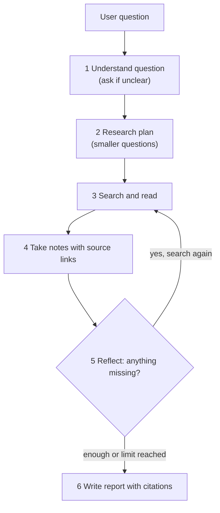
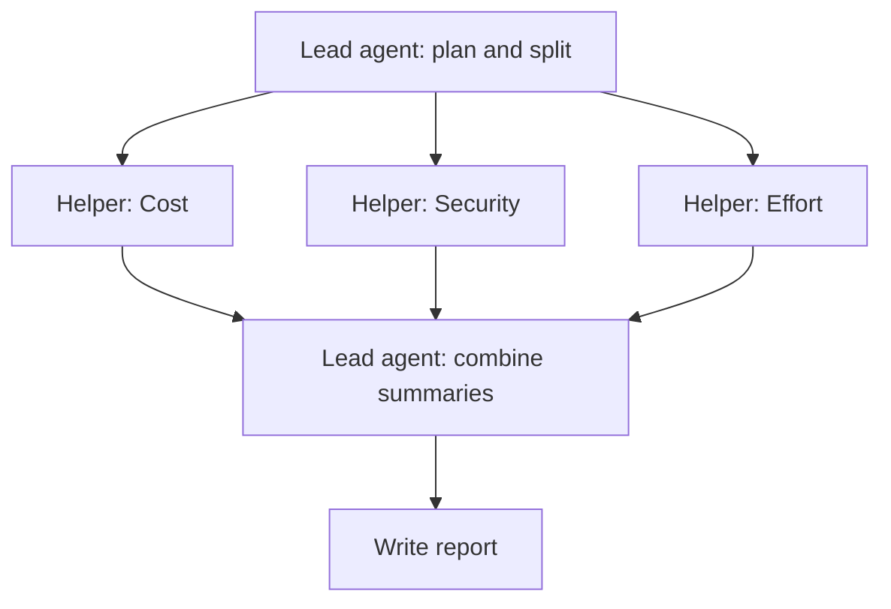

# How does a deep research agent work?

> **Step 10: AI Agents and Agentic Systems** · ⏱️ 14 min read · [Read original](https://outcomeschool.com/blog/deep-research-agent)

## TL;DR
A deep research agent is an AI agent that takes a big question, plans smaller questions, searches and reads many sources in a loop, keeps notes with source links, reflects on gaps, and finally writes a long report with citations. It does in minutes what a human researcher does in hours. It is costlier and slower than normal chat, and citations still need checking.

## Key Concepts
- **Deep research agent** — AI agent that researches in many rounds of searching and reading, then writes an organized report with links to sources.
- **AI agent** — LLM in a loop: think, use a tool, look at result, repeat until done. A tool is a function the LLM asks our code to run.
- **web_search** — returns a list of results (links plus snippets).
- **read_page** — opens a page and returns its text.
- **Planning** — breaking a big question into smaller searchable ones (see Plan-and-Execute Agent).
- **Context window** — limited text the LLM can hold at once; the "desk" with limited space.
- **Reflection** — the agent reviewing its own notes and progress to find gaps.
- **Citation** — link showing the source of an important claim.
- **Sub-agents / helper agents** — agents that each research one part in parallel under a lead agent.
- Analogy: a good student making sub-topics, reading many books, writing note cards with book names, spotting gaps, then listing books used.

## How It Works
### Problem with a normal LLM answer
Example: "Should our 20-person company move from own servers to the cloud? Compare cost, security, effort." Needs prices, security reports, company stories, expert opinions. Normal chat either answers from memory (old or wrong) or does one quick search and reads 2-3 pages. A human would plan, search repeatedly, read 30-50 pages, note each source, spot gaps, write a report.

### The six steps
1. **Understand the question** — may ask clarifying questions (country, budget limit, data rules). Matters because research costs time and money; a misunderstanding wastes it all.
2. **Make a research plan** — split into Q1 own-server cost, Q2 cloud cost, Q3 security risks, Q4 migration time, Q5 problems similar companies faced. Clear small questions are easy to search; a vague big one is not.
3. **Search and read** — per sub-question write queries, call `web_search`, pick the best links, `read_page` them. Does not trust only the first result, varies wording, opens many pages, prefers official pricing pages, research papers, trusted news.
4. **Take notes** — pages are long and the context window is limited, so keep only useful facts, each with its source link (`Note: ...` + `Source: url`). Link is later used to show where claims came from.
5. **Reflect and find gaps** — ask: is every plan question answered? Do sources disagree, which is more trustworthy? Anything new needing search? Example: strong cost info, little on migration time, so go back to Step 3 only for that gap. It also adds new questions found while reading (e.g. surprise data-egress bills). Loop stops when the agent has enough or hits a limit (max searches, time limit).
6. **Write the report with sources** — short summary on top, sections per part, comparison table where useful, clear recommendation, citations for important claims (so we can click and catch mistakes).

Steps 3-4-5 form a loop; this loop makes the research "deep".

### Many agents working together
Like an editor splitting a story among reporters.
- Lead agent plans and splits work.
- Helper sub-agents research parts in parallel (e.g. Cost, Security, Effort).
- Each returns a short summary; lead combines and writes the report.
- Pros: faster (parallel); each helper has its own fresh context window, so lead's stays clean.
- Con: many more tokens, so more money than a single agent.

### Code example (core loop)
```python
def deep_research(question, max_rounds=5):
    plan = llm(f"Break this into smaller search questions: {question}")
    notes = []
    for _ in range(max_rounds):
        for sub_question in plan:
            for link in web_search(sub_question)[:3]:
                page = read_page(link)
                facts = llm(f"Extract facts for '{sub_question}': {page}")
                notes.append({"facts": facts, "source": link})
        plan = llm("What is still missing? New questions, or empty list if done.")
        if not plan:
            break
    return llm("Write a report using notes. Cite the source for every claim.")
```
Plan, top 3 links per question, keep facts with link, reflect to make new plan, stop if empty or at `max_rounds` (so it never runs forever), then write report with citations. Real systems are bigger but follow plan, search, read, note, reflect, repeat.

### Normal chat vs deep research
| Point | Normal chat | Deep research |
|---|---|---|
| Time | Few seconds | Several minutes or more |
| Searches | None or one | Many, in rounds |
| Sources read | A few | Dozens |
| Planning | No | Yes |
| Gap checks | No | Yes, reflects and searches again |
| Output | Short answer | Long report with citations |
| Cost | Low | Much higher |
| Best for | Quick facts, simple questions | Big questions, comparisons, market/topic research |

## Diagram(s)
### Deep research loop


### Lead agent with helpers


## Trade-offs & Pitfalls
Works well for: comparing products/tools/options, quickly learning current state of a topic, market research, collecting info spread over many sites.

Fails or struggles when:
- Info is behind a login or paywall.
- Web has many low-quality or wrong pages and the agent trusts the wrong ones.
- A citation does not actually support the claim (happens; click and check key ones).
- Question needs private data (internal company numbers) unless access is given.
- Answer needed in seconds.

Report saves hours, but important decisions still need key facts verified. Multi-agent systems cost more tokens.

FAQ:
- How long does it take? Several minutes or more, versus seconds for chat; wrong choice when a fast answer is needed.
- Trust citations? Not blindly; they enable checking, but may not support the claim.
- When does it stop? When it decides it has enough, or at a set limit (max searches, time); if nothing is missing the loop ends.
- Does multi-agent cost more? Yes (more tokens), in return for speed from parallelism and a clean lead context.

## Key Takeaways
- A deep research agent = plan + loop of search, read, note, reflect + cited report.
- The search-note-reflect loop is what makes it "deep".
- Its two core tools are `web_search` and `read_page`.
- Notes keep only useful facts with source links, because the context window is limited.
- Reflection finds gaps and can add new questions not in the original plan.
- Stop conditions (enough info or a search/time limit) prevent endless loops.
- Multi-agent setups run helpers in parallel with fresh context windows, but cost more tokens.
- Always verify key citations; the agent can cite sources that do not support a claim.
