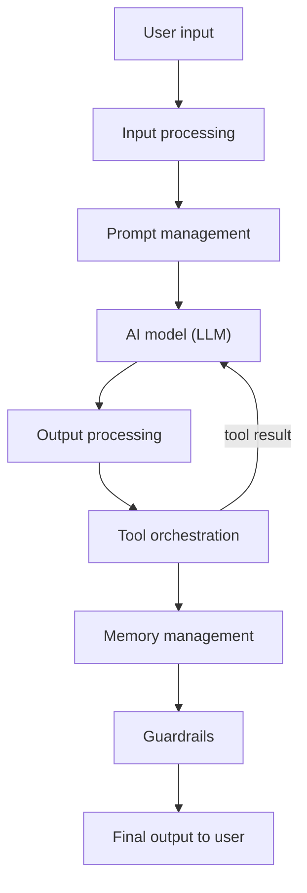

# What is Harness Engineering?

> **Step 11: Agentic Engineering and Agent Frameworks** · ⏱️ 12 min read · [Read original](https://outcomeschool.com/blog/harness-engineering-in-ai)

## TL;DR
Harness Engineering is building the control layer of code around an AI model (inputs, outputs, tools, memory, errors, evaluation) so it is usable in production. The model is the engine; the harness is the car around it. Product quality depends heavily on harness quality.

## Key Concepts
- **Harness** — Code layer that manages everything around the model.
- **Prompt management** — System prompts, templates, context (this is Context Engineering).
- **Tool orchestration** — Which tools exist, how they run, how results return.
- **Memory management** — What to keep, drop or compress.
- **Error handling** — Invalid outputs, failed tools, API errors.
- **Input/output processing** — Parsing, formatting, validation, filtering.
- **Guardrails** — Safety checks (harmful content, data leaks, scope).
- **Evaluation harness** — Framework that runs tests on a model and scores it.

## How It Works
**Why needed:** a model alone only maps input to output. Real apps need tools, memory, graceful errors, format control, evaluation, deployment and monitoring. A great model with a poor harness gives a poor experience.

**Agent harness loop**
1. Build initial prompt (instructions, tools, context) from the user task.
2. Send to model and get a response.
3. If the model asks for a tool, the harness executes it and feeds the result back.
4. Repeat until the model says done.
5. Present the final result.

The model only decides which tool to call; the harness executes. Example: "Find weather in Delhi and email it" runs weather_api then email_api, each result fed back, ending in a final reply. Claude Code is a real example.

**Evaluation harness:** load a dataset with known answers, send each to the model, compare, compute a score. Answers: how accurate, better or worse after changes, model vs model, where it fails. For open-ended outputs it uses LLM as a Judge; for agents it also scores trajectory, tool calls and plan.

**Best practices:** modular components, log everything, guardrails from day one, reliable tools (retry, fallback, inform model), test the harness itself, monitor latency, errors, cost and quality in production.

## Diagram

## Key Takeaways
- Model = brain/engine; harness = everything that makes it useful.
- The model never executes tools; the harness does and manages the loop.
- Context Engineering is one component of the harness.
- Test, log and monitor the harness like any software.
- Evaluation harnesses make model quality measurable and repeatable.
