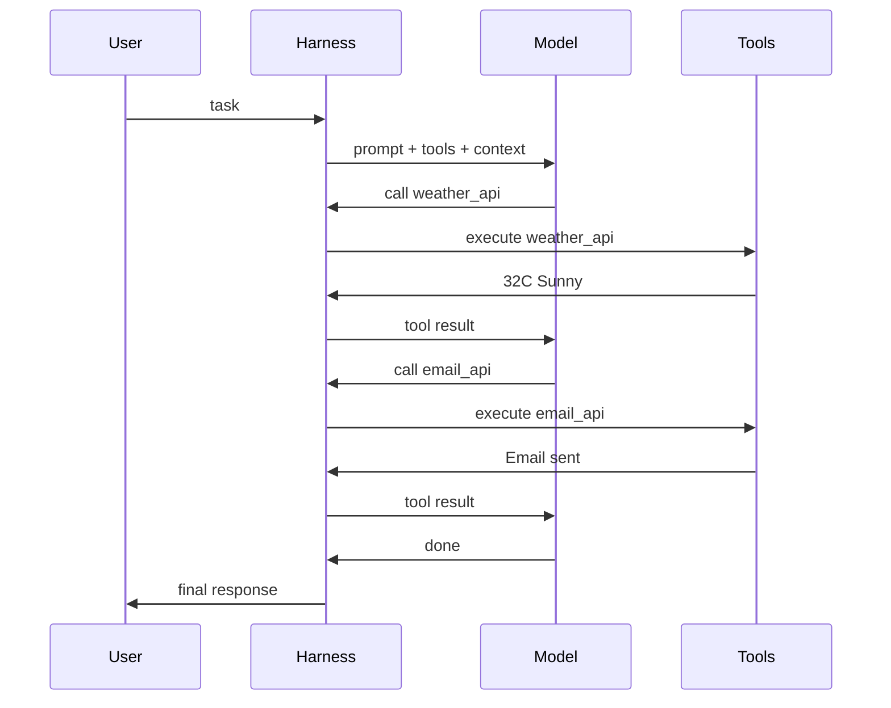
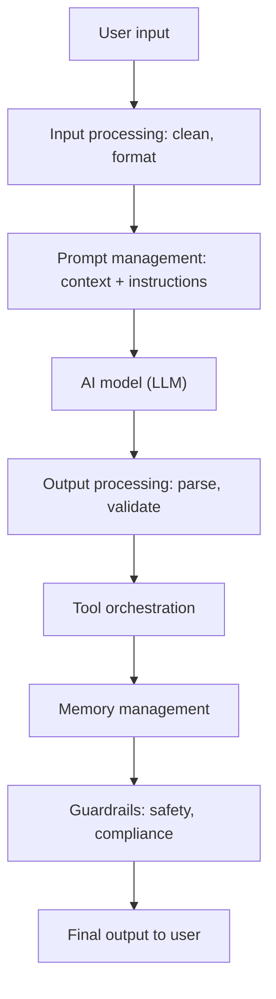

# What is Harness Engineering?

> **Step 11: Agentic Engineering and Agent Frameworks** · ⏱️ 12 min read · [Read original](https://outcomeschool.com/blog/harness-engineering-in-ai)

## TL;DR
Harness Engineering is building the control layer around an AI model that manages its inputs, outputs, tools, memory, errors and evaluation so it is usable in production. The model is the brain (engine); the harness is the car body, steering and brakes. Product quality depends heavily on the harness, and in many apps the harness code is larger than the model integration code.

## Key Concepts
- **Harness** — control layer of code around a model. Harness Engineering = Harness + Engineering (building it systematically and reliably).
- **Agent loop** — the agent keeps working in a loop until the task is done; the harness manages it (designing it deliberately is Loop Engineering).
- **Evaluation harness** — framework that runs tests on a model and measures performance.
- **Context Engineering** — the prompt-management part of the harness; **Agent Skills** — long procedures kept outside the prompt and loaded only when a task matches.
- **LLM as a Judge** — scoring open-ended outputs where no single correct answer exists.

## How It Works

### Why we need it
A bare model only maps input to output. Real apps need: tools (search, DBs, APIs), memory of past conversation, graceful error handling, format/instruction following, quality evaluation, deployment and monitoring. A great model with a poor harness gives a poor experience; a good model with a great harness gives an excellent one.

### Components
| Component | Role |
|---|---|
| Prompt Management | System prompts, user messages, templates, context (Context Engineering) |
| Tool Orchestration | Which tools exist, how they are called, results passed back |
| Memory Management | What to keep, remove, compress when conversation is long |
| Error Handling | Invalid output, failed tool calls, API errors without crashing |
| Input/Output Processing | Parse, format, validate, filter before and after the model |
| Guardrails | No harmful content, no sensitive leaks, stay within boundaries |

### Harness for AI agents
1. Harness takes the user task and builds the initial prompt (instructions, tools, context).
2. Sends to model, gets response.
3. If model recommends a tool, the harness executes it and returns the result.
4. Repeat 2 and 3 until the model says the task is complete.
5. Present the final result.

The model only decides which tool to call; it never executes tools. The model thinks, the harness manages. Claude Code is a real-world agent harness.

Example: "Find the weather in Delhi and send it to my email": prompt with [weather_api, email_api] -> model calls weather_api(city='Delhi') -> harness runs it, result 32°C Sunny -> model calls email_api(...) -> harness runs, "Email sent" -> model says done -> harness shows final response.

### Harness for evaluation
Evaluation harness (like software tests): load dataset with known answers, send each question to the model, compare with correct answers, compute overall score. Answers: how accurate, better or worse after changes, model A vs B, where it fails. Replaces slow, unreliable manual testing. Open-ended outputs use LLM as a Judge; agents also need scoring of trajectory, tool calls and plan (see AI Agent Evaluation).

### Putting it together

## Best Practices
- **Modular**: separate prompt, tools, memory so one can change without breaking others.
- **Log everything**: inputs, outputs, tool calls, errors.
- **Guardrails from day one.**
- **Reliable tools**: retry, fall back, or tell the model about the failure.
- **Test the harness**, not just the model; it can have bugs.
- **Monitor in production**: latency, errors, cost, quality (see AI Agent Observability).

## FAQ
- Does the model execute tools? → No; harness does.
- Better model or better harness? → Both matter; harness quality directly affects product quality.
- Same as Context Engineering? → No; context engineering is just the prompt-management part.
- Open-ended eval? → LLM as a Judge.
- Test harness code separately? → Yes.

## Key Takeaways
- Model = brain/engine; harness = everything that makes it useful in production.
- Core components: prompts, tools, memory, errors, I/O processing, guardrails.
- In an agent, the harness runs the loop; the model only decides.
- Evaluation harnesses automate dataset-based scoring of models.
- Keep it modular, logged, guarded, tested and monitored.
- Context Engineering is a subset of Harness Engineering.
