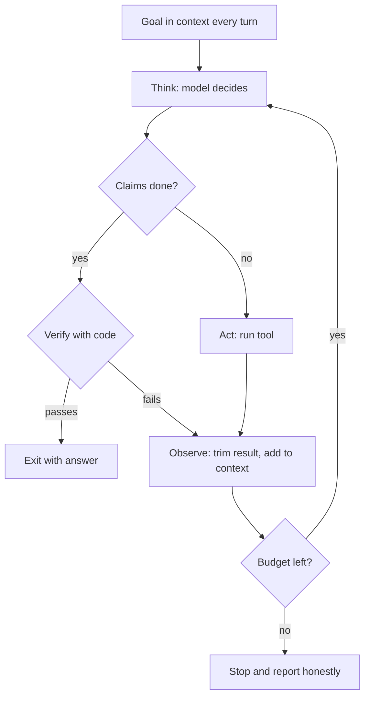

# What is Loop Engineering?

> **Step 11: Agentic Engineering and Agent Frameworks** · ⏱️ 21 min read · [Read original](https://outcomeschool.com/blog/what-is-loop-engineering)

## TL;DR
Loop Engineering is the deliberate design of the think, act, observe repetition around an AI model: step budget, tools, observations, memory, failure feedback and exit conditions. The model produces one output; the loop is our code, so a modest model in a well-built loop often beats a strong model in a bad one.

## Key Concepts
- **Context** — Everything the model sees right now; its only memory.
- **Turn** — Think (model decides), Act (system runs a tool), Observe (result added to context). This is the ReAct pattern.
- **Definition of done** — A finish line a machine can check (e.g. test_login passes).
- **Step budget** — Hard cap on turns; stop and report honestly if exceeded.
- **Verify** — Check the model's "done" claim with real code.

## How It Works
**Naive loop** (`while True: decide, run tool, append result`) fails: no stop, ever-growing context, no error handling, no definition of done.

**Seven parts to engineer:** goal, step budget, tools (short, sharp list), observation (trim/summarize/page), memory (full history is honest but costly; summary is cheap but lossy), feedback on failure (informative errors like "did you mean src/main.py"), exit (success, budget, repeated failure, ask human).

**Improved loop:** `for step in range(MAX_STEPS)`, pass the goal every turn, if `is_done` then `verify(goal)` before returning, wrap tools in try/except turning crashes into lessons, `trim(result)` before adding to context.

**Prompt vs Context vs Loop Engineering**
| | Prompt | Context | Loop |
|---|---|---|---|
| Unit | One instruction | One context | One full run |
| Question | What do we say? | What does the model see? | What next, when to stop? |
| Prevents | Vague answers | Confused/overloaded model | Endless, drifting, falsely successful runs |

**Failure modes and fixes**
| Failure | Fix |
|---|---|
| Endless | Step budget plus machine-checkable finish |
| Repeating | Better failure messages, block repeated action |
| Forgetting | Compact history instead of dropping turns |
| Drifting | Repeat goal each turn, plan first |
| Lying | Verify claim with code |
| Expensive | Trim observations, use sub-loops |

**More techniques:** plan first then loop (Plan-and-Execute), sub-loops via sub-agents returning only final results, human approval for irreversible steps.

**Example:** goal "test_login must pass": run test, read line 42, fix token order, rerun (new error means progress), add import, pass, then final full-suite verify; used 6 of 12 turns.

**Works well:** machine-checkable goals, honest fast feedback, small reversible steps. **Fails:** no objective finish ("improve this essay"), slow/silent feedback, irreversible actions, very long tasks that overflow memory.

## Diagram

## Key Takeaways
- The model does not loop; our code does, which is why it can be engineered.
- Always have a step budget and a machine-checkable definition of done.
- Verify before trusting "done"; repeat the goal; trim observations.
- Turn errors into hints and block repeated identical actions.
- Prompt shapes a sentence, context shapes what the model sees, graph shapes the path, loop shapes the whole run.
