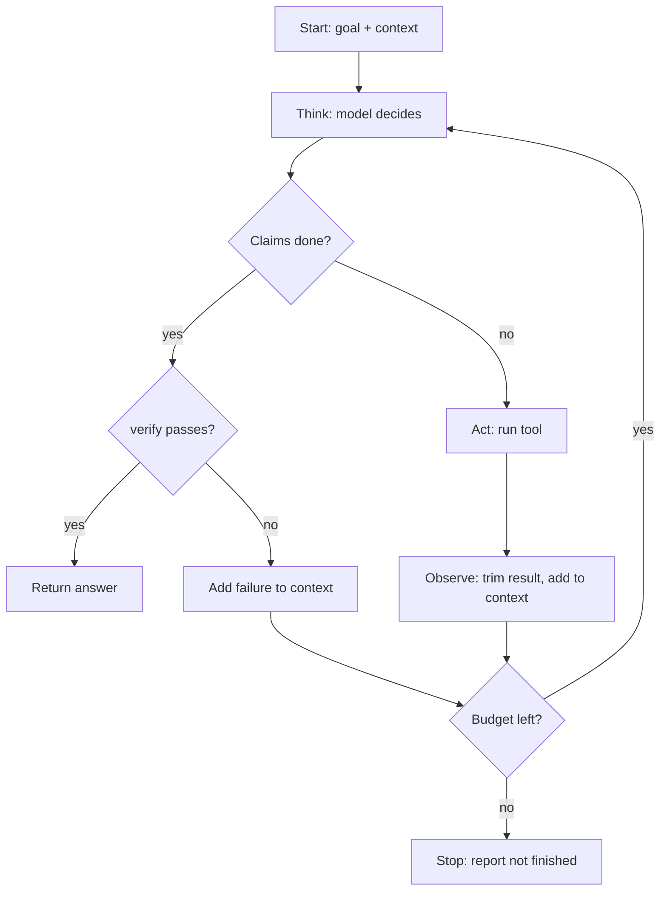

# What is Loop Engineering?

> **Step 11: Agentic Engineering and Agent Frameworks** · ⏱️ 21 min read · [Read original](https://outcomeschool.com/blog/what-is-loop-engineering)

## TL;DR
Loop Engineering is deliberately designing the repeating think, act, observe cycle an agent runs, so it keeps making real progress and stops at the right moment with the right result. The model does not loop; code around it does, so the loop can be engineered. A strong model in a bad loop fails, while a modest model in a good loop often succeeds.

## Key Concepts
- **Loop Engineering** — Loop (repetition until a stop condition) + Engineering (rules, limits, checks on purpose).
- **Context** — everything the model sees now; its only memory. Facts not in context do not exist for it.
- **Turn** — Think (model reads context, decides), Act (system runs a tool), Observe (result appended to context). The same pattern as a ReAct agent.
- **Tool** — small program given to the model (read file, search, run command).
- **Definition of done** — machine-checkable statement of success.
- Kitchen analogy (soup): cook = model; pinch of salt = action; tasting = observation; remembering salt added = memory; "good enough" = definition of done; serve before cold = turn limit.

## How It Works

### Why needed
Earlier LLMs were vending machines: one request, one response. Real tasks (find and fix a bug) need read, run test, see error, edit, re-run: each step depends on the last. Looping introduces new problems: repeating, forgetting, drifting from the goal, running forever and burning money, declaring false success. These are loop problems, not prompt problems. The better loop ships the better agent even with the same model.

### The naive loop and its flaws
```python
while True:
    decision = model(context)
    result = run_tool(decision.tool, decision.input)
    context = context + result
```
1. No stop (`while True`).
2. Context only grows with raw results: huge, costly, noisy.
3. No error handling; a tool crash kills the loop.
4. No definition of done.

### Seven parts to engineer
1. **Goal** — clear finish, machine-checkable ("test_login passes", not "fix the bug").
2. **Step budget** — max turns; when exhausted, report honestly.
3. **Tools** — short sharp list, not many overlapping ones.
4. **Observation** — trim, summarize or page outputs.
5. **Memory** — full history is honest but expensive; running summary is cheap but lossy.
6. **Feedback on failure** — informative errors ("File not found at src/mian.py, did you mean src/main.py").
7. **Exit** — success, budget exhausted, repeated failure, request for a human.

Improved loop:
```python
MAX_STEPS = 12
def run_agent(goal, context):
    for step in range(MAX_STEPS):
        decision = model(goal, context)      # goal every turn
        if decision.is_done:
            if verify(goal): return decision.answer
            context = add(context, "Verification failed. Keep working.")
            continue
        try: result = run_tool(decision.tool, decision.input)
        except ToolError as e: result = f"Tool failed: {e}. Try a different approach."
        context = add(context, trim(result))
    return "Could not finish within the step budget."
```
Six changes: hard ceiling, goal each turn, `is_done`, `verify` (the single most valuable line), try/except turning crashes into lessons, `trim`.



### Prompt vs Context vs Loop Engineering
| Point | Prompt | Context | Loop |
|---|---|---|---|
| Unit | One instruction | One context | One full run |
| Question | What do we say? | What does the model see? | What next, and when stop? |
| Typical fix | Rewrite wording | Add, trim, reorder info | Add budget, check, better exit |
| Prevents | Vague/misread answer | Confused/overloaded model | Endless, drifting, falsely successful run |
| Controlled by | Prompt writer | Code gathering information | Code re-running the model |

Prompt fixes what the model hears, context what it knows, loop what it may do over time. Graph Engineering shapes the path between steps; Loop Engineering shapes the whole run.

### Failures and fixes
| Failure | Description | Fix |
|---|---|---|
| Endless | Never decides it is done (no checkable done) | Step budget, machine-checkable finish |
| Repeating | Same failing command repeatedly (error carries no new info) | Better failure messages, block repeated action |
| Forgetting | Earlier solution squeezed out of context | Compact history instead of dropping |
| Drifting | Login bug turns into DB rewrite | Repeat goal every turn, plan first |
| Lying | Claims done with no verification (most dangerous) | Verify with code before exit |
| Expensive | 90 turns, raw outputs re-sent each turn | Trim observations, sub-loops |

### Techniques
- Step budget; machine-checkable done (run test, read pass/fail).
- Verify before trusting; put failed check into context.
- Repeat goal every turn (cheapest cure for drift).
- Informative failures (one key line plus hint).
- Break the repeat: block identical action+input, say "already failed twice".
- Trim observations (head/tail lines, first 20 results, relevant function).
- Compact history at a threshold with a summary of decisions and facts (see context compaction).
- Plan first, then loop (Plan-and-Execute agent).
- Sub-loops: sub-agent with own budget and tools returns only final result.
- Human in the loop for irreversible steps (delete, email, money, deploy).

### Complete example: "test_login must pass"
Turn 1 run test, fail at line 42 (output trimmed). T2 read line 42: token compared before created. T3 edit to create first. T4 test again, different error (progress, not spinning). T5 add missing import. T6 test passes, agent says done. Verify: loop runs the full suite itself, all pass, exit. Used 6 of 12 turns; checkable goal, pointed errors, verified claim.

## Trade-offs & Pitfalls
Works well: clear machine-checkable finish (tests, build, format); honest environment feedback (compiler, test runner); small steps with cheap undo; long tasks that need information gathering.
Fails: no objective finish ("make this essay better"); slow or silent feedback (mistake appears 30 minutes later); irreversible actions (production, real money); very long tasks with hundreds of facts (summaries drop things, forgetting loop).

## FAQ
- Stronger model compensates? → No.
- Trust "done"? → No, verify.
- Out of budget? → Stop cleanly and report progress.
- Paste full tool output? → No, trim.
- Loop vs Graph Engineering? → Graph shapes step paths; Loop shapes the whole run from first turn to last.

## Key Takeaways
- The model decides what to do next; the loop decides what happens.
- Never trust "done": verify with code.
- Always have a step budget and a machine-checkable goal.
- Repeat the goal each turn; trim observations; compact history.
- Make errors informative and block repeated identical actions.
- Use plans and sub-loops for long tasks; humans for irreversible steps.
- Loop quality, not prompt cleverness, decides whether long work finishes.
