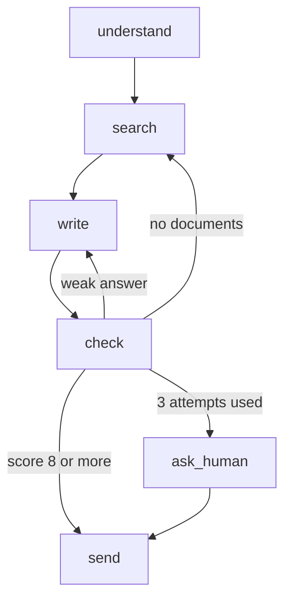

# What is Graph Engineering?

> **Step 11: Agentic Engineering and Agent Frameworks** · ⏱️ 27 min read · [Read original](https://outcomeschool.com/blog/what-is-graph-engineering)

## TL;DR
Graph Engineering designs an AI system as a graph: nodes are small steps, edges are the paths between them, and a shared state carries information. The model does the thinking, but our code (conditional edges) controls the flow, giving structure, testability, pausing, and safe self-correction.

## Key Concepts
- **Node** — One step; a plain function from state to updated state (may or may not call a model).
- **Edge** — Answers "which node runs next?".
- **State** — Shared notebook every node reads and writes; the most important design decision.
- **Conditional edge** — Routing function reads state and picks the next node.
- **Cycle** — Going back (write, check, write) for self-correction; needs a hard limit.
- **Fan-out / fan-in** — Parallel branches that later merge.
- **Checkpoint** — State saved after each node, enabling resume by thread id.

## How It Works
**Why a graph? (document Q&A example)**
1. One big prompt — model forgets parts, no way to localize failures.
2. Chain (prompt chaining) — structured but only moves forward; cannot retry.
3. One agent loop — can go back but the model controls everything (repeats failures, skips checks).
4. Graph — small visible steps, can go back, model decides only where allowed. (This is Agentic RAG.)

**Building it:** nodes `understand`, `search`, `write` connected by edges; a `check` node (LLM as Judge) scores the answer and increments `attempts`. Routing is plain code:
- score >= 8: `send`
- attempts >= 3: `ask_human`
- no documents: `search`
- else: `write`

The model scored; our code chose the path. Every cycle must have a stop condition and every path must reach an end.

**Sample run:** first answer lacks sources, score 5, route back to write; second answer cites policy-v3.pdf, score 9, send.

**Parallel branches:** `understand` fans out to `search_docs` and `search_web`, both feed `merge`. Parallel nodes must write to different state keys or one silently overwrites the other.

**Checkpoints:** save state after each node (`thread_id`) so a restart resumes from the last node.

**Human in the loop:** mark a node `interrupt_before`; graph saves and pauses; human approves or edits the state, then resumes.

**Errors as paths:** catch failures into `state["error"]` and route on them (search down, fall back to web; nothing found, ask human).

**Graph vs Loop Engineering**
| Point | Loop | Graph |
|---|---|---|
| Who decides next step | Model | Our code using model output |
| Path per run | Varies | Same for same situation |
| Testing | Hard | Node by node |
| Debugging | Read long history | Inspect failed node |
| Best for | Open-ended tasks | Known staged work |

**Good fit:** staged, approval-needing, repeatable, long-running, parallelizable, explainable work. **Bad fit:** truly open-ended work, very simple tasks, sprawling graphs, messy state, hidden key dependencies, unlimited cycles.

**Best practices:** small nodes, design state first, decisions in code, limit every cycle, always have an exit, turn failures into paths, draw the graph, log every node, test node by node, start with a straight line.

## Diagram

## Key Takeaways
- Nodes = steps, edges = next-step paths, state = shared notebook.
- Keep control of flow in code; let the model supply scores, labels or choices.
- Cycles enable self-correction but must have attempt limits and an exit path.
- Checkpoints plus interrupts give resume and human approval for free.
- Use a graph for known staged work; use a loop for open-ended tasks.
