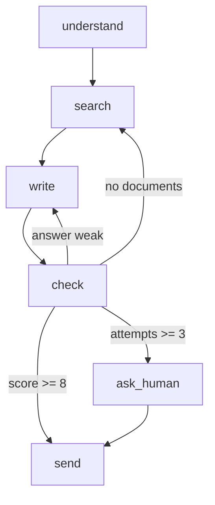
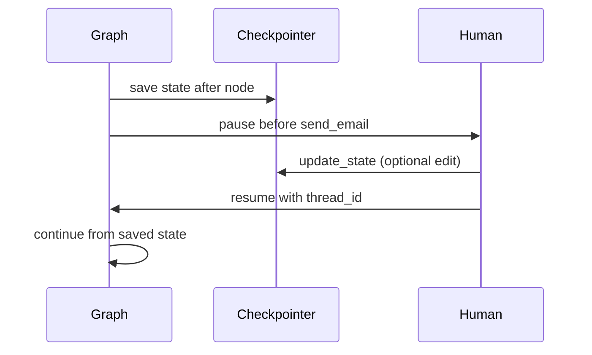

# What is Graph Engineering?

> **Step 11: Agentic Engineering and Agent Frameworks** · ⏱️ 27 min read · [Read original](https://outcomeschool.com/blog/what-is-graph-engineering)

## TL;DR
Graph Engineering designs an AI system as a graph: each step is a node, each path between steps is an edge, and all progress lives in one shared state. Our own code (reading the model's outputs) picks the paths, so the system can branch, loop back, run in parallel, pause and resume, yet stay testable and explainable. The model does the thinking; the graph decides where that thinking goes.

## Key Concepts
- **Graph** — nodes (where something happens) + edges (paths between them). Metro map analogy: station = node, track = edge, passenger bag = state.
- **Node** — one step; a plain function state -> state. May call a model, tool, DB, or plain code with no model.
- **Edge** — answers "after this step, which step runs next?"
- **State** — shared notebook every node reads and writes; the most important design decision. Clean state also means good Context Engineering.
- **Conditional edge** — routing function reads state and picks the next node.
- **Cycle** — going back and forth between nodes (self-correction; Reflection Agent idea). Must have a hard limit.
- **Fan-out / fan-in** — one node feeding several parallel nodes / several nodes joining at a merge node.
- **Checkpoint** — state saved after each node; resume from the last one with a `thread_id`.
- **Prompt chaining**, **agent loop**, **Agentic RAG** (search, write, check, search again), **LLM as a Judge**, **LangGraph** (popular library with the same node/edge/state ideas).

## How It Works

### Why a graph: four approaches (internal-docs Q&A)
| Approach | Idea | Problem |
|---|---|---|
| 1. One big prompt | Model does everything in one call | Forgets parts, skips search/check, nothing visible to debug |
| 2. Chain | understand, search, write, send | Straight line only; cannot go back (bad search, wrong answer) |
| 3. One loop | Model thinks/acts repeatedly | Too little control: repeats failing search, skips checking, calls dangerous tools, path differs each run, hard to test |
| 4. Graph | Small steps + back-edges + paths written by us | Model decides only where we allow |

Graph 4: understand -> search -> write -> check; check -> send (good), check -> search (sources missing), check -> write (weak).

### State and nodes
```python
state = {"question": "...", "intent": None, "documents": [],
         "answer": None, "score": None, "attempts": 0}
def understand(state): state["intent"] = model.find_intent(state["question"]); return state
def search(state): state["documents"] = db.search(state["intent"]); return state
def write(state): state["answer"] = model.write_answer(state["question"], state["documents"]); return state
```
Build: `add_node` for each, `add_edge("understand","search")`, `add_edge("search","write")`, `set_entry`, `set_finish`; `graph.run(state)`. This alone is a straight line.

### Conditional edges
`check` node: model (as judge) scores answer out of 10 and `attempts += 1`.
```python
def route_after_check(state):
    if state["score"] >= 8: return "send"
    if state["attempts"] >= 3: return "ask_human"
    if not state["documents"]: return "search"
    return "write"
```
Attach with `add_conditional_edge("check", route_after_check)`, normal edge write -> check, finish moved to `send`. The model gave the score but our code chose the path: the heart of Graph Engineering.

### Cycles need limits
check <-> write is a self-correcting cycle but can run forever (money burned). Count attempts; after 3, route to an `ask_human` node joined to `send`, so even the sad path ends. Every cycle needs a hard limit.



### One run (refund policy question)
1. Start state, attempts 0.
2. understand: intent "refund policy duration and conditions".
3. search: documents ["policy-v3.pdf","faq-refunds.md"].
4. write: "Refunds are allowed within 30 days."
5. check: no sources, score 5, attempts 1.
6. Route: score < 8, docs present, attempts < 3 -> write.
7. write: "...within 30 days of purchase, as per policy-v3.pdf."
8. check: score 9, attempts 2.
9. Route -> send, stop. The system fixed itself yet stayed in our control.

### Parallel branches
`understand` -> `search_docs` and `search_web` (fan-out); both -> `merge` (fan-in, waits for both); merge concatenates `doc_results + web_results` into `documents`. Parallel nodes must write to different state keys, otherwise one silently overwrites the other. Related: AI Orchestration patterns.

### Checkpoints
`Graph(state, checkpointer=Database())`, `run(state, thread_id="user-123")`. State saved after each node; a crash after search resumes at write, not understand. Works because all progress is one plain state object.

### Human in the loop
`add_node("send_email", send_email, interrupt_before=True)` saves state and pauses before the node. Human approves -> `resume(thread_id)`; or edits via `update_state(thread_id, changes={"answer": edited})` then resumes. The graph does not know a human touched it. Use for emails, refunds, deletes, production pushes.



### Error handling
Catch failure inside node, write `state["error"]`; routing: error -> `search_web` fallback, no documents -> `ask_human`, else `write`. Use a conditional edge out of `search`. Failures become normal paths; nothing crashes.

### Graph vs Loop Engineering
| Point | Loop | Graph |
|---|---|---|
| Who decides next step | Model | Our code using model output |
| Structure | One think/act loop | Nodes joined by edges |
| Path per run | Different each time | Same for same situation |
| Testing | Hard | Test one node at a time |
| Finding bugs | Read long history | Inspect the failed node |
| Model freedom | Very high | Only where allowed |
| Best for | Open-ended, unknown tasks | Known work with clear stages |

## Trade-offs & Pitfalls
Works well: clear stages (tickets, refunds, doc review); approval needs; repeatability; long-running work (checkpoints survive restarts for hours or days); independent parts in parallel; explainability (banking, healthcare, legal).
Fails: truly open-ended work (use a loop); very simple work (one call suffices); graphs grown to sixty tangled nodes; messy junkyard state; hidden dependencies between nodes' keys; cycles without limits.

## Best Practices
1. One node, one job (describable in a sentence).
2. Design state first: each key, what it holds, who fills it.
3. Decisions in code, not prose (model gives score/label, code routes).
4. Limit every cycle via attempts in state.
5. Every path, even sad ones, reaches an end.
6. Turn failures into paths.
7. Draw the graph on paper.
8. Log every node (in/out) for observability.
9. Test node by node with fixed state, no model.
10. Start with a straight line; add branches, cycles, parallelism when needed.

## FAQ
- Same as prompt chaining? → No; chains cannot go back or branch.
- Model picks next step? → No, our code does.
- Every node calls a model? → No.
- LangGraph same as Graph Engineering? → No, it is a library implementing the practice.
- Parallel nodes writing same key? → Silent overwrite; use different keys plus a merge node.

## Key Takeaways
- Nodes, edges, state: three building blocks.
- Keep control of flow in code; use the model for thinking, scoring, labelling.
- Conditional edges + limited cycles give safe self-correction.
- Checkpoints give pause/resume and crash recovery; interrupts give human review.
- Fan-out/fan-in saves time; use separate keys per branch.
- Graphs suit known staged work; loops suit open-ended work.
- Start simple and keep state clean.
