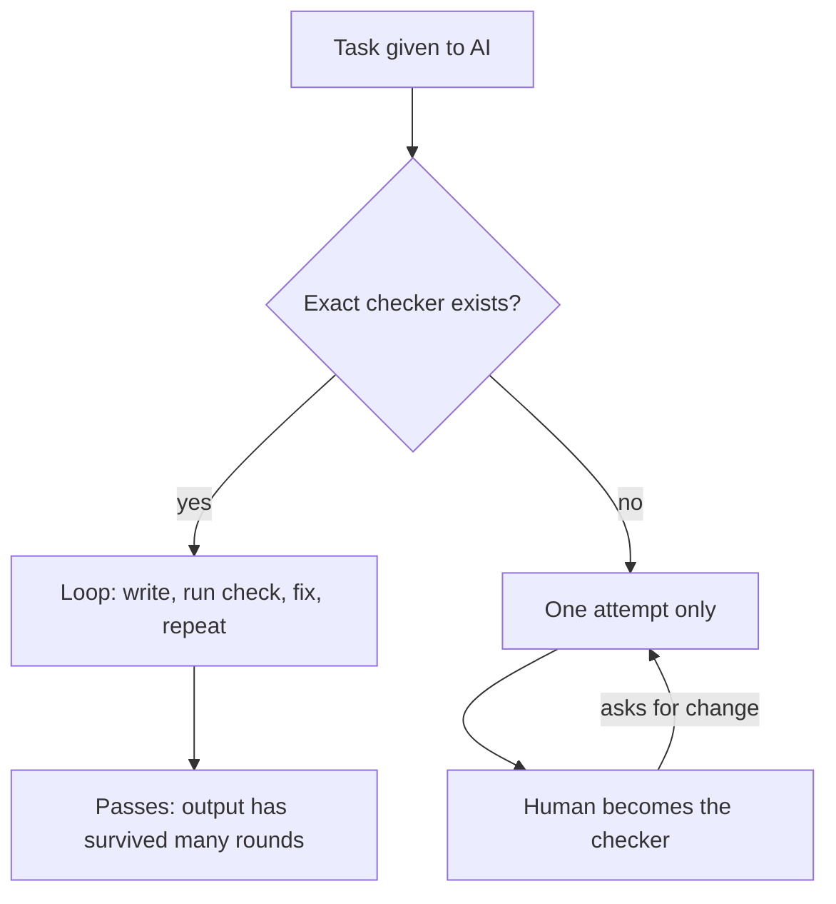

# AI Is Only as Good as Our Definition of Done

> **Step 11: Agentic Engineering and Agent Frameworks** · ⏱️ 11 min read · [Read original](https://outcomeschool.com/blog/ai-is-only-as-good-as-our-definition-of-done)

## TL;DR
AI is strong on tasks with a fast, exact checker (tests, compiler) and unreliable on tasks without one. The gap is not model intelligence but our definition of done: with a checker the AI loops and self-corrects many times, without one it gets a single try and we become the checker.

## Key Concepts
- **Checker / verifier** — Anything that returns pass or fail without opinion: unit test, compiler. A human reader is a slow, inconsistent checker.
- **Exact definition of done** — Machine-checkable boundary between done and not done.
- **Fuzzy definition of done** — Words like "good", "clean", "readable" with nothing to run.
- **Green means done** — The AI stops when the test passes, so weak tests give false confidence.

## How It Works
**Exact tasks:** write the test first (e.g. `calculateDiscountedPrice(1000, 20)` must equal 800), then ask AI to make it pass. It writes, runs, sees red, fixes, reruns, with no trust needed, only running the check. Same for: compiles, exact input/output, bug stops reproducing, SQL returns exact rows, math matches known answer.

**Fuzzy tasks:** "Build the login feature" compiles and works, but hidden questions go unchecked (network failure, secure token, empty password, good error message, maintainability). Absence of failure is not presence of correctness. A test that covers only the happy path proves only that. Other fuzzy asks: "good summary", "clean architecture", "more readable". LLM as a Judge can act as checker when no exact one exists.

**Why the difference is so sharp:** AI works in a loop (try, check, see mistake, fix). Each round needs an answer to "am I done?".
- Checker present: loop runs 10 or 50 times on its own; we see the surviving attempt.
- Checker absent: loop dies after round one; we read a first guess; we become the checker at human speed.

**Writing a better definition of done**
- Write the test first.
- Give exact input and expected output (25-08-2026 becomes 2026-08-25).
- Give the command that must pass (build and test).
- Turn edge cases into an explicit list (empty input, timeout, expired token, duplicate request).
- Turn vague quality into a number (under 200 ms for 1000 rows).
- Be honest about what remains uncheckable (design fit) and review that part yourself.

## Diagram

## Key Takeaways
- AI is strong where success can be measured quickly and exactly.
- Same model, different outcomes: many self-corrections vs one guess.
- Green only means done as far as the test covers; include edge cases.
- Convert fuzzy goals into tests, commands, exact examples and numbers.
- Before any task ask: how will I check this?
