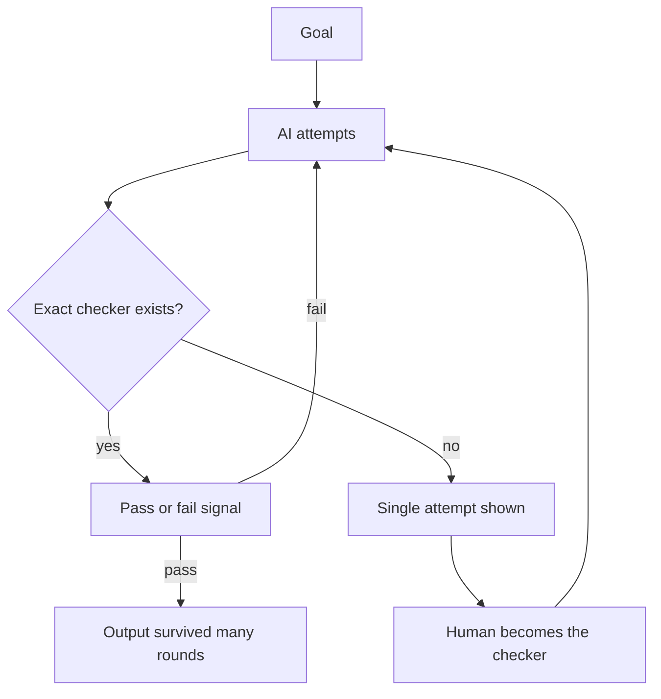

# AI Is Only as Good as Our Definition of Done

> **Step 11: Agentic Engineering and Agent Frameworks** · ⏱️ 11 min read · [Read original](https://outcomeschool.com/blog/ai-is-only-as-good-as-our-definition-of-done)

## TL;DR
AI excels when a fast, exact checker can say pass or fail, and is unreliable when only a human can judge. The reason is the loop AI runs: with a checker it gets many tries; without one it gets a single try. So the limit is our clarity, not model intelligence; we should make tasks checkable.

## Key Concepts
- **Definition of Done** = Goal + a way to check the goal.
- **Checker / verifier** — anything that gives pass or fail without opinion: unit test, compiler. A human is also a checker, but slow and inconsistent on a tired day.
- **Exact vs fuzzy done** — exact: boundary between done and not done is machine-checkable; fuzzy: words like "good", "clean", "readable".
- **Loop** — try, check, see mistake, fix, retry; needs an honest "am I done?" signal each round.

## How It Works

### Exact definition of done
Write the test first (`calculateDiscountedPrice(1000, 20)` must equal 800), then ask AI to make it pass. AI writes, runs, sees red, fixes, re-runs until green. We never have to trust the AI; we just run the check. Other examples: code must compile; exact output for exact input; a bug stops reproducing; a SQL query returns exact rows; math answer matches known answer. Machine checks machine, so AI feels magical.

### Fuzzy definition of done
"Build the login feature": code compiles, screen opens, user logs in. Is it done? Unknown, because done was never defined. Hidden questions: network failure midway? token stored securely? empty password? error message good enough? easy to change in six months? None written, so none checkable. Looking complete is not being complete; absence of failure is not correctness. Even a test can mislead: if it covers only the happy path, green proves only that, and AI stops at green. Same for "good summary", "clean architecture", "more readable". Only a human remains as checker, so we cannot fully rely on the output (not because AI is weak). LLM as a Judge can act as a checker when no exact one exists.

### Why the loop explains the gap
- **With a checker**: loop runs autonomously, 10 or 50 rounds, each giving honest signal; we only see the attempt that survived checking.
- **Without a checker**: no signal, AI stops after round one; we read a single guess as final.
- When missing, we become the checker, and the loop runs at our speed, costing our attention each round.
- Same model, same intelligence; the difference is the number of tries.

### Writing a better definition of done
1. Write the test first, then give the task (biggest change).
2. Give exact input and expected output (25-08-2026 -> 2026-08-25).
3. Give the command that must pass ("build and test commands both pass", not "make sure it works").
4. Turn edge cases into an actual list: empty input, network timeout, expired token, duplicate request.
5. Turn vague quality into a number ("response under 200 ms for 1000 rows", not "faster").
6. Be honest about what is still not checkable (e.g. is this design right for the product's direction); read those parts yourself and accept checked parts. This beats reading everything with equal doubt.
A checking layer around the model is Harness Engineering.

## Trade-offs & Pitfalls
- Green tests with poor coverage give false confidence.
- Pretending a judgement call has a checker lets weak decisions enter quietly.
- Fuzzy tasks cost human time on every round.

## FAQ
- Checker? → Pass/fail without opinion (test, compiler).
- Passing test = correct? → Only for what it covers.
- AI weak at fuzzy tasks? → No, it just gets one try.
- Everything checkable? → No; keep judgement for some parts.

## Key Takeaways
- Definition of Done = goal + checker.
- Same AI feels magical with tests and unreliable without them.
- Checkers give the loop many honest tries; no checker means one try.
- Write tests first, exact I/O, runnable commands, edge-case lists, numeric targets.
- Know which parts need human judgement.
- Before delegating, ask: how will I check this?
