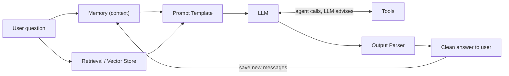
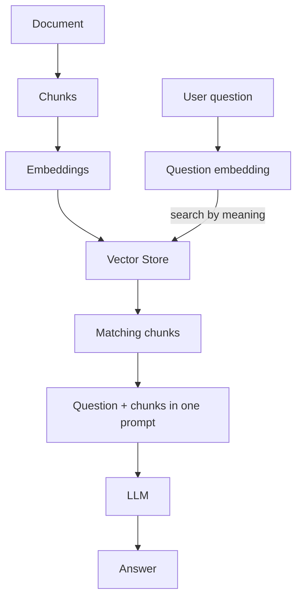

# How does LangChain work?

> **Step 11: Agentic Engineering and Agent Frameworks** · ⏱️ 20 min read · [Read original](https://outcomeschool.com/blog/how-does-langchain-work)

## TL;DR
LangChain is a framework that sits between us and an LLM, offering ready-made building blocks (prompt templates, chains, output parsers, memory, retrieval, tools and agents) that we join like Lego with the pipe `|`. Each block does one job and its output feeds the next, like an assembly line. It turns messy glue code for real LLM apps into a clean flow.

## Key Concepts
- **LLM** — model that takes text and returns text; the brain of the app. LangChain is not an LLM.
- **LangChain = Lang + Chain** — chaining steps, i.e. Prompt Chaining (output of one prompt becomes input of next).
- **Prompt / Prompt Template** — instruction to the LLM / ready-made prompt with blanks filled at runtime.
- **Chain** — blocks joined so output of one flows into the next (pipeline).
- **Output Parser** — turns raw LLM text into structured form (e.g. "apple, banana, mango" -> list of 3). `StrOutputParser` returns a clean string rather than the message object.
- **Memory** — stores earlier messages and adds them to each new prompt.
- **Retrieval / RAG** — fetch relevant chunks of our data, then generate with them.
- **Chunk, Embedding, Vector Store** — small doc piece; text as numbers to compare meaning; database searching by meaning rather than exact words.
- **Tool** — external function (calculator, search, weather) for what the LLM cannot do.
- **Agent** — controller loop using the LLM to choose tools, running them, feeding results back.

## How It Works

### Why needed
Real apps must take a question, look up own documents, remember messages, call calculator/search, and format output. Hand-gluing this is messy and hard to maintain. LangChain gives reusable blocks. Assembly-line analogy: raw material = user input; station = block; car moving = data passing on; finished car = final answer.

### Prompt template and chain
```python
template = PromptTemplate.from_template("Explain {topic} in simple words for a beginner.")
chain = template | llm | parser
result = chain.invoke({"topic": "LangChain"})
```
`|` sends output of the left into the right. Without parser: `template | llm`. The template fills the blank, the LLM answers, the parser cleans.

### Memory
LLM calls are fresh and stateless. Turn 1: "Who is Albert Einstein?" saved. Turn 2: "Where was he born?" is sent with the earlier conversation, so the LLM knows "he" = Einstein.

### Retrieval and RAG
LLM knows only general internet data, not our 200-page handbook.
1. Split document into chunks.
2. Convert each chunk to an embedding.
3. Store in a vector store.
4. Embed the question, search for closest chunks.
5. Send chunks plus question to the LLM.
```python
relevant_chunks = vector_store.similarity_search("What is the leave policy?")
chain = prompt_with_context | llm | parser
chain.invoke({"context": relevant_chunks, "question": "What is the leave policy?"})
```
Data preparation is done once; Agentic RAG extends this pattern.

### Tools and agents
LLM is weak at exact math and lacks live data. The LLM only recommends a tool and its input; our code (the agent) calls it. LLM = advisor, code = doer. Agent loop: ask LLM, run recommended tool, send result back, repeat until done.
Example "25 times 18, and is that more than 400?": LLM recommends calculator `25 * 18`; agent runs it, gets 450; LLM compares 450 > 400 and answers "25 times 18 is 450, which is more than 400." Math was computed, not guessed. For complex agent steps/loops, use a graph (LangGraph). The LLM is the brain, tools the hands.

### Complete flow
1. User asks about the handbook.
2. Pull previous messages from memory.
3. Retrieve matching chunks from the vector store.
4. Prompt template merges question, memory, chunks.
5. Prompt flows into the LLM via the chain.
6. If action needed, LLM recommends a tool; agent runs it and returns the result.
7. LLM produces answer.
8. Output parser cleans it.
9. Show to user; save new messages to memory.





## Trade-offs & Pitfalls
- Common confusion: the LLM does not run tools; LangChain/agent code does.
- Without memory, the LLM forgets earlier turns.
- LLMs do not know private data without retrieval.
- When agent decisions and loops get complex, move to LangGraph.

## FAQ
- Is LangChain an LLM? → No, a framework between us and the LLM.
- Does LLM run tools? → No, only recommends; agent runs.
- Remembers without memory? → No.
- What does `|` do? → Feeds left output into right block.
- When LangGraph? → When steps, decisions and loops grow complex.

## Key Takeaways
- LangChain = reusable building blocks chained with the pipe.
- Prompt templates, chains, parsers, memory, retrieval, tools/agents are the six blocks.
- Memory injects past messages into each prompt.
- RAG = chunk, embed, store, similarity search, then generate.
- LLM recommends tools; the agent executes them.
- Use LangGraph for complex agent flows.
