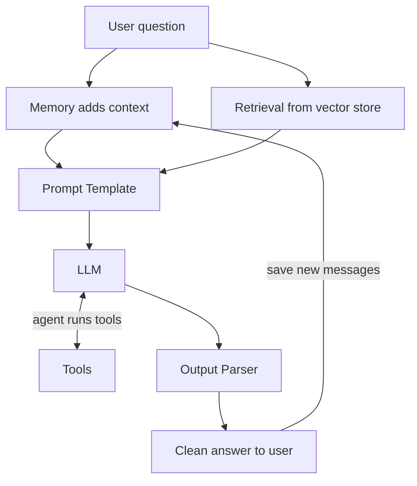

# How does LangChain work?

> **Step 11: Agentic Engineering and Agent Frameworks** · ⏱️ 20 min read · [Read original](https://outcomeschool.com/blog/how-does-langchain-work)

## TL;DR
LangChain is a framework that sits between us and the LLM, giving ready-made building blocks (prompt templates, chains, parsers, memory, retrieval, tools, agents) that we chain together like an assembly line. It makes complex LLM apps simpler to build and maintain than hand-gluing everything.

## Key Concepts
- **Prompt Template** — Prompt with blanks filled at runtime.
- **Chain** — Pipeline where one block's output feeds the next; joined with the pipe `|`.
- **Output Parser** — Converts raw LLM text into structured, usable form (e.g. `StrOutputParser`).
- **Memory** — Stores earlier messages and prepends them to each new prompt.
- **Retrieval / RAG** — Fetch relevant chunks of our own data, then generate an answer from them.
- **Tool** — External function (calculator, search, weather) the LLM can ask for.
- **Agent** — Controller loop that asks the LLM what to do, runs the tool, returns the result.

## How It Works
**Why:** real apps need user input, document lookup, conversation memory, tools and formatting; hand-gluing is messy. LangChain gives Lego-like blocks.

**Chain:** `chain = template | llm | parser`; `chain.invoke({"topic": "LangChain"})` flows data left to right.

**Memory:** every LLM call is fresh. For "Where was he born?" to work, memory adds the earlier Einstein exchange to the new prompt.

**Retrieval / RAG steps**
1. Split documents into chunks.
2. Convert chunks to embeddings.
3. Store them in a vector store (search by meaning).
4. Embed the question and find the closest chunks.
5. Send chunks plus question to the LLM.

**Tools and agents:** the LLM only recommends a tool and its input; our code (the agent) runs it. Example: "25 times 18, more than 400?" The LLM asks for the calculator with `25 * 18`, tool returns 450, LLM compares and answers. LLM is the brain, tools are the hands. Complex agent logic can be laid out as a graph (LangGraph).

**Complete flow:** question arrives, memory adds context, retrieval fetches chunks, prompt template combines all, LLM (with tool calls via the agent if needed) answers, parser cleans, answer shown and new messages saved to memory.

## Diagram

## Key Takeaways
- LangChain is a framework, not an LLM; it chains small blocks.
- The pipe `|` sends one block's output into the next.
- Memory re-sends past messages; the LLM itself remembers nothing.
- RAG = chunk, embed, store, search by meaning, generate.
- The LLM recommends tools; the agent (our code) executes them.
