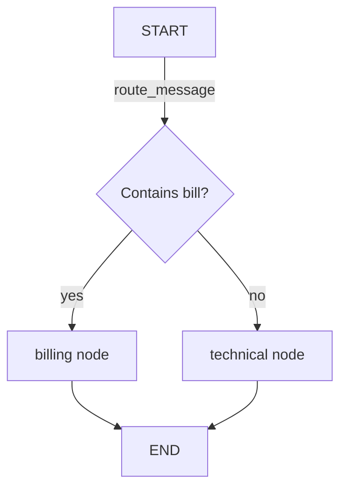

# How does LangGraph work?

> **Step 11: Agentic Engineering and Agent Frameworks** · ⏱️ 22 min read · [Read original](https://outcomeschool.com/blog/how-does-langgraph-work)

## TL;DR
LangGraph (from the LangChain team) lets us describe an AI app as a graph of nodes and edges sharing a state, with conditional edges for decisions, loops for retries, checkpointer-based memory and human-in-the-loop pauses. It replaces messy if/else logic once an app has many steps, tools and branches.

## Key Concepts
- **State** — Shared box of data every node reads and writes (declared with `TypedDict`).
- **Node** — Python function: takes state, returns a partial update.
- **Edge** — Arrow to the next node; `START` and `END` mark begin and finish.
- **Conditional edge** — Function reads state and returns the next node's name (a fork in the road).
- **Tool** — Normal function doing a real action.
- **Agent** — Code around the LLM that calls recommended tools.
- **Checkpointer** — Saves state after each step (persistence, memory, pausing).

## How It Works
**Why:** a support assistant must classify, search, reply, loop back, remember and wait for humans; plain if/else grows unreadable.

**Billing vs technical example**
- State: `message`, `reply`.
- Nodes `billing` and `technical` each return a reply.
- `route_message` returns "billing" if "bill" is in the message, else "technical".
- Wiring: `StateGraph(State)`, `add_node`, `add_conditional_edges(START, route_message)`, `add_edge(..., END)`, `compile()`, then `graph.invoke({...})`.
- "I have a question about my bill" goes to billing; "My app is not working" goes to technical.

**Tools:** the LLM only recommends (tool name plus input) as text, like a doctor writing a prescription; the agent (pharmacist) runs it. Flow: user question, LLM node recommends, agent reads, tool node runs, result returns to LLM node, LLM writes answer. A conditional edge after the LLM checks "did it recommend a tool?" and loops back. This is function calling.

**Memory:** a checkpointer saves state each step so the app resumes later ("My name is Amit" then "What is my name?").

**Human-in-the-loop:** because state is checkpointed, the graph can pause at any node (e.g. a refund reply), a human reviews, and it resumes from there.

**When to use**
| Situation | Simple LLM call | LangGraph |
|---|---|---|
| One question, one answer | Best | Not needed |
| Many ordered steps | Hard | Easy |
| Branching | Messy if/else | Conditional edges |
| Retry loops | Difficult | Built in |
| Tools | LLM only recommends | Agent calls |
| Past runs | Manual | Checkpointer |
| Human pause | Very hard | Supported |

## Diagram

## Key Takeaways
- LangGraph = state + nodes + edges (+ conditional edges) compiled into a runnable graph.
- Nodes never call each other; they communicate through shared state.
- The LLM recommends tools; the agent/graph executes them in a loop.
- A checkpointer enables memory and human-in-the-loop.
- Skip it for single-shot LLM calls.
