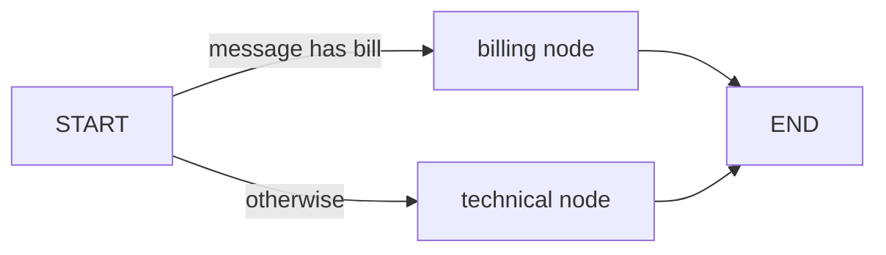

# How does LangGraph work?

> **Step 11: Agentic Engineering and Agent Frameworks** · ⏱️ 22 min read · [Read original](https://outcomeschool.com/blog/how-does-langgraph-work)

## TL;DR
LangGraph (from the LangChain team) lets us describe an LLM app as a graph: nodes are Python functions, edges say what runs next, and a shared state carries data between steps. It adds branching (conditional edges), loops, tool calling, persistence via a checkpointer, and human-in-the-loop on top of LangChain's ideas. Use it when an app has many steps, decisions, loops, tools, memory or approvals.

## Key Concepts
- **LangGraph = Lang + Graph** — structured connection of language model steps.
- **Graph / Node / Edge** — points of work / functions / arrows to the next step (Graph Engineering).
- **State** — shared box every node reads/writes; defined with `TypedDict` (dictionary with declared names and types). Nodes do not call each other; state is the glue.
- **START / END** — where graph begins and stops.
- **Conditional edge** — edge picking next node from the state (a fork in the road).
- **StateGraph** — builder; `compile()` makes a runnable graph; `invoke(state)` runs it.
- **Tool** — normal function doing a real action (search, DB read).
- **Agent** — code around the LLM that calls tools; here LangGraph plays this role. Function calling = LLM names tool and input, agent runs it.
- **Checkpointer** — saves state after each step (persistence).
- **Human-in-the-loop** — graph pauses for human review/approval.

## How It Works

### Why needed
Support assistant: read message, decide billing vs technical, search the right doc, have LLM write a reply, maybe get human approval. Steps are not a straight line: decisions, loops, memory, pauses. Plain if/else becomes messy; LangGraph describes steps and decisions as a graph and runs it.

### Nodes
A node takes the state and returns an update:
```python
def write_reply(state: State):
    return {"reply": "Thanks for your message: " + state["message"]}
```
LangGraph merges the returned dict into the state; nothing else changes.

### Conditional edges
```python
def route_message(state: State):
    if "bill" in state["message"]: return "billing"
    return "technical"
```
LangGraph reads the returned name and sends the graph to that node.

### Complete example
```python
class State(TypedDict): message: str; reply: str
def billing(state): return {"reply": "This is the billing team. We will help you with your payment."}
def technical(state): return {"reply": "This is the technical team. We will help you fix the issue."}

builder = StateGraph(State)
builder.add_node("billing", billing)
builder.add_node("technical", technical)
builder.add_conditional_edges(START, route_message)
builder.add_edge("billing", END)
builder.add_edge("technical", END)
graph = builder.compile()
graph.invoke({"message": "I have a question about my bill"})   # billing reply
graph.invoke({"message": "My app is not working"})              # technical reply
```



### Tools: who calls them
LLM only produces text; it cannot search, query DB or send email. It recommends e.g. `tool: search, input: weather in Delhi`; the agent (LangGraph) calls the real function and gives the result back. Analogy: LLM is the doctor writing the prescription, agent is the pharmacist dispensing.
1. User asks.
2. LLM recommends tool + input (does not run it).
3. Agent reads the recommendation and calls the tool.
4. Tool returns a result.
5. Agent gives the result to the LLM.
6. LLM writes the final answer.

In LangGraph: LLM node, tool node, and a conditional edge after the LLM asking "did it recommend a tool?" Yes -> tool node -> loop back to LLM; no -> END.

```mermaid
flowchart TD
    UQ["User question"] --> LN["LLM node: recommends tool"]
    LN --> CE{"Tool recommended?"}
    CE -->|"yes"| TN["Tool node: actually calls tool"]
    TN -->|"result"| LN
    CE -->|"no"| EN["END: final answer"]
```



### Memory and persistence
Without memory the graph forgets after finishing. A checkpointer saves state after each step; when the user returns (e.g. "My name is Amit" then "What is my name?") the graph loads saved state and continues. State is persisted.

### Human-in-the-loop
For sensitive steps (e.g. refund reply), the graph pauses at a node using the checkpointed state, a human reviews and decides, and the graph resumes from that exact point.

## When to use LangGraph
| Situation | Simple LLM call | LangGraph |
|---|---|---|
| One question, one answer | Best fit | Not needed |
| Many ordered steps | Hard | Easy |
| Decisions/branching | Messy if/else | Conditional edges |
| Looping to retry | Difficult | Built-in |
| Tools/actions | LLM only recommends | Agent calls tool |
| Remember past runs | Manual | Checkpointer |
| Pause for human | Very hard | Supported |

| LangGraph piece | Real-world role |
|---|---|
| State | Shared notebook |
| Node | Worker doing one task |
| Edge | Path between workers |
| Conditional edge | Fork in the road |
| Tool | Real action |
| LLM | Advisor recommending the tool |
| Agent | Worker who calls the tool |
| Checkpointer | Save button |
| Human-in-the-loop | Manager approving |

## FAQ
- LangGraph vs LangChain? → Same team; LangGraph adds graphs, loops, branching on top.
- Needed for simple Q&A? → No.
- Nodes call each other? → No; shared state and edges.
- Can it loop? → Yes (tool loop back to LLM).
- Why does HITL need checkpointer? → To stop at any node and resume from saved state.

## Key Takeaways
- Describe the app as nodes, edges and a shared state.
- Nodes return only the state updates they want.
- Conditional edges choose the path from state.
- The LLM recommends tools; the agent/graph calls them.
- Checkpointer enables memory across runs and human approval.
- Overkill for single-shot calls; ideal for multi-step, looping, tool-using apps.
