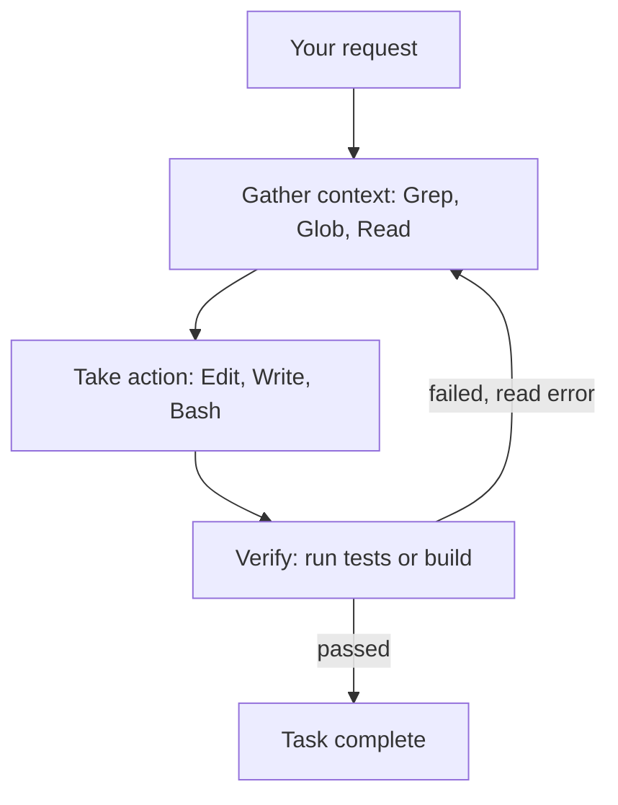

# How does Claude Code work?

> **Step 11: Agentic Engineering and Agent Frameworks** · ⏱️ 20 min read · [Read original](https://outcomeschool.com/blog/how-does-claude-code-work)

## TL;DR
Claude Code is a terminal-based agent: the Claude model is the brain, and a set of tools (Read, Grep, Glob, Edit, Write, Bash) gives it eyes and hands. It runs a gather context, act, verify loop until the task is done, with permissions, checkpoints, CLAUDE.md, plan mode, subagents and hooks around it.

## Key Concepts
- **Agent loop** — Gather context, take action, verify results; repeat. The user can interrupt anytime.
- **Tools** — Read (file contents), Grep (text search across files), Glob (filename patterns), Edit, Write, Bash (any terminal command; enables self-verification).
- **Context window** — Model's limited working memory ("whiteboard").
- **CLAUDE.md** — Project file read at every session start with standing instructions.
- **Permissions and modes** — Manual (default), Accept edits, Plan, Auto.
- **Checkpoints** — Snapshot before each file edit; everything can be rewound.
- **Subagent** — Helper with its own fresh context returning a short summary.
- **Hook** — Script the system runs on an event, every time.

## How It Works
**Chatbot problem:** cannot see the project, cannot act, cannot verify; the human is a copy-paste messenger. Claude Code adds tools so the model acts directly.

**Bug-fix example ("Fix the failing login test"):** Bash runs `npm test` (one failure), Grep finds `loginUser` in auth.js, Read opens it, Edit fixes the missing return, Bash reruns tests (all pass). Each result drives the next decision.

**Searching big projects:** reading everything would overflow the context window, so it funnels: thousands of files, Grep/Glob find a few, Read opens only those. No special index or database; the intelligence is in the model deciding what to search.

**Verification:** run tests, build or program; failures feed errors back into the loop (reflection). Giving a target helps ("write a failing test first, fix, run tests").

**CLAUDE.md vs hook**
| | CLAUDE.md | Hook |
|---|---|---|
| Nature | Request the model follows | Rule the system enforces |
| Runs | When the model complies | Every time, no exception |

**Permissions:** asks before edits or state-changing commands; can allow a command permanently. **Plan mode:** read-only exploration, present a plan, implement after approval. **Subagents:** isolate noisy exploration on their own context; can run in parallel; context compaction is another way to save space.

## Diagram

## Key Takeaways
- Claude Code = model (brain) + tools (body) + agent loop.
- Search first, read only what matters, to protect the context window.
- Running tests is how it verifies; errors loop back automatically.
- CLAUDE.md gives persistent project memory; hooks guarantee enforcement.
- Permissions, checkpoints and plan mode keep the human in control.
