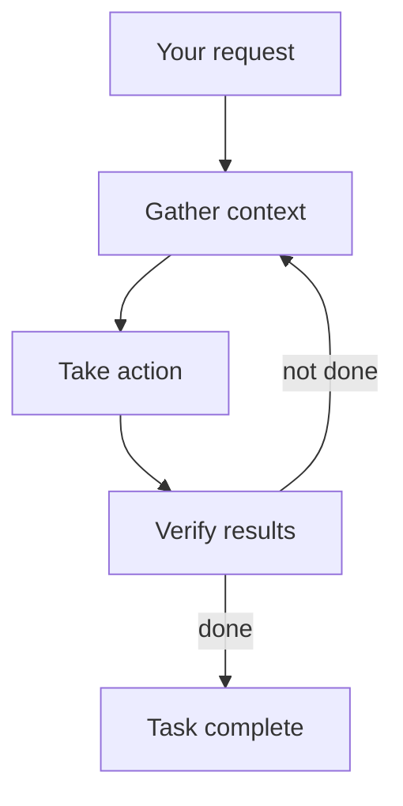
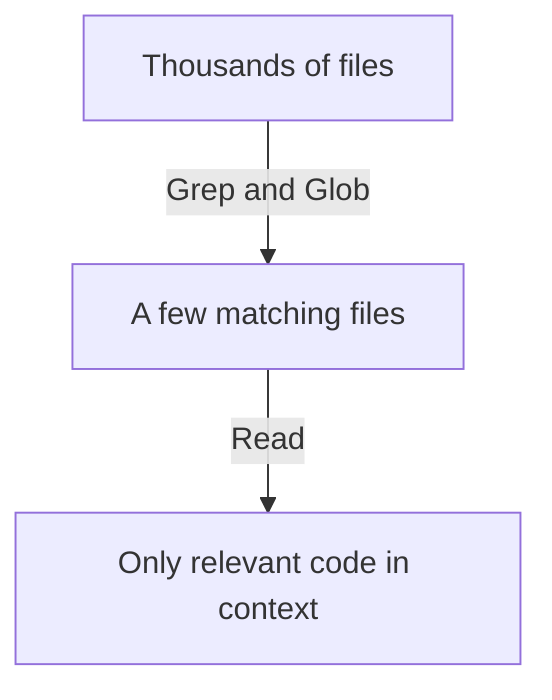
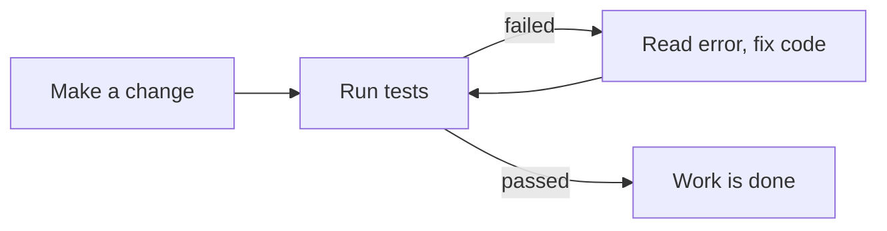

# How does Claude Code work?

> **Step 11: Agentic Engineering and Agent Frameworks** · ⏱️ 20 min read · [Read original](https://outcomeschool.com/blog/how-does-claude-code-work)

## TL;DR
Claude Code is Anthropic's terminal coding agent: the Claude model is the brain, and tools (Read, Grep, Glob, Edit, Write, Bash) are the eyes and hands. It runs a gather context, take action, verify results loop until the task is done, with CLAUDE.md for memory, permissions and checkpoints for control, plan mode, subagents and hooks. There is no magic index; it finds code with simple text search.

## Key Concepts
- **Terminal** — text window where we type commands. **Agent** — program that takes actions on its own toward a goal.
- **Claude Code** — like a new developer: told "fix the login bug", it searches, reads, fixes, runs tests.
- **Tool** — one small ability; the model only requests a tool, the tool acts, the result returns (function calling).
- **Context window** — the model's limited working memory (whiteboard); old content erased when full. Managing it is context engineering.
- **CLAUDE.md** — text file in the project read at the start of every session; standing instructions.
- **Permissions, checkpoints** — approval prompts; snapshot before every file edit so all edits are reversible.
- **Plan mode**, **Subagent** (helper with its own fresh context window), **Hook** (script run automatically on an event).
- **Reflection** — agent inspects its own output and corrects itself.

## How It Works

### Problem with a normal chatbot
We copy code into chat, copy the fix back, run tests ourselves, paste errors back: we are the messenger. The chatbot (1) cannot see the project (hundreds of files, only a pasted piece), (2) cannot do anything (only text), (3) cannot verify its answer. Claude Code adds eyes and hands (tools) to the brain.

### Agent loop
Three phases repeated until complete: **gather context** (search/read files), **take action** (edit/create files, run commands), **verify results** (run tests/program). On failure it reads the error and tries again. We can interrupt and correct at any point. Shaping the loop deliberately is Loop Engineering.

### Tools
| Tool | Does | Like a developer... |
|---|---|---|
| Read | Returns a file's content | Opening a file |
| Grep | Searches a word/pattern inside all files | "Find in all files" (Ctrl+F for whole project) |
| Glob | Finds files by name pattern (e.g. `*.js`) | Looking for a file by name |
| Edit | Changes a specific part of a file | Editing a few lines |
| Write | Creates or replaces a file | New file |
| Bash | Runs any terminal command (tests, install, git, server) | Running tests/build |

Bash is the most powerful; it lets Claude Code verify its own work.

### Example: "Fix the failing login test"
1. Bash `npm test`: one test failed, "loginUser should return a token".
2. Grep `loginUser`: found in `auth.js`.
3. Read `auth.js`: sees code forgets to return a value in one case.
4. Edit `auth.js`.
5. Bash `npm test`: all pass.
Each result feeds the next decision: gather (Bash, Grep, Read), act (Edit), verify (Bash).

### Searching a big project
Reading thousands of files would overflow the context window. So it searches first (Grep, Glob scan thousands of files fast, return a small list), then reads only the 2-3 relevant files. No special index or database: same text searches developers have used for decades; the intelligence is in the model deciding what to search.

### Verifying work
The chatbot's weakness is that code that looks correct is not proven correct. Claude Code runs tests, compiler/build, or the program, feeds errors back, and fixes, repeatedly (reflection). Giving it something to verify against helps: "Write a failing test first, then fix the code, then run the tests."

### CLAUDE.md
Each session starts with an empty context. CLAUDE.md holds rules like "We use Kotlin for all new code", "Run the tests with: ./gradlew test", "Do not edit files inside the generated/ folder". A rule that grows into a full procedure becomes an Agent Skill, loaded only when needed.

### Permissions
By default it asks before edits or state-changing commands (options: yes, yes and don't ask again for this command, no and tell Claude what to do differently).
| Mode | Behaviour |
|---|---|
| Manual (default) | Asks before every edit and command |
| Accept edits | Edits auto-approved; other commands need approval |
| Plan | Read and think only; no edits |
| Auto | No asking, background safety checks; for automated setups |

Checkpoints: snapshot before each edit; rewind anytime.

### Plan mode, subagents, hooks
- **Plan mode**: read-only exploration, then a plan ("what I will change and why"); refine via conversation, then allow implementation. Blueprint before construction; better for big changes.
- **Subagents**: own fresh context for messy exploration; return only a short summary; can run in parallel; keeps main context clean. Alternative: context compaction (summarize older history).
- **Hooks**: e.g. run formatter after every file edit. CLAUDE.md instruction = request the model follows; hook = rule the system enforces every time.

## Trade-offs & Pitfalls
- Context window limits what it can hold; use search, subagents, compaction.
- Autonomy requires safety: permissions, checkpoints, plan mode.
- Quality improves when there is something to verify against.

## FAQ
- vs chatbot? → Chatbot only produces text; Claude Code acts via tools.
- Special code index? → No, Grep and Glob.
- Changes without approval? → Not by default; checkpoints make edits reversible.
- CLAUDE.md vs hook? → Request vs enforced rule.
- Plan mode? → For big changes; read-only planning first.

## Key Takeaways
- Brain (Claude) + body (tools) connected by the agent loop.
- Gather context, act, verify, repeat.
- Search before reading to protect the context window.
- Verification by running code is the key advantage over chatbots.
- CLAUDE.md = project memory; hooks = enforced rules.
- Permissions, checkpoints and plan mode keep humans in control.
- Subagents keep the working memory clean.
