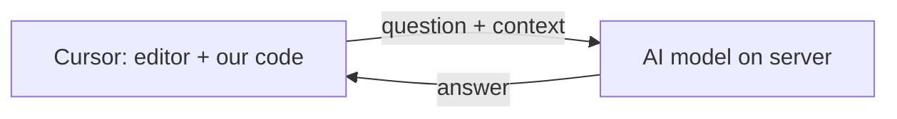
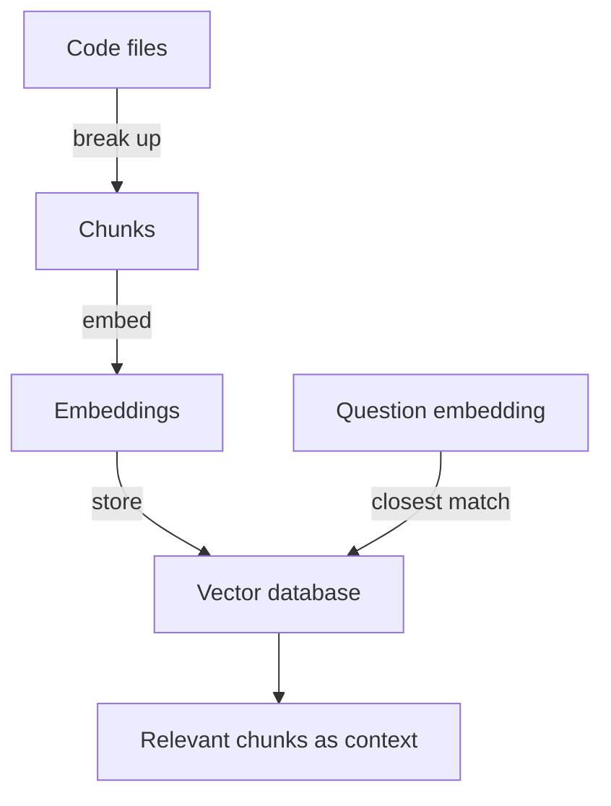
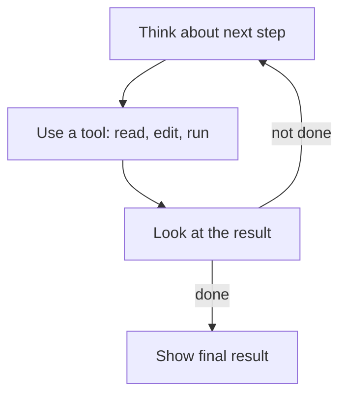

# How does Cursor work?

> **Step 11: Agentic Engineering and Agent Frameworks** · ⏱️ 18 min read · [Read original](https://outcomeschool.com/blog/how-does-cursor-work)

## TL;DR
Cursor is an AI code editor built on VS Code. It acts as a bridge: it indexes our codebase into embeddings, retrieves only the few relevant chunks as context, sends them with our question to AI models on a server, and applies the answer back via diffs. Different models handle different jobs (fast Tab, smart Chat/Agent, small Apply), and Privacy Mode limits code retention.

## Key Concepts
- **Cursor = Code Editor + AI** — VS Code base (familiar UI) plus connection to powerful AI models that read and write code (code is text).
- **Context** — the right pieces of our code sent with the question; the model has never seen our project.
- **Chunk** — small piece of a file (a function or a few related lines).
- **Embedding** — list of numbers capturing meaning; similar meaning gives similar numbers.
- **Vector database** — finds numbers close to given numbers quickly.
- **Semantic search** — search by meaning.
- **Prompt** — full message built from question plus context.
- **Tool** — action the AI may take (read file, search codebase, edit, run terminal command); more via MCP (database, issue tracker).
- **Apply model** — small fast model merging described changes into files.
- **Diff** — old lines red, new lines green.
- **Privacy Mode** — code not stored after the request.

## How It Works

### Big idea
The AI model lives on a server, not in Cursor. Cursor (1) collects context, (2) sends question plus context to the model, (3) puts the answer back into our code. Doctor-on-the-phone analogy: the model is smart but cannot see our project, so describing it well (picking the right pieces) is the real magic.

### Understanding the codebase: indexing
Problem: a project of a thousand files cannot be sent whole (slow, costly). For "Where do we check the user's password?" send the password file, not color or image files.
1. Break code into chunks.
2. Turn each chunk into an embedding.
3. Store embeddings in a vector database.
At query time: embed the question the same way, find closest chunks (semantic search), use those. Password-check and login chunks have close numbers; app-color chunks differ greatly. For most plans Cursor mainly stores these numbers, not actual code, on its servers.

### Tab autocomplete
Not just one-word completion: predicts the next full edit, possibly many lines, even changes a few lines away. A special model trained only for next-edit prediction receives the code above and below the cursor, recent changes, and related project pieces. It must respond in a fraction of a second, so a smaller, faster model is used. Example: after creating a name variable, it suggests a line greeting the user; press Tab to accept.

### Chat
1. Type question.
2. Cursor gathers context via the index, plus the current file (we can also point to files).
3. Builds the prompt (question plus context).
4. Sends it to the big model on the server.
5. Answer appears in chat.
Feels smart because of context about our actual project.

### Agent mode
Chat only talks; Agent does the work (e.g. "Add a dark mode to my app"). The model gets tools (read file, search codebase, edit, run terminal command; MCP for others) and loops: think, use tool, Cursor runs it and returns the result, think again (e.g. read settings file, edit to add dark mode option, run app to check) until done. Loop design is Loop Engineering. Cursor can ask permission before risky actions and we review changes before accepting.

### Applying changes
The big model does not rewrite the whole file (500 lines for a 10-line change is wasteful); it only describes the change. The small, fast Apply model merges it into the real file. Cursor shows a diff; Accept makes it real, Reject changes nothing, so we stay in control.

### Different models for different jobs
| Job | Model | Why |
|---|---|---|
| Tab autocomplete | Small, fast | Must appear instantly while typing |
| Chat and Agent | Big, smart | Hard thinking and code writing |
| Applying change | Small, fast Apply model | Simple, quick merge |
Big models are smart but slow and costly; small ones quick but less smart.

### Privacy
With Privacy Mode on, code is not stored by Cursor after the request; it is used only to answer. Code pieces must still be sent to the server model. The index mostly holds embeddings, not full code, adding safety.

### Complete flow
1. Index project once into embeddings.
2. While typing, fast Tab model suggests grey edits.
3. In Chat, search index, find chunks, build prompt, send to big model, show answer.
4. In Agent mode, tools in a loop until done.
5. Apply model merges changes; we accept or reject each diff.

## Trade-offs & Pitfalls
- Sending the whole project is slow and costly, hence indexing and retrieval.
- Smart models are slow, so speed-critical tasks use small ones.
- Code must reach a server; mitigated by Privacy Mode and storing embeddings.
- Risky agent actions need permission; nothing applies without Accept.

## FAQ
- Different from VS Code? → Built on it; adds AI.
- Model runs locally? → No, on a server.
- Sends whole project? → No, only relevant chunks.
- Chat vs Agent? → Chat talks; Agent uses tools in a loop.
- Changes without approval? → No; diff with Accept/Reject.

## Key Takeaways
- Cursor = VS Code + AI, acting as a bridge to server models.
- Quality depends on picking the right context.
- Indexing: chunks, embeddings, vector database, semantic search.
- Tab uses a small fast model; Chat/Agent a big one; Apply a small merger.
- Agent mode = tools in a think-act loop.
- Diffs keep you in control; Privacy Mode limits retention.
