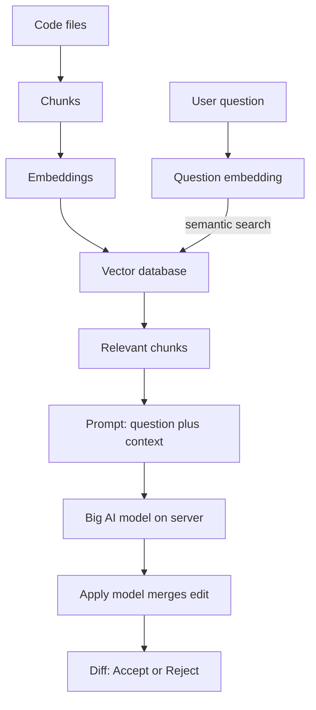

# How does Cursor work?

> **Step 11: Agentic Engineering and Agent Frameworks** · ⏱️ 18 min read · [Read original](https://outcomeschool.com/blog/how-does-cursor-work)

## TL;DR
Cursor is an AI code editor built on VS Code that acts as a bridge between our code and AI models running on a server. Its key skill is picking the right context (via a semantic index of the codebase) and using different models for Tab, Chat/Agent and applying edits.

## Key Concepts
- **Context** — The relevant code pieces sent with the question; the model has never seen our project.
- **Indexing** — Chunk code, embed each chunk, store in a vector database.
- **Embedding** — List of numbers capturing meaning; similar meaning gives close numbers.
- **Semantic search** — Embed the question and find the closest code chunks.
- **Tool** — Action the Agent may take: read, search, edit, run command (more via MCP).
- **Apply model** — Small fast model that merges a described change into the real file.
- **Diff** — Old lines in red, new in green; Accept or Reject.
- **Privacy Mode** — Code not stored after the request; index mostly holds embeddings, not full code.

## How It Works
**Architecture:** Cursor collects context, sends question plus context to the server-side model, and puts the answer back into the code (like describing symptoms to a doctor over the phone).

**Indexing:** a thousand-file project cannot be sent whole, so: break into chunks, embed, store in a vector database. A question is embedded the same way and nearest chunks are retrieved.

**Features**
- **Tab:** a small fast model predicts the next full edit (multi-line, even nearby lines) from surrounding code, recent changes and related project snippets. Speed matters most.
- **Chat:** question, then gathered context (index plus current file plus pointed files), then a prompt sent to the big model, then answer shown.
- **Agent mode:** model gets tools and loops: think, use tool, look at result, repeat until done ("Add a dark mode to my app"). Cursor can ask permission for risky actions.
- **Applying changes:** the big model only describes the edit; the Apply model merges it; user reviews the diff.

**Different models for different jobs**
| Job | Model | Why |
|---|---|---|
| Tab | Small, fast | Instant suggestions |
| Chat and Agent | Big, smart | Hard reasoning and code writing |
| Apply | Small, fast Apply model | Simple quick merge |

## Diagram

## Key Takeaways
- Cursor = VS Code + AI; the model lives on a server, Cursor is the bridge.
- Quality comes from context selection via chunking, embeddings and semantic search.
- Tab uses a fast small model; Chat/Agent use a big model; Apply merges edits.
- Agent mode is a think, act, observe loop with tools.
- Nothing changes without Accept; Privacy Mode limits code retention.
