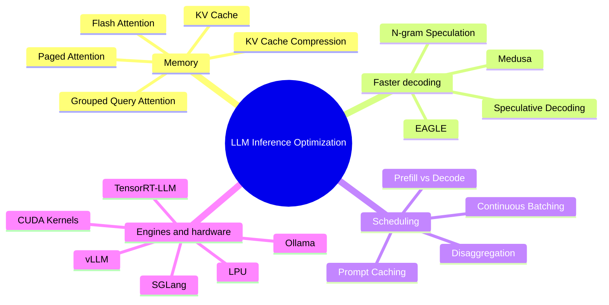

# LLM Inference Optimization

> **Step 12: LLM Inference Engineering** · ⏱️ 13 min read · [Read original](https://outcomeschool.com/blog/llm-inference-optimization)

## TL;DR
LLM Inference Optimization is the set of techniques that make an LLM generate answers faster and serve more users at lower cost. This blog is an index of the deep-dives: KV Cache, Paged Attention, Flash Attention, Speculative Decoding, Continuous Batching, and more. Each deep-dive targets a specific bottleneck in memory, compute, or scheduling.

## Key Concepts
- **KV Cache** — stores Keys and Values of past tokens so they are not recomputed per generated token.
- **KV Cache Compression** — shrinks the memory used to remember the conversation while replying.
- **Paged Attention** — fixes KV cache memory waste, borrowing paging from computer memory management.
- **Flash Attention** — faster attention via clever GPU memory use (HBM vs SRAM).
- **GQA** — Grouped-Query Attention, between MHA and MQA.
- **Speculative decoding family** — draft model, Medusa, EAGLE, N-gram speculation.
- **Continuous batching**, **Prompt caching**, **Prefill vs Decode**, **Prefill-Decode disaggregation**.
- **Serving engines / hardware** — vLLM, SGLang, TensorRT-LLM, Ollama, CUDA kernels, LPU.

## How It Works: the topic map

### Memory and attention
| Topic | What it covers |
|---|---|
| KV Cache | How LLMs generate token by token; roles of Key, Value, Query; repeated computation problem; cache stores and reuses past results |
| KV Cache Compression | Why cache gets huge; four approaches: quantization, token eviction, sharing K/V across heads, low-rank compression; comparison and when to use which |
| Paged Attention | KV cache memory waste from traditional allocation; solved by paging idea, serving many more users |
| Flash Attention | Why standard attention is slow; HBM vs SRAM; tiling; online softmax (no full matrix); recomputation in backward pass; FA2 and FA3; impact |
| Grouped Query Attention | MHA recap and its problem; MQA; GQA as generalization of MHA and MQA; comparison; real-world use; uptraining MHA to GQA |

### Faster token generation
| Topic | What it covers |
|---|---|
| Speculative Decoding | Small draft model + big target model; rejection-sampling math guarantees no quality loss; 2x to 3x speedup; trade-offs |
| Medusa | Extra heads on one model guess several future tokens, no draft model; tree attention checks many guesses at once; 2 to 3x faster |
| EAGLE | Drafts at the feature level instead of token level; feeds back the token to resolve uncertainty; EAGLE-2 dynamic draft trees |
| N-gram Speculation | Guess next words from text already seen; no draft model; output stays exactly the same; works well vs fails; compared with draft-model speculation |

### Scheduling, caching and phases
| Topic | What it covers |
|---|---|
| Continuous Batching | Static batching problem; fills GPU at every step; ride-share analogy; numeric example; speedup |
| Prompt Caching | Exact-prefix rule; cache write vs read and TTL; what to cache; benefits in assistants and agents |
| Prefill vs Decode | The two inference phases, KV cache as bridge, compute-bound vs memory-bound, TTFT/TPOT/throughput/latency, optimization mapped to phases |
| Prefill-Decode Disaggregation | Prefill and decode on separate machines; compute-heavy vs memory-heavy; co-located vs disaggregated; advantages, disadvantages, overkill cases |

### Engines and hardware
| Topic | What it covers |
|---|---|
| vLLM | KV cache eats GPU memory; PagedAttention memory sharing; continuous batching; OpenAI-compatible API server |
| SGLang | RadixAttention reuses past work; frontend language; continuous batching; structured output and faster decoding; comparison with vLLM |
| TensorRT-LLM | NVIDIA engine: build step from model to engine, kernel fusion, quantization, custom attention kernels, paged KV cache, in-flight batching, CUDA graphs, speculative decoding, multi-GPU, PyTorch backend; vs vLLM |
| Ollama | Run LLMs locally; quantization and GGUF; client/server architecture; CPU and GPU loading; Modelfile; API |
| CUDA Kernels | Why GPU, threads/blocks/grids, host vs device, first kernel, memory in CUDA, relevance to AI |
| LPU | Chip built for inference only; bottleneck is memory not math; model kept on chip; compiler removes guesswork; network never waits; LPU vs GPU |

## FAQ
- Does Speculative Decoding reduce quality? → No; rejection-sampling math guarantees no loss; about 2 to 3 times speedup.
- Speed up without a draft model? → Yes: Medusa (extra heads) or N-gram speculation.
- Prefill vs decode? → Prefill reads the prompt (compute-heavy); decode writes the answer (memory-heavy); KV cache bridges them; disaggregation puts them on separate machines.
- More users at once? → Paged Attention (memory waste) and Continuous Batching (GPU busy every step).

## Key Takeaways
- Inference optimization = faster answers, more users, lower cost.
- KV cache avoids recompute but grows large; Paged Attention and compression tackle it.
- Flash Attention speeds attention through GPU memory tiling.
- Speculative decoding (draft, Medusa, EAGLE, N-gram) speeds generation without quality loss.
- Continuous batching and prompt caching improve throughput and TTFT.
- Prefill is compute-bound, decode memory-bound; disaggregation separates them.
- vLLM, SGLang, TensorRT-LLM, Ollama are practical serving engines.
