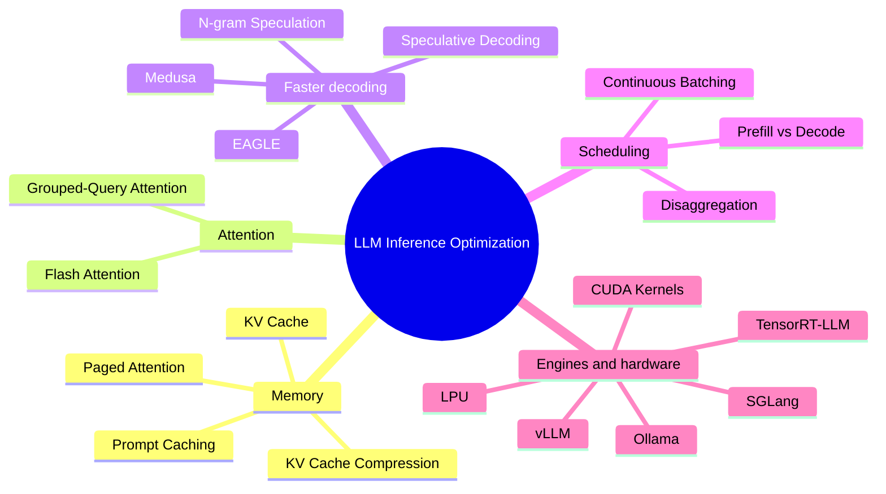

# LLM Inference Optimization

> **Step 12: LLM Inference Engineering** · ⏱️ 13 min read · [Read original](https://outcomeschool.com/blog/llm-inference-optimization)

## TL;DR
LLM Inference Optimization is the set of techniques that make an LLM generate answers faster and serve more users at lower cost. This post is a hub: it summarizes each technique and the deep-dive blog behind it (KV cache, Paged Attention, Flash Attention, Speculative Decoding, Continuous Batching and more).

## Key Concepts
- **KV Cache** — stores Keys and Values of past tokens so each step only computes the new token.
- **KV Cache Compression** — shrinks cache memory via quantization, token eviction, sharing K/V across heads, or low-rank compression.
- **Paged Attention** — stores the KV cache in small blocks, borrowing paging from operating systems, to remove memory waste.
- **Flash Attention** — makes attention fast by using GPU memory smartly (HBM vs SRAM), tiling and online softmax.
- **Grouped-Query Attention (GQA)** — middle ground between Multi-Head and Multi-Query Attention; fewer K/V heads.
- **Speculative Decoding** — small draft model guesses tokens, big target model verifies them in one pass; roughly 2x to 3x speedup, no quality loss.
- **Medusa / EAGLE / N-gram speculation** — ways to draft without a separate model (extra heads, feature-level drafting, copying from seen text).
- **Continuous Batching** — keeps the GPU busy at every generation step by refilling finished slots.
- **Prompt Caching** — reuses work for an identical prompt prefix.
- **Prefill vs Decode** — the two inference phases: compute-heavy prompt reading vs memory-heavy token writing.
- **Prefill-Decode Disaggregation** — run the two phases on separate machines.

## How It Works
The blog groups the topics into a map of the inference stack.

| Layer | Topics |
|---|---|
| Memory of past tokens | KV Cache, KV Cache Compression, Paged Attention, Prompt Caching |
| Attention math | Flash Attention, Grouped-Query Attention |
| Generating more tokens per step | Speculative Decoding, Medusa, EAGLE, N-gram Speculation |
| Scheduling many users | Continuous Batching, Prefill-Decode Disaggregation |
| Serving engines and hardware | vLLM, SGLang, TensorRT-LLM, Ollama, CUDA Kernels, LPU |

FAQ highlights from the post:
- Speculative decoding does not reduce quality; rejection sampling math guarantees it.
- You can speculate without a draft model: Medusa (extra heads) or N-gram speculation.
- Prefill reads the prompt (compute-heavy); decode writes the answer (memory-heavy); the KV cache bridges them.
- Paged Attention (memory waste) and Continuous Batching (GPU idle time) both help serve more users at once.

## Diagram

## Key Takeaways
- Inference optimization attacks three things: repeated computation, wasted memory, and idle GPU time.
- KV Cache removes recomputation; Paged Attention and compression tame the memory it consumes.
- Speculative decoding speeds up generation by about 2x to 3x without hurting output quality.
- Continuous batching and disaggregation are about serving many users efficiently.
- Prefill is compute-heavy and decode is memory-heavy, so they are optimized differently.
