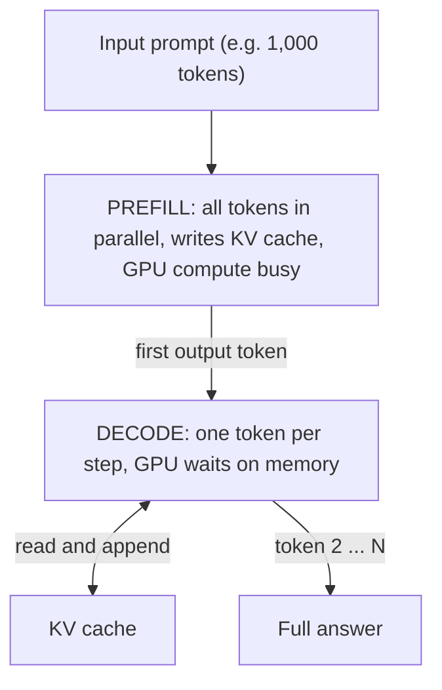
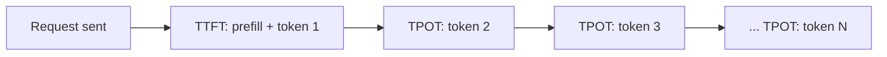
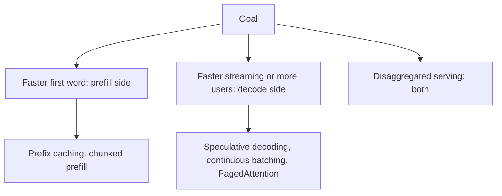

# Prefill vs Decode: LLM Inference Optimization

> **Step 12: LLM Inference Engineering** · ⏱️ 35 min read · [Read original](https://outcomeschool.com/blog/prefill-vs-decode-llm-inference-optimization)

## TL;DR
LLM inference has two phases using the same model: prefill reads the whole prompt in one parallel pass, fills the KV cache and emits the first token (compute-bound); decode generates the remaining tokens one at a time, reading and extending the cache (memory-bandwidth-bound). These opposite bottlenecks, tied to the metrics TTFT and TPOT, explain almost every serving optimization.

## Key Concepts
- **Inference** — using a trained model to answer. **Token** — chunk of text (a short sentence is about 15 to 20 tokens). **Streaming** — tokens appearing one after another. **Request** — one user's question.
- **Weights** — learned numbers; huge, occupy much GPU memory.
- **Prefill** — reads the whole prompt in parallel, writes the KV cache, outputs the first token.
- **Decode** — autoregressive: one new token per step, each feeding the next.
- **KV cache** — stored Keys and Values of past tokens (not Queries); the bridge between phases.
- **Compute-bound** — limited by math; **memory-bandwidth-bound** — limited by moving data from GPU memory to math units.
- **TTFT, TPOT/ITL, throughput, end-to-end latency, batch, batch size.**
- **Prefix**, **block table**, **draft/target model**, **pool**.

## How It Works

### The two phases
Same model, same weights; only the way they work differs. Prefill = student reading the whole question paper; decode = writing the answer word by word.

**Prefill**
- All 1,000 prompt tokens processed together (parallel); for each token compute and store K and V (the KV cache); produce only the first output token.
- Compute-bound: big matrix times big matrix suits GPUs; math units can approach 90 percent or more on large prompts.
- Longer prompts mean longer prefill; attention part grows quadratically (100 to 200 tokens makes that part about 4x bigger). Handshake analogy: room of 10 vs 100 people.
- Faster prefill means sooner first token.

**Decode**
- One token per step, strictly sequential (autoregressive). Does not reprocess the prompt: computes K and V for the one new token, reads all older K/V from cache, produces next token, appends its K/V (cache grows by exactly one entry).
- Memory-bandwidth-bound: math is a big table times a thin vector (tiny), but the GPU must read all weights plus the whole growing KV cache each step; math units idle (around 20 to 40 percent busy for one request). Chef-in-pantry analogy.
- Prefill often takes a fraction of a second; decode can take several seconds, so decode dominates total time and most optimizations target it.
- Faster decode means the rest of the answer streams faster.

One prefill pass plus N sequential decode steps (200-token answer = 1 + 200).

### KV cache as the bridge
The new token compares its Query with Keys of all previous tokens and mixes their Values. A past token's K and V never change, so compute once and store; Queries are fresh each step and not stored.
Example: prompt of 3 tokens, cache 3 entries. Decode step 1 reads 3, produces token 4, appends (4 entries); step 2 reads 4, produces token 5 (5); step 3 reads 5, produces token 6 (6). Each step computes K/V for only one token.
Without cache, step N would redo work for N earlier tokens, so total work grows roughly with the square of length; the cache makes each K/V computed exactly once.
Catch: the cache grows per token and per user; with very long contexts and many users it can exceed the model weights and fill GPU memory. This motivates KV cache compression and the optimizations below.

### Prefill vs Decode table
| Aspect | Prefill | Decode |
|---|---|---|
| Does | Processes whole prompt | Generates tokens one by one |
| Parallelism | All prompt tokens at once | Sequential |
| Steps | One big | Many small (N) |
| Math shape | Big table x big table | Big table x thin vector |
| Bottleneck | Compute-bound | Memory-bandwidth-bound |
| GPU utilization | High (90 percent+) | Low (20 to 40 percent) |
| KV cache | Writes | Reads and extends |
| Latency metric | TTFT | TPOT |
| Cost driver | Prompt length | Streaming weights + KV cache each step |

Consequences: long prompts delay the first word (more prefill math); many users' decode steps can be batched together cheaply because one decode step barely uses math. Since phases want different hardware, some systems run them on separate GPUs.

### Metrics
- **TTFT** — request to first token; mainly prefill (about prefill time + one decode step); longer prompts, larger TTFT.
- **TPOT / ITL** — average time per token after the first, set by decode. 50 ms = 20 tokens/s; 25 ms = 40 tokens/s; halving TPOT doubles streaming speed.
- **Throughput** — tokens per second across all users (system-wide); raised by batching.
- **End-to-end latency** = TTFT + (N - 1) x TPOT, where N output tokens (first counted in TTFT).
Example: TTFT 400 ms, 200 tokens, TPOT 25 ms -> 400 + 199 x 25 ms, about 5.4 s.
- TTFT/TPOT are per-user (lower is better); throughput is system-level (higher is better). Bigger batches raise throughput but worsen per-user latency; smaller batches are snappier but waste GPU. Chatbot wants low TTFT and TPOT; bulk summarization wants throughput. Prefill owns TTFT; decode owns TPOT and throughput.

### Optimizations mapped to phases
- **KV cache** (decode) — foundation; but grows and fills memory.
- **Continuous batching** (throughput) — static batching waits for the slowest request and leaves slots empty; continuous batching decides every decode step, refilling a freed slot at once (shared-taxi analogy); large throughput jump.
- **Chunked prefill** (smooth streaming) — a long prefill hogs the GPU and stalls other users' decoding; split into chunks with decode steps slipped between. Does not change total math, so does not make prefill itself faster.
- **Prefix caching / prompt caching** (prefill, TTFT) — reuse KV for a shared prefix (system instructions, same document, earlier chat turns); computed once, skipping redundant work; high hit rates cut cost; no benefit without a shared prefix (falls back to full prefill).
- **Disaggregated serving** (TTFT and TPOT) — prefill pool and decode pool; KV cache moved over a fast link; each tuned for its bottleneck, avoids prefill bursts stalling decodes. Costs: network KV transfer and duplicated model; pays off at large scale with strict targets; small setups are fine with continuous batching + chunked prefill. SGLang supports it (plus chunked prefill, prefix caching); TensorRT-LLM supports chunked prefill.
- **Speculative decoding** (decode, TPOT) — small draft model guesses several tokens, big target model verifies all in one parallel pass; correct guesses kept, first wrong one fixed, rest discarded. Works because decode is memory-bound: checking 5 tokens moves almost the same data as producing 1. Example: 5 proposed, 3 accepted + 1 fix for about one step's cost. Preserves quality (greedy gives identical tokens; sampling draws from the same distribution); about 2 to 3x decode speedup depending on acceptance. Alternatives: Medusa (extra heads), EAGLE (feature-level), N-gram (copy from prompt).
- **PagedAttention** (KV memory) — naive contiguous allocation reserves for the longest answer and wastes space; paging uses fixed-size blocks (typically 16 tokens) anywhere in memory, with a block table; blocks added only as sequences grow; shared prefixes can point to the same block. Allows bigger batches and higher throughput; foundation for prefix caching (distinct ideas: layout vs reuse). Introduced by vLLM.

| Technique | Target | Improves |
|---|---|---|
| KV cache | Decode | Avoids recomputation |
| Continuous batching | Both | Throughput |
| Chunked prefill | Others' streaming | Protects ITL from long prefills |
| Prefix caching | Prefill | TTFT |
| Disaggregated serving | Both | TTFT and TPOT independently at scale |
| Speculative decoding | Decode | TPOT |
| PagedAttention | KV memory | Throughput via bigger batches |

## Trade-offs & Pitfalls
- KV cache vs memory growth; throughput vs per-user latency; disaggregation overhead; prefix caching needs shared prefixes; chunked prefill does not speed total prefill.
- Each optimization has a dedicated deep-dive (LLM Inference Optimization index).

## FAQ
- Different models per phase? → No, same weights.
- Why does decode dominate time? → Many sequential tokens (fraction of a second prefill vs seconds of decode).
- Does the cache store Queries? → No; K and V only.
- Speculative decoding hurts quality? → No.
- Chunked prefill faster? → No; it protects ongoing answers from stalling.

## Key Takeaways
- Prefill = parallel, compute-bound, sets TTFT; decode = sequential, memory-bound, sets TPOT.
- KV cache bridges them: written by prefill, read and extended by decode.
- Latency = TTFT + (N - 1) x TPOT.
- Throughput and per-user latency trade off via batch size.
- Optimizations target a specific phase or metric.
- Speculative decoding exploits decode's idle compute; PagedAttention fixes cache waste.
- Disaggregation lets each phase hit its own target at scale.
