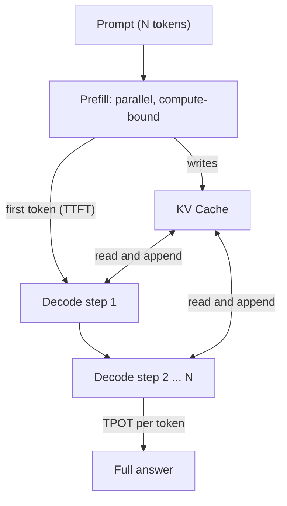

# Prefill vs Decode: LLM Inference Optimization

> **Step 12: LLM Inference Engineering** · ⏱️ 35 min read · [Read original](https://outcomeschool.com/blog/prefill-vs-decode-llm-inference-optimization)

## TL;DR
LLM inference has two phases using the same model: Prefill reads the whole prompt in parallel and produces the first token, while Decode generates the rest one token at a time reusing the KV cache. They have opposite bottlenecks (compute vs memory bandwidth), and almost every serving optimization targets one of them.

## Key Concepts
- **Token** — small chunk of text; the model generates one at a time (streaming).
- **Prefill** — processes all prompt tokens in parallel, fills the KV cache, emits first token. Compute-bound.
- **Decode** — autoregressive, one token per step, reads and extends the KV cache. Memory-bandwidth-bound.
- **KV cache** — stored Keys and Values of past tokens (never Queries); the bridge between phases.
- **TTFT** — Time To First Token; set by prefill.
- **TPOT / ITL** — Time Per Output Token / inter-token latency; set by decode.
- **Throughput** — total tokens per second across all users (system metric).

## How It Works
### Prefill
All prompt tokens are processed at once as big matrix-by-matrix multiplication, which keeps GPU math units very busy (can approach 90 percent or more). Longer prompts mean longer prefill; the attention part grows roughly quadratically (doubling the prompt about quadruples that part).

### Decode
One new token per step. The math is a big matrix times a thin vector (tiny), but the GPU must stream the entire weights and the growing KV cache from memory every step. Math units sit around 20 to 40 percent busy for a single request. Decode usually dominates total time since it runs many steps.

### KV cache growth
Each decode step computes K and V for one new token, reads all older entries, then appends one entry. Without the cache, work would grow roughly with the square of the length. The cache grows with length and with number of users, and can even exceed the weights in extreme cases.

### Comparison

| Aspect | Prefill | Decode |
|---|---|---|
| Work | Whole prompt | Output tokens one by one |
| Parallelism | Parallel | Sequential |
| Math shape | Matrix x matrix | Matrix x vector |
| Bottleneck | Compute | Memory bandwidth |
| GPU utilization | High | Low (about 20 to 40 percent) |
| KV cache | Writes | Reads and extends |
| Metric | TTFT | TPOT |

### Metrics
$$\text{E2E latency} = \text{TTFT} + (N - 1) \times \text{TPOT}$$
Example: TTFT 400 ms, 200 tokens, TPOT 25 ms gives about 5.4 s. Bigger batches raise throughput but worsen per-user TTFT/TPOT.

### Optimizations mapped to phases

| Technique | Target | Effect |
|---|---|---|
| KV cache | Decode | Avoids recomputation |
| Continuous batching | Both | Refills finished slots each step; higher throughput |
| Chunked prefill | Smoothness | Splits long prefill so others' streaming does not stutter (does not speed prefill itself) |
| Prefix caching | Prefill | Reuses KV for shared prefix; lowers TTFT |
| Disaggregated serving | Both | Separate GPU pools for prefill and decode; costs KV transfer and model duplication |
| Speculative decoding | Decode | Draft guesses verified in one pass; about 2x to 3x, quality preserved |
| PagedAttention | KV memory | Fixed-size blocks (typically 16 tokens) plus block table; bigger batches |

## Diagram

## Key Takeaways
- Same model and weights in both phases; only the access pattern differs.
- Prefill is compute-bound and owns TTFT; decode is memory-bound and owns TPOT and throughput.
- KV cache stores only K and V, written by prefill, extended by decode, and it eats GPU memory.
- End-to-end latency = TTFT + (N - 1) x TPOT.
- Pick optimizations by metric: prefix caching for TTFT, speculative decoding for TPOT, batching and paging for throughput.
- Chunked prefill protects other users' streaming but does not make prefill faster.
