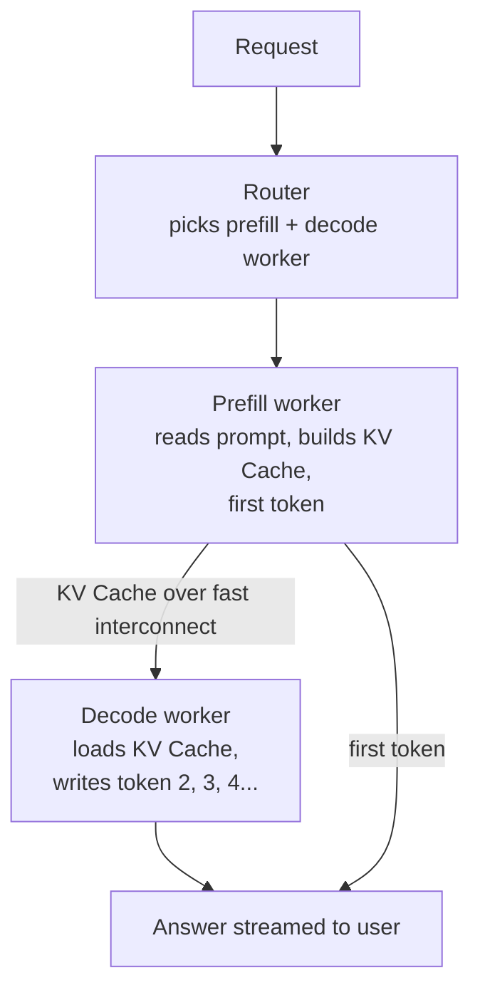
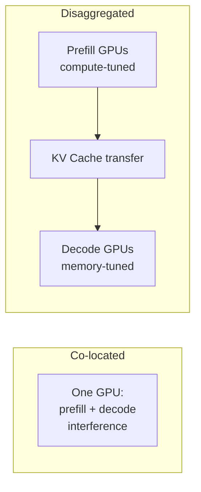

# What is Prefill-Decode Disaggregation in LLM Inference?

> **Step 12: LLM Inference Engineering** · ⏱️ 22 min read · [Read original](https://outcomeschool.com/blog/prefill-decode-disaggregation)

## TL;DR
Prefill-Decode Disaggregation runs the prompt-reading phase (prefill) and the answer-writing phase (decode) on separate GPU groups. Prefill is compute-bound and decode is memory-bound, so sharing one GPU makes them interfere. Splitting them lets each phase get its own hardware and scaling, at the cost of shipping the KV Cache over a fast network.

## Key Concepts
- **Token** — a word or part of a word; LLMs read and write tokens.
- **Prefill** — read the whole prompt at once, build the KV Cache, produce the first token.
- **Decode** — write the answer one token at a time, repeating until done (streaming).
- **KV Cache** — the "notes" (Keys and Values per token) made during prefill and read during decode, so the prompt is not re-read per token. Can be many GB for long prompts.
- **Co-located serving** — one GPU does both phases for every request.
- **Batching** — GPU handles many requests together.
- **Generation stall / interference** — one user's big prefill freezes the decode of everyone else.
- **TTFT (Time To First Token)** — wait before the answer starts; set mostly by prefill.
- **TPOT (Time Per Output Token)** — gap between tokens; set by decode.
- **Disaggregation** — un-joining; separating the two phases onto different GPUs.
- **Interconnect** — very fast link between machines (NVLink, InfiniBand, RDMA).

## How It Works

### Why the phases differ
- Prefill is **compute-heavy**: thousands of prompt tokens processed at once, compute units fully busy. Limited by how fast the GPU can think.
- Decode is **memory-heavy**: one token per step means little maths, but every step must read all weights and the whole KV Cache from memory, so compute sits idle. Limited by memory fetch speed.
- Analogy: chef reads a 10-page recipe and makes notes (prefill, brainpower), then cooks step by step walking to the shelf (decode, data movement).

### The problem in co-located serving
- 10 users are mid-decode; an 11th sends a 10,000-token prompt. Its prefill takes about 1 s, and the other 10 freeze mid-sentence.
- The reverse also holds: if the GPU is busy decoding, a new prefill waits and TTFT rises.
- Optimising one metric hurts the other: prioritise prefill, TTFT good but TPOT bad; prioritise decode, TPOT good but TTFT bad.
- Example: TTFT 500 ms and TPOT 30 ms means the answer starts in half a second, then about 30 tokens per second.

### Naive approaches
| Approach | Why it falls short |
|---|---|
| More GPUs, each doing both | Interference remains inside each GPU, just less often, at high cost; hardware cannot be tuned per phase |
| Chunked prefill (mix small prefill chunks into decode batches) | Used in real systems, but still shares a GPU: every decode step carries extra prefill so TPOT rises, and prefill finishes slower so TTFT rises. Spreads the pain |

### The disaggregated setup
1. **Router** — receives each request, picks a prefill worker and a decode worker.
2. **Prefill workers** — only prefill; process the prompt, build the KV Cache, produce the first token; tuned for compute.
3. **Decode workers** — only decode; receive the KV Cache and generate tokens; tuned for memory access and many users at once.
4. **KV Cache transfer** — the bridge; the cache is sent over the network to the decode worker. It must be fast or the benefit is lost.

```python
def handle_request(prompt):
    first_token, kv_cache = prefill_worker.prefill(prompt)
    send_to_user(first_token)
    decode_worker.load(kv_cache)      # over the network
    while not finished:
        send_to_user(decode_worker.decode_step())
```

SGLang supports this out of the box.

### Walkthrough (4000-token prompt, 200-token answer)
1. Router picks the least-loaded prefill worker and reserves a decode slot.
2. Prefill processes all 4000 tokens together (about 400 ms), giving the first token and about 2 GB KV Cache.
3. First token sent: TTFT is about 400 ms.
4. 2 GB cache copied over the interconnect (about 20-50 ms); often streamed in pieces during prefill to hide the wait.
5. Decode worker produces tokens at about 20 ms each: TPOT 20 ms, 200 tokens in about 4 s.
6. Prefill worker is already free for the next prompt.
7. Decode worker is never interrupted because no prefills run on it.

### Diagrams

#### Request flow


#### Co-located vs disaggregated


## Co-located vs Disaggregated
| Point | Co-located | Disaggregated |
|---|---|---|
| Prefill / decode location | Same GPU | Separate workers |
| Interference | Yes, prefill stalls decode | No |
| TTFT and TPOT | Trade-off | Tuned separately |
| Scaling | Both together | Each independently |
| Hardware | One GPU type for both | Different type per phase |
| KV Cache transfer | Not needed | Every request |
| Network | None special | Fast interconnect a must |
| Complexity | Low | High |
| Best for | Small scale, single GPU, short prompts | Large scale, many users, long prompts |

## Trade-offs & Pitfalls
**Advantages**
- Independent scaling: long prompts and short answers need more prefill workers; the opposite needs more decode workers.
- No interference; predictable latency, no random mid-answer freezes.
- Different hardware: strongest compute for prefill; faster, bigger, often cheaper memory GPUs for decode.
- Better batching: decode workers pack many users into big batches, so cost per token drops.

**Disadvantages**
- KV Cache transfer is gigabytes per request for long prompts; slow networks erase the gain.
- Needs NVLink/InfiniBand-class links, which adds cost.
- Complexity: router, two worker types, transfer system, failure handling. A decode worker crash loses the KV Cache and the request is redone.
- Idle capacity: traffic mix changes leave prefill or decode workers idle or overloaded, so monitoring and balancing are needed.
- Overkill at small scale.

**Works well when:** many users (public chat), long prompts (documents, histories, code) with streaming, users care about both TTFT and TPOT, fast interconnect exists (data centre).
**Overkill when:** single GPU or laptop, very few users, short prompts and tiny KV Cache, no fast networking. Chunked prefill on one GPU is the simpler choice there.

## FAQ
- More GPUs fix interference? → No; each still fights internally, just less often.
- Chunked prefill an alternative? → Fine for small setups; spreads pain (TPOT and TTFT both rise slightly). Disaggregation for large.
- Why a fast interconnect? → Gigabytes of KV Cache move per request.
- Different GPUs per phase? → Yes, compute-strong for prefill, memory-strong for decode.
- Decode worker crash? → KV Cache lost, request redone.

## Key Takeaways
- Prefill is compute-bound; decode is memory-bound; they stress different parts of the GPU.
- On one GPU, a long prefill stalls everyone else's decode (generation stall).
- TTFT is driven by prefill, TPOT by decode; co-location forces a trade-off.
- Disaggregation = prefill workers + decode workers + router + KV Cache transfer.
- The KV Cache hand-off needs a fast interconnect (NVLink, InfiniBand, RDMA) or the gain disappears.
- Benefits: independent scaling, per-phase hardware, no interference, better batching.
- Costs: complexity, transfer overhead, idle capacity; overkill for small scale.
