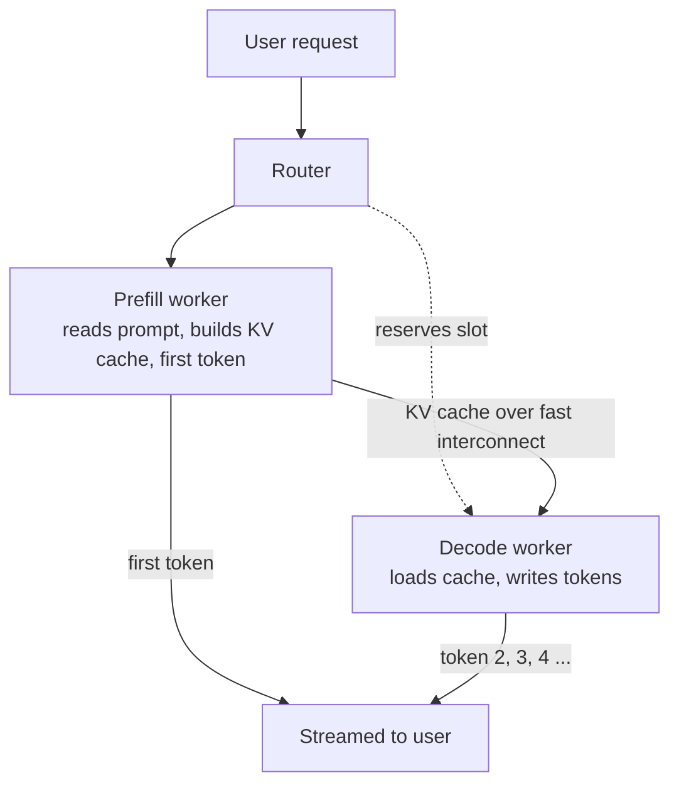

# What is Prefill-Decode Disaggregation in LLM Inference?

> **Step 12: LLM Inference Engineering** · ⏱️ 22 min read · [Read original](https://outcomeschool.com/blog/prefill-decode-disaggregation)

## TL;DR
Prefill-Decode Disaggregation runs prompt reading (prefill) and answer writing (decode) on separate GPU pools so each can be tuned for its own bottleneck. It removes the interference where one user's long prefill stalls everyone else's decode, at the cost of moving the KV cache across the network.

## Key Concepts
- **Prefill** — reads the whole prompt at once, builds the KV cache, produces the first token; compute-heavy.
- **Decode** — writes tokens one at a time; memory-heavy because weights and KV cache are read each step.
- **KV Cache** — the "notes" made during prefill and read during decode; can be gigabytes for long prompts.
- **Co-located serving** — one GPU does both phases.
- **Generation stall (interference)** — a long prefill freezes ongoing decodes of other users.
- **TTFT / TPOT** — time to first token (prefill) and time per output token (decode).
- **Interconnect** — fast links (NVLink, InfiniBand, RDMA) used to copy the KV cache between machines.

## How It Works
### The problem
In co-located serving, ten users mid-decode freeze for about a second when an eleventh sends a 10,000-token prompt. Prioritizing prefill gives good TTFT but bad TPOT; prioritizing decode does the reverse.

### Naive fixes
- **More GPUs, each doing both** — interference remains, just less frequent, and hardware cannot be specialized.
- **Chunked prefill** — mixes small prefill chunks into decode batches; spreads the pain (TPOT and TTFT both rise a little) rather than removing it.

### Disaggregation components
1. **Router** — picks a prefill worker and a decode worker per request.
2. **Prefill workers** — compute-tuned; read prompt, build KV cache, emit first token.
3. **KV cache transfer** — sends cache over the interconnect; often streamed in pieces during prefill to hide latency.
4. **Decode workers** — memory-tuned; load the cache and stream tokens, batching many users.

Walkthrough (example numbers): 4000-token prompt, TTFT about 400 ms, 2 GB cache transferred in about 20 to 50 ms, then 200 tokens at about 20 ms TPOT. The prefill worker is freed immediately; the decode worker is never interrupted.

### Co-located vs disaggregated

| Point | Co-located | Disaggregated |
|---|---|---|
| Interference | Yes | No |
| TTFT and TPOT | Trade-off | Tuned separately |
| Scaling | Together | Independently |
| Hardware | One GPU type | Different per phase |
| KV transfer | None | Every request |
| Complexity | Low | High |
| Best for | Small scale, short prompts | Large scale, long prompts |

**Pros:** independent scaling, no interference, specialized hardware, better decode batching, predictable latency.
**Cons:** transfer cost, needs fast interconnect, complexity (a crashed decode worker loses the cache), possible idle capacity, overkill at small scale.

## Diagram

## Key Takeaways
- Prefill stresses GPU compute; decode stresses GPU memory; sharing one GPU makes them fight.
- Disaggregation gives each phase its own pool so TTFT and TPOT can both be low.
- The KV cache transfer is the price, so a fast interconnect is a must.
- Great for large-scale, long-prompt, streaming workloads; overkill for a single GPU, where chunked prefill is enough.
- Adding GPUs alone does not fix interference.
