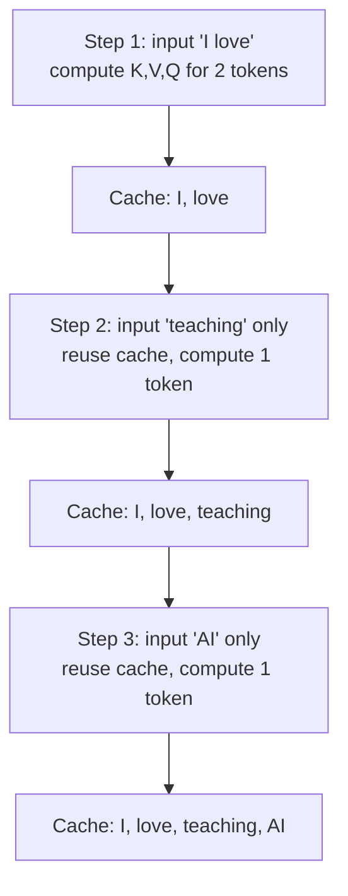

# What is KV Cache in LLMs?

> **Step 12: LLM Inference Engineering** · ⏱️ 12 min read · [Read original](https://outcomeschool.com/blog/kv-cache-in-llms)

## TL;DR
KV Cache stores the Key and Value of every already-processed token so the model computes them only once and reuses them at every later step. It removes massive repeated computation during token-by-token generation, trading extra memory for speed.

## Key Concepts
- **Token** — small piece of text (word, part of word, character).
- **Attention layer** — heart of the Transformer; decides which previous tokens matter for the next one.
- **Query (Q)** — what the current token is looking for ("who knows this topic?").
- **Key (K)** — name tag of each previous token: what information it holds.
- **Value (V)** — the actual notes/information a previous token carries.
- **Attention scores** — Query compared against all Keys; higher means more relevant; used to collect Values.
- **KV Cache** — memory holding K and V of all processed tokens.
- **Attention sinks** — first few tokens kept alongside a recent window to bound cache size.
- **Prompt Caching** — reusing cached K/V across requests sharing the same starting text.

## How It Works

### Generation is token by token
"I love" gives "teaching"; "I love teaching" gives "AI"; and so on until the model stops. Every new prediction looks at all previous tokens. This happens in two phases, prefill and decode, with the KV Cache bridging them.

### The problem: repeated computation
Without a cache, each step recomputes K, V, Q for the whole sequence:
- Step 1 computes "I", "love".
- Step 2 recomputes "I", "love" and computes "teaching".
- Step 3 recomputes "I", "love", "teaching" and computes "AI".
Cost grows with sequence length; at 100 tokens, 100 old tokens are recomputed just to predict one.

### The fix
Compute K and V once per token, store, reuse.
1. Step 1: compute K, V, Q for "I", "love"; save K, V of both; predict "teaching".
2. Step 2: input is only "teaching". Fetch K, V of "I", "love" from cache; compute K, V, Q only for the new token; save its K, V; predict "AI".
3. Step 3: input is only "AI"; same pattern; cache now holds I, love, teaching, AI.

The new token still gets its own K, V, Q computed; only previous tokens are skipped.

### Why K and V but not Q
Q is needed only for the token being generated now; once the prediction is done it is useless. K and V of every past token are needed at every future step.

### Speed gain
```
Without cache: step N computes for N+1 tokens (N recomputed)
With cache:    step 1 computes 2 tokens, every later step computes 1 token
```
For 100 tokens: 2+3+...+100 = 5,049 computations vs 2+1+...+1 = 101, roughly 50x fewer. Savings grow with length.



## Trade-offs & Pitfalls
- Speed vs memory: cache grows with every token; long sequences use significant memory.
- Never-ending chats: keep a recent window plus first few attention sinks to keep a fixed size (one of several KV Cache Compression techniques; others keep every token).
- Serving many users makes cache memory management critical (vLLM); Paged Attention solves the cache memory problem (next blog).
- KV Cache itself does not solve the memory problem; it saves compute.

## FAQ
- New token still computed? → Yes, K, V, Q for the new token; only old tokens are skipped.
- Reuse across requests? → Yes, Prompt Caching for shared starting text.
- Stop unbounded growth? → Sliding window plus attention sinks, or other compression methods.

## Key Takeaways
- LLMs generate one token at a time and each step needs all earlier tokens.
- Without a cache, K and V of old tokens are recomputed every step.
- KV Cache stores K and V once and reuses them; only the new token is computed.
- Q is not cached because it is only used for the current token.
- 100-token example: 5,049 vs 101 computations, about 50x fewer.
- The price is memory that grows with sequence length.
- Prompt Caching extends the idea across requests.
