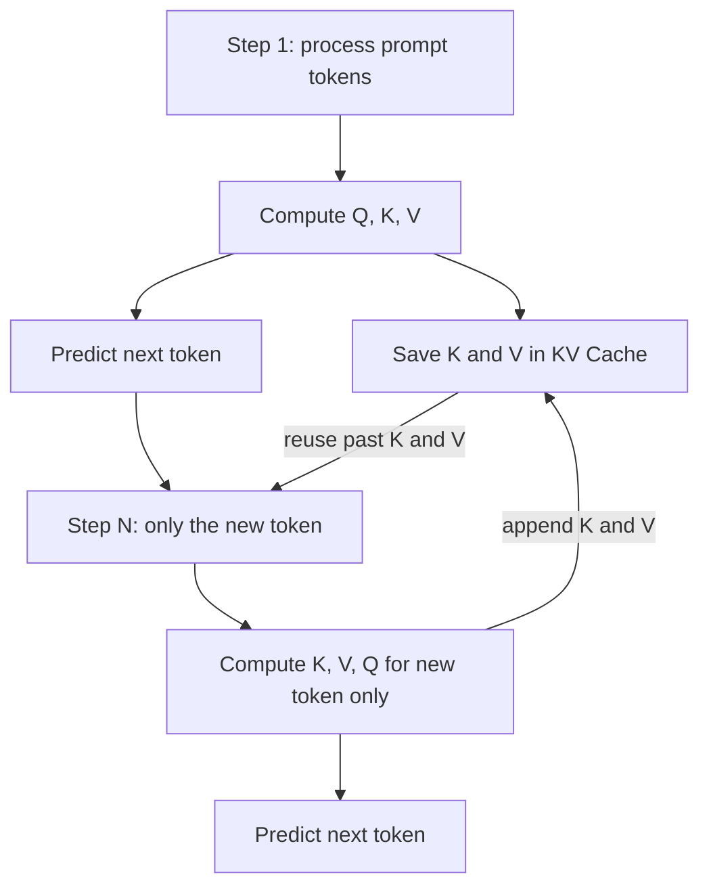

# What is KV Cache in LLMs?

> **Step 12: LLM Inference Engineering** · ⏱️ 12 min read · [Read original](https://outcomeschool.com/blog/kv-cache-in-llms)

## TL;DR
KV Cache stores the Key and Value of every token already processed so the model does not recompute them at each generation step. It makes text generation dramatically faster at the cost of extra memory that grows with sequence length.

## Key Concepts
- **Token-by-token generation** — the model predicts one token, appends it, and repeats until it decides to stop.
- **Query (Q)** — what the current token is looking for.
- **Key (K)** — label describing what a past token holds.
- **Value (V)** — the actual information a past token carries.
- **Attention scores** — Query compared with all previous Keys; they weight the Values collected.
- **KV Cache** — stored K and V for all past tokens, reused each step.

## How It Works
### The problem
At each step the attention layer needs K and V of all earlier tokens. Without caching, the model recomputes them every time. Example with "I love teaching AI": the K and V for "I" are computed in step 1, then again in step 2, and again in step 3.

### The fix
Compute K and V once per token, save them, reuse forever.
- Step 1: process "I love", cache K,V for both, predict "teaching".
- Step 2: input is only "teaching"; fetch cached K,V for "I", "love"; compute and cache K,V for "teaching"; predict "AI".
- Step 3: same, only "AI" is new.

The new token still gets its own Q, K and V computed; only past work is skipped.

### Why not cache Q?
Q is used only by the token being generated right now and is discarded afterward. K and V of past tokens are needed at every future step.

### Savings
For 100 tokens: without cache, 2 + 3 + ... + 100 = 5,049 computations; with cache, 2 + 1 + ... + 1 = 101. Roughly 50 times fewer, and the gap widens with length.

### Trade-off: speed vs memory
The cache grows with sequence length and can consume a lot of memory. Mitigations mentioned:
- Sliding window of recent tokens plus first few attention sinks (fixed-size cache).
- KV Cache Compression techniques.
- Paged Attention and serving systems like vLLM for managing memory across users.
- Prompt Caching reuses cached K,V across requests sharing the same starting text.

## Diagram

## Key Takeaways
- Past tokens' Keys and Values never change, so compute them once and cache them.
- Only K and V are cached; the Query is needed only for the current token.
- Savings grow with length: about 50 times fewer computations in the 100-token example.
- It trades memory for compute; the cache grows with every token and every user.
- Paged Attention, compression and sliding windows address the memory side.
