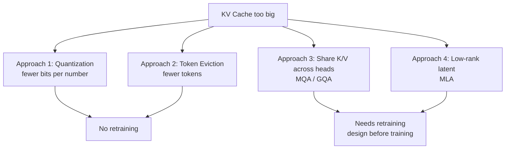

# What is KV Cache Compression?

> **Step 12: LLM Inference Engineering** · ⏱️ 21 min read · [Read original](https://outcomeschool.com/blog/kv-cache-compression)

## TL;DR
KV Cache Compression is a set of techniques that shrink the memory an LLM uses to remember past tokens, while keeping output quality almost unchanged. Four approaches: quantization (fewer bits), token eviction (fewer tokens), sharing K/V across heads (GQA/MQA), and low-rank latent compression (MLA). They can be combined.

## Key Concepts
- **Token** — small piece of text; the model writes one per step and looks back at all previous ones via Attention.
- **Attention** — how the model decides which previous tokens matter. Q (what the current token seeks), K (label a previous token offers), V (information it carries); each a vector. Query is compared to Keys, and Values are combined by match. Library analogy: question = Q, book spine = K, contents = V.
- **Layers and heads** — many stacked layers, each with many attention heads (each head looks for different things: grammar, names, what "it" refers to).
- **KV Cache** — stores K and V of all previous tokens, since they never change once computed. New token: compute only its K, V, append, read the rest.
- **Heavy hitters** — tokens with highest accumulated attention (H2O).
- **Attention sink** — first few tokens that absorb leftover attention (StreamingLLM).
- **Latent vector** — small hidden compressed form of K and V (MLA).

## How It Works

### Why the cache gets huge
Example (close to Llama 2): 32 layers, 32 heads, K = 128 numbers, V = 128 numbers per head, 16 bits (2 bytes) each.

$$
\text{per token} = 2 \times \text{layers} \times \text{heads} \times \text{head\_dim} \times \text{bytes}
$$

- Per head: 256 numbers; x32 heads = 8,192; x32 layers = 262,144 numbers; x2 bytes = 524,288 bytes = **0.5 MB per token**.
- 4,000-token chat = 2 GB. 100,000-token document = 50 GB for one user.
- GPUs have 24-80 GB, and a big part is already taken by the model. 100 concurrent users means far beyond any GPU.
- Also a speed issue: each new token reads the full cache from memory, so bigger cache means slower generation.
- Paged Attention fixes wasted memory in serving; compression makes the cache itself smaller.

### Approach 1: Quantization
Store each number in fewer bits (16 to 8 gives 1/2; 16 to 4 gives 1/4). Example: Key `[0.31, -0.72, 0.05, 0.98]`, scale = max abs / 127 = 0.98/127, quantized = round(v/scale) = `[40, -93, 6, 127]`; store the scale to recover approximations.
- Pros: simple, no tokens lost, small quality loss.
- Cons: below 4 bits rounding error grows and answers worsen; cache still grows per token.
- Keys have a few positions with very large values, so Keys and Values are quantized differently (KIVI).

### Approach 2: Token Eviction
Drop K/V of unimportant tokens (like remembering the key characters and last pages of a novel). Most attention goes to a few tokens.
Rule: fix a budget (e.g. 1,000 tokens), always keep recent tokens, keep heavy hitters from older ones (running total of attention received, H2O), discard the rest.
- Attention sink: attention must sum to 100 percent, so the model dumps unwanted attention on the first token(s) even if meaningless. Evicting them wrecks output (StreamingLLM). Final rule: keep first few + recent + heavy hitters from the middle.
- Pro: fixed cache size regardless of length; the only approach that truly stops unbounded growth.
- Con: evicted info is gone forever; fails on exact recall (e.g. "phone number on page 40"); fine for chat and summarising.

### Approach 3: Sharing K/V across heads (changes model design, before training)
Only Queries need to differ per head (32 students, one shelf of books).
- **MQA** — all heads share one K and one V: 32x smaller, some quality loss.
- **GQA** — heads grouped, one K/V per group (32 heads in 8 groups: 4x smaller). Middle ground, near-full quality; used by Llama 3, Mistral, Gemma.
- Pros: no token loss, no rounding error, always on. Cons: must be decided before training (retrain needed); cache still grows per token.

### Approach 4: Low-Rank Compression (MLA)
Store one small latent vector per token (like a zip), expand with learned matrices when needed. Example: 8,192 numbers per layer per token become a 512-number latent: 16x smaller. Multi-Head Latent Attention, introduced by DeepSeek-V2 and used in V3. Trained with compression from the start, so the latent keeps only useful info.
- Pros: huge saving, no token loss, quality as good as full attention (sometimes better). Cons: must be built in before training; small extra compute to expand.
- DeepSeek-V4 goes further by merging several consecutive tokens into one compressed entry.

## Comparison
| | Quantization | Token Eviction | Sharing across Heads | Low-Rank |
|---|---|---|---|---|
| Saves by | Fewer bits | Fewer tokens | Fewer K/V per layer | Smaller vector per token |
| Retraining | No | No | Yes | Yes |
| Drops tokens | No | Yes | No | No |
| Typical saving | 2x-4x | Fixed size | 4x-8x | 10x or more |
| Quality loss | Very less | Task dependent | Very less | Almost none |
| Example | KIVI | H2O, StreamingLLM | GQA, MQA | MLA (DeepSeek) |

They compose: MLA design, then quantize latents, then evict on top.

## When to use which
- Existing model, quick win: Quantization.
- Endless/very long streams: Token Eviction with attention sinks.
- Need exact recall of a long document: no eviction; use quantization or a GQA/MLA model.
- Training a new model: GQA or MLA from day one.
- Maximum saving: combine all.

## Trade-offs & Pitfalls
- Quantization floor around 4 bits; eviction is lossy and irreversible; GQA/MLA can't be retrofitted.
- Smaller cache also speeds generation (less memory read per token), not just saves memory.
- Never evict the first tokens.
- Paged Attention is not a compression technique.

## Key Takeaways
- KV cost per token = 2 x layers x heads x head_dim x bytes (0.5 MB in the example).
- Cache grows with length and users, eats GPU memory, and slows reads.
- Quantization: fewer bits; Eviction: fewer tokens; GQA/MQA: fewer K/V sets; MLA: latent vector.
- Attention sinks (first tokens) must be kept.
- GQA and MLA need training-time design; quantization and eviction apply to existing models.
- Approaches are complementary and can be stacked.
