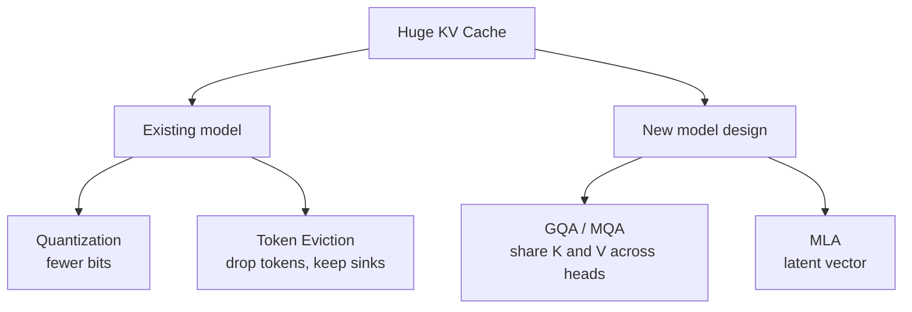

# What is KV Cache Compression?

> **Step 12: LLM Inference Engineering** · ⏱️ 21 min read · [Read original](https://outcomeschool.com/blog/kv-cache-compression)

## TL;DR
KV Cache Compression is a family of techniques that shrink the memory an LLM uses to remember the conversation, so it can handle longer text and more users on the same GPU. The four approaches are quantization, token eviction, sharing K/V across heads, and low-rank compression.

## Key Concepts
- **KV Cache** — stored Keys and Values of all previous tokens; K and V never change once computed.
- **Attention head** — a separate "reader" in a layer; each normally has its own K and V.
- **Quantization** — store each cached number in fewer bits (16 to 8 or 4).
- **Token eviction** — drop K/V of unimportant tokens (H2O heavy hitters, StreamingLLM).
- **Attention sink** — first few tokens soak up leftover attention; never evict them.
- **MQA / GQA** — heads share K/V (one set, or one set per group).
- **MLA (Multi-Head Latent Attention)** — store a small latent vector and expand it when needed (DeepSeek-V2/V3).

## How It Works
### Why the cache gets huge
Llama-2-like model: 32 layers, 32 heads, 128-dim K and V, 2 bytes per number.
$$\text{per token} = 2 \times 32 \times 32 \times 128 \times 2 = 524{,}288 \text{ bytes} \approx 0.5\text{ MB}$$
4,000 tokens is about 2 GB; 100,000 tokens is about 50 GB for a single user. It grows with length and users, and a bigger cache also means slower reads each step.

### The four approaches
1. **Quantization** — scale values by max/127 and round, e.g. `[0.31, -0.72, 0.05, 0.98]` becomes `[40, -93, 6, 127]`. 8-bit halves, 4-bit quarters the cache. Keys and Values are quantized differently (KIVI). Below 4 bits error grows; cache still grows per token.
2. **Token eviction** — fixed budget (e.g. 1,000 tokens): keep first few (sinks), recent tokens, and heavy hitters from the middle. Fixed cache size, but evicted info is gone forever, so exact recall tasks fail.
3. **Sharing across heads** — MQA: all heads share one K/V (32x smaller in example). GQA: 8 groups instead of 32 (4x smaller); used by Llama 3, Mistral, Gemma. Must be decided before training.
4. **Low-rank (MLA)** — one latent vector (example 512 numbers vs 8,192 per layer per token, 16x smaller), learned during training so little is lost. Needs training; small extra compute to expand.

| | Quantization | Eviction | Head sharing | Low-rank |
|---|---|---|---|---|
| Saves by | Fewer bits | Fewer tokens | Fewer K/V sets | Smaller vector |
| Retraining | No | No | Yes | Yes |
| Drops tokens | No | Yes | No | No |
| Typical saving | 2x to 4x | Fixed size | 4x to 8x | 10x or more |
| Examples | KIVI | H2O, StreamingLLM | GQA, MQA | MLA |

They can be combined (MLA, then quantize latents, then evict).

## Diagram

## Key Takeaways
- KV cache size per token = 2 x layers x heads x head_dim x bytes; it scales with length and users.
- Quantization is the easiest add-on for an existing model.
- Eviction gives a fixed-size cache but risks forgetting; always keep attention sinks.
- GQA/MQA and MLA must be built in before training and lose no tokens.
- Paged Attention is not compression; it stops wasting memory rather than shrinking the cache.
