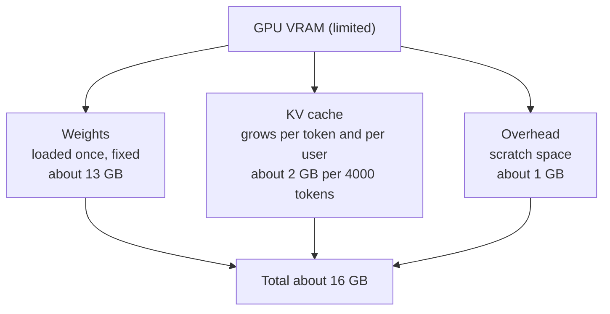

# How does an LLM use GPU memory?

> **Step 12: LLM Inference Engineering** · ⏱️ 14 min read · [Read original](https://outcomeschool.com/blog/llm-gpu-memory)

## TL;DR
An LLM's GPU memory is used by three things: VRAM = weights + KV cache + overhead. Weights are fixed once loaded, the KV cache grows with tokens and users, and overhead is unavoidable scratch space. Shrink any of the three to fit a model on a smaller GPU.

## Key Concepts
- **VRAM** — fast working memory next to the GPU (typically 16, 24, 40, 80 GB); everything the GPU works on must sit in it (cook = GPU, counter = VRAM).
- **Weights / parameters** — learned numbers (the model's knowledge); fixed during chat; loaded once at start. "7B parameters" = 7 billion weights.
- **FP16 (half precision)** — 2 bytes per number.
- **KV cache** — saved Key and Value for every past token so they are not recalculated; grows with every token.
- **Layer** — one processing stage; each layer keeps its own K and V per token.
- **Overhead** — temporary results, GPU software memory, reserved blocks; never zero.

## How It Works

### Weights

$$
\text{weights memory} = \text{params} \times \text{bytes per weight}
$$

7B x 2 bytes = 14 billion bytes, which is about 13 GB (divide by 1024^3). So loading a 7B FP16 model needs about 13 GB VRAM.

### KV cache

$$
\text{KV bytes} = 2 \times \text{tokens} \times \text{layers} \times \text{hidden size} \times \text{bytes}
$$

2 = Key and Value; tokens = one entry each; layers = each keeps a copy.
Example: 4000 tokens, 32 layers, hidden 4096, 2 bytes gives about 2 GB. Assumes every head has its own K/V (like Llama 2 7B); models that share K/V across heads have smaller caches.
10 users x 4000 tokens = about 20 GB for KV cache alone. Long chats and many users fill the GPU fast.

### Overhead
Roughly 1-2 GB, or 10-20 percent of total; keep a buffer.

### Worked example (7B, FP16, one user, 4000 tokens)
| Part | Meaning | Memory |
|---|---|---|
| Weights | Learned knowledge | about 13 GB |
| KV cache | Conversation short-term memory | about 2 GB |
| Overhead | Scratch space | about 1 GB |
| Total | | about 16 GB |

So a 24 GB GPU is a common choice for 7B in FP16.

### How to reduce memory
1. **Quantization** — fewer bytes per weight; 1 byte gives about 6.5 GB for 7B instead of 13 GB, slightly less precise.
2. **Limit conversation length** — keeps KV cache smaller (see KV Cache Compression for more).
3. **Smaller model** — 3B needs less than 7B.
4. **Better KV cache handling** — store in small blocks (paged), wasting little memory, serving more users per GPU.

## Trade-offs & Pitfalls
- Quantizing loses a little precision.
- Weights memory does not grow with conversation; KV cache does.
- Overhead cannot be zeroed; budget a buffer.

## FAQ
- Do weights grow with conversation? → No, only KV cache.
- Why many users need more memory? → Each has its own KV cache (10 x 2 GB = 20 GB).
- Fit 7B on smaller GPU? → Yes via quantization (about 6.5 GB weights at 1 byte).
- Overhead zero? → No.

## Key Takeaways
- VRAM = weights + KV cache + overhead.
- 7B FP16 weights is about 13 GB (params x bytes).
- KV cache scales with tokens, layers, hidden size, and users.
- 7B, one 4000-token user is about 16 GB total.
- Overhead is about 1-2 GB or 10-20 percent.
- Reduce via quantization, shorter context, smaller model, block-based KV handling.
