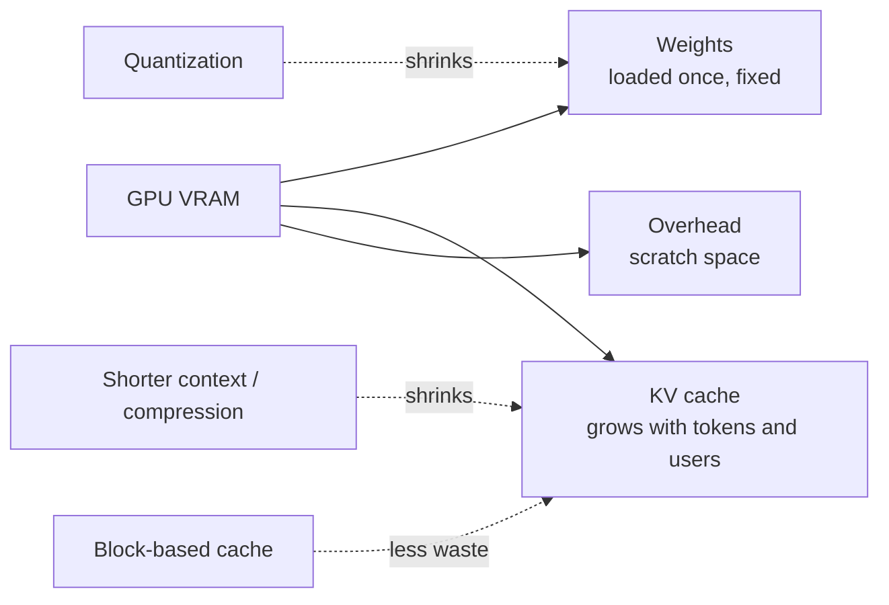

# How does an LLM use GPU memory?

> **Step 12: LLM Inference Engineering** · ⏱️ 14 min read · [Read original](https://outcomeschool.com/blog/llm-gpu-memory)

## TL;DR
An LLM's GPU memory (VRAM) goes to three things: model weights, the KV cache, and overhead. Weights are fixed after loading, the KV cache grows with tokens and users, and overhead is unavoidable scratch space.

## Key Concepts
- **VRAM** — the GPU's fast working memory (e.g. 16, 24, 40, 80 GB); everything the GPU works on must fit here.
- **Weights** — the learned parameters; loaded once and fixed during chat.
- **KV cache** — stored Keys and Values of past tokens; grows with every token.
- **Overhead** — temporary results, GPU software memory, reserved blocks; never zero.
- **FP16** — 2 bytes per number.

## How It Works
$$\text{VRAM} = \text{weights} + \text{KV cache} + \text{overhead}$$

### Weights
$$\text{weights} = \text{params} \times \text{bytes per weight}$$
7B params x 2 bytes = 14 billion bytes, about 13 GB.

### KV cache
$$\text{KV} = 2 \times \text{tokens} \times \text{layers} \times \text{hidden size} \times \text{bytes}$$
For 4,000 tokens, 32 layers, hidden 4096, FP16: about 2 GB. The 2 is for Key and Value. This assumes every head keeps its own K/V (like Llama 2 7B); newer models that share K/V across heads use less. Ten users at 4,000 tokens need about 20 GB for caches alone.

### Overhead
Rough estimate 1 to 2 GB, or 10 to 20 percent of total.

### Worked example (7B model, FP16, one user, 4,000 tokens)

| Part | Memory |
|---|---|
| Weights | about 13 GB |
| KV cache | about 2 GB |
| Overhead | about 1 GB |
| Total | about 16 GB |

That is why a 24 GB GPU is a common choice.

### Reducing memory
1. **Quantization** — 1 byte per weight makes the 7B weights about 6.5 GB.
2. **Limit conversation length** — shrinks KV cache (see KV Cache Compression).
3. **Smaller model** — fewer weights.
4. **Better KV cache handling** — block-based storage wastes little, so more users fit.

## Diagram

## Key Takeaways
- VRAM = weights + KV cache + overhead.
- Weights are constant; only the KV cache grows as conversations lengthen.
- 7B in FP16 is about 13 GB of weights, plus about 2 GB of cache per 4,000-token user.
- Many concurrent users multiply KV cache memory quickly.
- Quantization, shorter context, smaller models and paged cache handling are the main levers.
