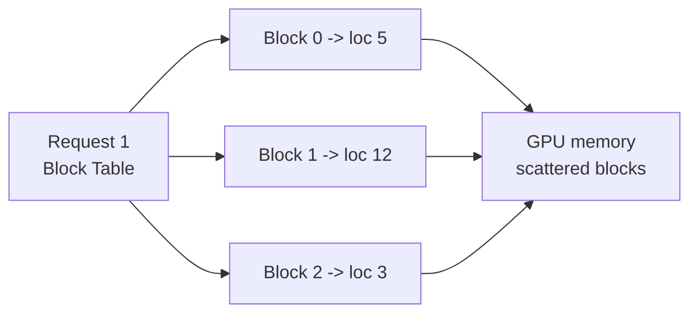
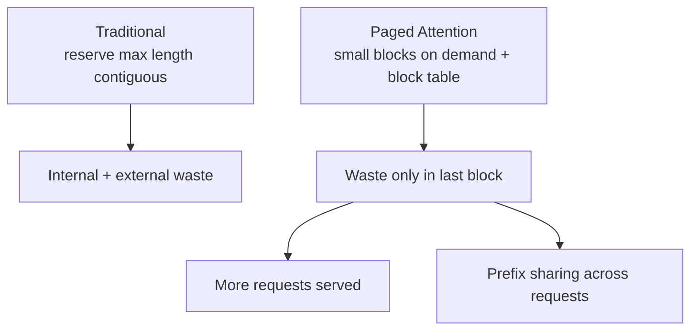

# What is Paged Attention in LLMs?

> **Step 12: LLM Inference Engineering** · ⏱️ 12 min read · [Read original](https://outcomeschool.com/blog/paged-attention-in-llms)

## TL;DR
Paged Attention splits KV Cache memory into small fixed-size blocks (pages) that need not be contiguous, allocated only as tokens are generated and tracked by a block table. This removes internal and external memory waste, so a GPU serves many more concurrent requests. It is the core idea of vLLM.

## Key Concepts
- **KV Cache recap** — stores K and V of each processed token for reuse; trades memory for speed.
- **Internal waste** — memory reserved for max length but never used (50-token reply in 2,048 reservation wastes 1,998 slots).
- **External waste** — free memory scattered in gaps that can't serve a request needing one contiguous block.
- **Page / block** — fixed-size chunk holding K/V for a fixed number of tokens (e.g. 4).
- **Block table** — per-request map from block number to physical memory location (like an OS page table).
- **Memory sharing** — multiple requests point to the same blocks for identical prefixes.

## How It Works

### The problem
Response length is unknown in advance (20 vs 2,000 tokens). Traditional systems reserve one contiguous block for the maximum length per request.
Hotel analogy: reserving 30 adjacent rooms per guest "just in case"; 10 guests lock up 300 rooms though most stay a few nights. Less usable memory means fewer concurrent users.

### The paged solution
OS idea: memory is split into fixed pages, scattered anywhere, tracked by a page table. Hotel version: give one room at a time, anywhere free, with a list of which rooms belong to whom.

Example: reply "I love teaching AI and Machine Learning at Outcome School" (10 tokens), block size 4.
- Traditional: 16 slots reserved, 10 used, 6 wasted.
- Paged: Block 1 [I love teaching AI]; Block 2 [and Machine Learning at] (not necessarily adjacent); Block 3 [Outcome School _ _]. Only 2 slots wasted.

Block table example: Block 0 -> location 5, Block 1 -> location 12, Block 2 -> location 3. The model uses it to find K/V of any past token.

### Why it works
- Internal waste nearly eliminated: only the last block may be partly empty (2 of 4 vs 6 of 16).
- External waste eliminated: any free block anywhere is usable.
- Result: same memory, far more concurrent requests.
- It does not shrink the KV Cache itself, only stops memory around it being wasted. Shrinking is KV Cache Compression's job.

### Memory sharing across requests
Same question from two users gives identical K/V for input tokens, so both block tables point to the same blocks (one copy).
- **Parallel sampling** — several responses to one question share the input blocks.
- **Beam search** — parallel candidate sequences share the input.
- SGLang extends prefix sharing with a radix tree.
- Paged Attention underlies vLLM; NVIDIA TensorRT-LLM has the same idea as paged KV cache.
- Next: Continuous Batching, which pairs with Paged Attention by adding new requests the moment old ones finish; Paged Attention makes room for them.

## Trade-offs & Pitfalls
- Does not make cache smaller; some waste remains in the last block.
- Paged Attention is a technique; vLLM is a serving engine built on it.

## FAQ
- Why not reserve exact memory? → Output length unknown up front.
- Remove all waste? → Almost; only last-block slack remains.
- Same as vLLM? → No; technique vs engine.

## Key Takeaways
- Traditional contiguous max-length reservation wastes memory internally and externally.
- Paged Attention uses fixed blocks allocated on demand, anywhere in memory.
- A block table maps logical blocks to physical locations (OS page-table idea).
- Waste drops to the partially filled last block.
- Identical prefixes share blocks (parallel sampling, beam search).
- Benefit is higher concurrency, not a smaller cache.
- Core idea behind vLLM.
