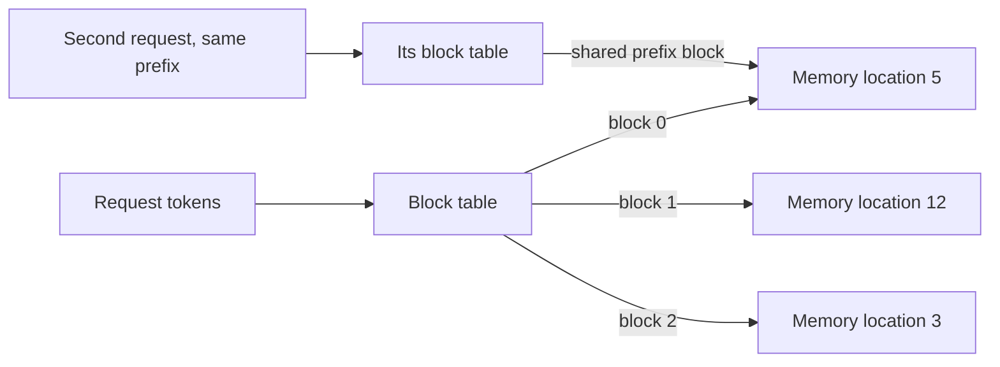

# What is Paged Attention in LLMs?

> **Step 12: LLM Inference Engineering** · ⏱️ 12 min read · [Read original](https://outcomeschool.com/blog/paged-attention-in-llms)

## TL;DR
Paged Attention manages KV cache memory by splitting it into small fixed-size blocks (pages) that can live anywhere in GPU memory, borrowing paging from operating systems. This nearly removes memory waste so a GPU can serve many more concurrent users.

## Key Concepts
- **Internal waste** — memory reserved for the maximum length but never used.
- **External waste** — free gaps too scattered to hold a new contiguous block.
- **Page / block** — fixed-size chunk holding K/V for a fixed number of tokens (e.g. 4).
- **Block table** — per-request map from logical block number to physical memory location (like an OS page table).
- **Memory sharing** — identical prefixes point to the same physical blocks.

## How It Works
### The problem
The system does not know response length in advance (20 or 2,000 tokens), so traditional serving reserves one contiguous region for the maximum (e.g. 2,048 tokens). A 50-token reply wastes 1,998 slots. Hotel analogy: reserving 30 adjacent rooms per guest who may stay 2 nights.

### The fix
Allocate blocks on demand, anywhere. Example with block size 4 and the reply "I love teaching AI and Machine Learning at Outcome School" (10 tokens):
- Block 1: I, love, teaching, AI
- Block 2: and, Machine, Learning, at
- Block 3: Outcome, School, plus 2 empty slots

Waste is 2 slots versus 6 of 16 with up-front reservation.

Block table example: Block 0 to location 5, Block 1 to location 12, Block 2 to location 3. The model uses the table to find any past token's K/V.

### Why effective
- Internal waste nearly eliminated; only the last block is partly empty.
- External waste eliminated; any free block works.
- It does not make the cache itself smaller; shrinking it is KV Cache Compression's job.

### Memory sharing
Requests with the same input can share blocks. Useful for parallel sampling (multiple answers to one question) and beam search. SGLang extends this idea with a radix tree. Paged Attention is the core of vLLM; TensorRT-LLM calls it paged KV cache. Continuous Batching pairs with it to keep the GPU busy.

## Diagram

## Key Takeaways
- Traditional contiguous reservation wastes memory both inside (unused) and outside (fragmentation) reservations.
- Paged Attention allocates fixed-size blocks on demand and tracks them with a block table.
- Only the last block can be partly empty, so waste is minimal and batches can be larger.
- Shared prefixes can reuse the same blocks.
- It is a memory-management technique, not compression, and is the core idea of vLLM.
