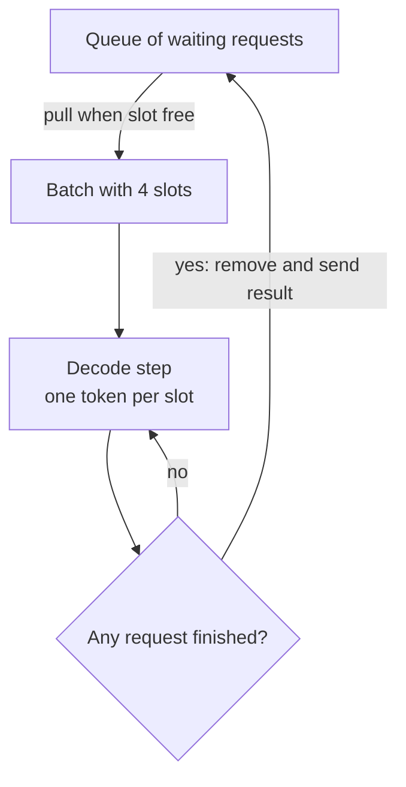

# What is Continuous Batching in LLMs?

> **Step 12: LLM Inference Engineering** · ⏱️ 20 min read · [Read original](https://outcomeschool.com/blog/continuous-batching-in-llms)

## TL;DR
Continuous Batching lets an LLM server swap a new waiting request into the batch the moment any request finishes, instead of waiting for the whole batch (Static Batching). It schedules at the token level, keeps every GPU slot busy, and typically gives 2x-4x higher throughput with lower waiting time.

## Key Concepts
- **Token / decode step** — response is hundreds of small steps, one token each.
- **Prefill** — model reads whole prompt in one pass, fills KV Cache, emits first token (once per request).
- **Decode** — one token per step; each request has its own KV Cache.
- **Batch** — requests processed together on the GPU (8 users take about the same time as 1); GPUs do the same work on many data in parallel.
- **Static Batching** — fixed group runs until all finish, then a new batch starts (request level).
- **Continuous Batching** — after every decode step, remove finished requests and slot in waiting ones (token level).
- **Throughput** — tokens produced per second.

## How It Works

### Static batching and its problem
Collect e.g. 4 requests, prefill all, decode all until every one finishes, then start a new batch. Requests finish at different times ("2+2" is a few tokens, an essay is 1,000). A short request finishing after 5 steps leaves an empty slot that still burns GPU work uselessly; new arrivals must wait for the whole batch.

### Continuous Batching steps
1. Fixed number of slots (e.g. 4).
2. While a slot is free, pull next request from queue, run its prefill.
3. Run one decode step for all slots (one token each).
4. Check each: stop token or max length reached means remove and return result.
5. Fill the freed slot from the queue (prefill it).
6. Next decode step; loop.

Ride-share analogy: static is a cab that waits until all 4 passengers finish; continuous refills a seat the moment anyone gets out. Seat = GPU slot, passenger = request, ride time = tokens generated.

### Numeric example (4 slots)
Requests A=100, B=20, C=50, D=200 steps; E needs 30 steps and arrives just after start.
- Static: E waits until step 200 to start; from step 20 on, slots sit empty.
- Continuous: B finishes at step 20, E slots in, finishes at step 50 (slots only empty when queue runs out).

With 50 ms per step:
| Request | Static | Continuous |
|---|---|---|
| A (100) | 5.0 s | 5.0 s |
| B (20) | 1.0 s | 1.0 s |
| C (50) | 2.5 s | 2.5 s |
| D (200) | 10.0 s | 10.0 s |
| E (30) | 11.5 s | 2.5 s (4.6x faster) |
| Average | 6.0 s | 4.2 s |
Static total: 200 steps (10 s) + 30 steps (1.5 s) = 11.5 s; continuous: 10 s. Both generate 400 tokens.

### Throughput example (100 requests)
50 short (20 tokens) + 50 long (200 tokens) = 11,000 tokens.
- Static: 25 batches of 4, each runs 200 steps = 10 s, total 250 s, throughput 44 tokens/s.
- Continuous: 4 tokens per step, 11,000/4 = 2,750 steps x 50 ms = 137.5 s, throughput 80 tokens/s.
- Speedup 1.8x, 112.5 s (45 percent) saved.
- Real workloads: 2x-4x over static, depending on length variance (more is better), steady traffic, model and hardware. vLLM benchmarks: with Paged Attention, over 20x vs naive serving.

## Benefits
- Higher throughput (GPU always doing useful work).
- Lower waiting time (new requests slot in immediately).
- Better hardware use of the costly GPU.
- Used by vLLM, SGLang, TensorRT-LLM and nearly all modern servers.

## Trade-offs & Pitfalls
- Pairs with Paged Attention: it fixes memory waste, continuous batching fixes compute waste.
- Does not change model output; only scheduling. Each user's output equals running alone.
- Batch size limited by GPU memory (each request has a KV Cache); excess waits in queue. KV Cache Compression helps fit more.
- New prefill shares GPU with others' decode; a very long prompt can briefly pause everyone's decode. Prefill-Decode Disaggregation removes this at large scale.
- Example numbers simplify (prefill cost for joiners treated as zero; 2 short + 2 long average mix), but the pattern holds.

## FAQ
- Changes output? → No.
- How much faster? → 2x-4x typically.
- Vs Paged Attention? → Compute waste vs memory waste; complementary.
- Unlimited batch? → No, memory-bound.
- Long prompt slow others? → Yes, briefly.

## Key Takeaways
- A response is many one-token decode steps; batching exploits GPU parallelism.
- Static Batching waits for the slowest request, wasting empty slots.
- Continuous Batching is token-level: after each step, evict finished and admit waiting.
- Example: E finishes at 2.5 s instead of 11.5 s; throughput 80 vs 44 tokens/s.
- Typical gain 2x-4x; larger with varied lengths and steady traffic.
- Output unchanged; batch limited by KV Cache memory.
- Combine with Paged Attention; disaggregation handles prefill interference.
