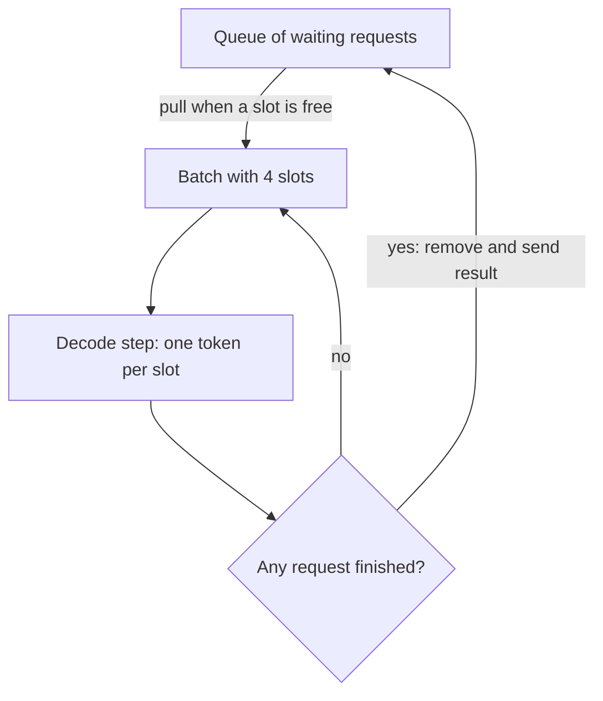

# What is Continuous Batching in LLMs?

> **Step 12: LLM Inference Engineering** · ⏱️ 20 min read · [Read original](https://outcomeschool.com/blog/continuous-batching-in-llms)

## TL;DR
Continuous Batching swaps a new request into the batch the moment any request finishes, instead of waiting for the whole batch to end. It schedules at the token level, keeps every GPU slot busy, and typically gives 2x to 4x higher throughput than static batching.

## Key Concepts
- **Batch** — group of requests processed together so the GPU is well used.
- **Static batching** — fixed group runs until the slowest request finishes; request-level scheduling.
- **Continuous batching** — after every decode step, remove finished requests and slot in waiting ones; token-level scheduling.
- **Throughput** — tokens produced per second across all users.
- **Prefill / decode** — prompt processed once, then one token per step.

## How It Works
### Why static batching fails
Request lengths vary wildly ("What is 2 + 2?" vs a 1,000-token essay). A short request finishes in a few steps, but its slot sits empty (still computed, producing nothing) until the longest one ends. New arrivals wait for the entire batch.

### Continuous loop (4 slots)
1. Fill free slots from the queue, running prefill for each new request.
2. Run one decode step for all requests in the batch.
3. Check for stop token or max length; remove finished ones and return results.
4. Pull waiting requests into freed slots and repeat.

Analogy: a shared cab that picks up a new passenger the moment a seat opens, versus one that waits for all passengers to reach their stops.

### Numeric example (50 ms per step, 4 slots)
Requests A=100, B=20, C=50, D=200 steps; E=30 arrives just after start.

| | Static | Continuous |
|---|---|---|
| Total time for 5 requests | 11.5 s | 10.0 s |
| Request E latency | 11.5 s | 2.5 s (4.6x faster) |
| Average latency | 6.0 s | 4.2 s |

Realistic workload (50 short at 20 tokens, 50 long at 200 tokens, 11,000 tokens): static 250 s, about 44 tokens/s; continuous 137.5 s, 80 tokens/s, about 1.8x. In practice 2x to 4x, depending on length variance and traffic steadiness. vLLM benchmarks cite 20x or more over naive serving when combined with Paged Attention.

### Notes
- Does not change model output; only scheduling.
- Batch size is bounded by GPU memory for KV caches (KV Cache Compression helps).
- Pairs with Paged Attention: it fixes memory waste, continuous batching fixes compute waste.
- A long new prefill can briefly stall others' decode; Prefill-Decode Disaggregation addresses this at scale.
- Used by vLLM, SGLang, TensorRT-LLM.

## Diagram

## Key Takeaways
- Static batching works per request; continuous batching works per decode step.
- Finished slots are refilled immediately, so the GPU never does wasted work on empty slots.
- Gains are largest with highly varied request lengths and steady traffic.
- Output is identical to running each request alone.
- Paged Attention (memory) plus Continuous Batching (compute) is why one GPU can serve many users.
