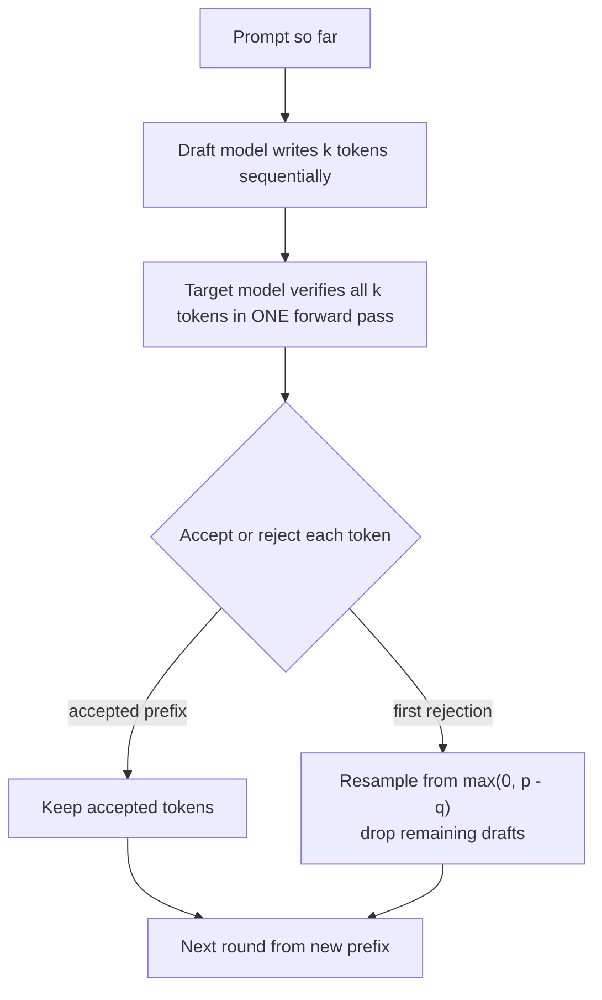

# What is Speculative Decoding?

> **Step 12: LLM Inference Engineering** · ⏱️ 20 min read · [Read original](https://outcomeschool.com/blog/speculative-decoding)

## TL;DR
Speculative Decoding speeds up LLM generation (typically 2x to 3x) with no quality loss. A small, fast draft model guesses the next few tokens and the big target model verifies them all in one parallel forward pass, using GPU compute that would otherwise sit idle.

## Key Concepts
- **Autoregressive generation** — one token per full model pass; slow because weights must be loaded from GPU memory every time (memory-bound, compute idle).
- **Draft model** — small, fast model (e.g. 1B) that proposes about 4 to 5 tokens.
- **Target model** — the big model (e.g. 70B) whose output we want; verifies all draft tokens at once.
- **Rejection sampling** — accept/reject rule that makes the output distribution exactly match the target model.
- **Bonus token** — if all drafts are accepted, the same pass yields one extra token for free.
- **Multi-Token Prediction (MTP)** — DeepSeek-V3's built-in drafter module (about 1.8x reported).

## How It Works
### One round (draft length 4)
Prompt "I love teaching AI". Draft: "and", "Machine", "Learning", "today". Target, in one pass, predicts "and", "Machine", "Learning", "everyday". The first three are accepted; "today" is replaced by "everyday". Result: 4 tokens for 1 target pass.

### Acceptance rule
$q(x)$ = draft probability, $p(x)$ = target probability.
- If $p(x) \ge q(x)$: always accept.
- Else accept with probability $p(x)/q(x)$ (e.g. 0.1/0.5 = 0.2).
- On rejection, sample a replacement from the corrected distribution $\max(0, p - q)$ normalized. Example: everyday 0.3, today 0, tomorrow 0.1, sum 0.4, giving 0.75 / 0 / 0.25.

The final output has exactly the target's distribution (an exact result, not an approximation).

### Speed numbers (target 50 ms, draft 5 ms/token, draft length 4)
Round cost = 4 x 5 + 50 = 70 ms.

| Case | Tokens per round | Baseline | Speedup |
|---|---|---|---|
| All 4 accepted | 5 (with bonus) | 250 ms | 3.57x |
| 3 accepted | 4 | 200 ms | 2.86x |
| 0 accepted | 1 | 50 ms | 0.71x (slower) |

A 200-token answer: 10.0 s baseline vs 3.5 s (50 rounds x 70 ms) in the average case.

### Where used and trade-offs
- Supported in vLLM, SGLang, TensorRT-LLM; Llama pairs small and large models; DeepSeek-V3 uses MTP.
- Costs: extra GPU memory, shared tokenizer required, acceptance depends on draft/target agreement, overhead hurts very short outputs, draft length must be tuned, gain shrinks at high batch sizes where GPU is already busy.
- Alternatives that drop the separate draft model: Medusa (extra heads), EAGLE (feature-level drafting), N-gram speculation (copy from prompt).

## Diagram

## Key Takeaways
- Decode is memory-bound, so verifying several tokens in one pass is nearly free.
- Rejection sampling guarantees output identical in distribution to the target alone.
- Each round always advances at least 1 token, but a bad draft can make it slower than baseline.
- Typical speedup 2x to 3x; depends on draft/target agreement and draft length.
- Best at low batch sizes; draft and target must share a tokenizer.
