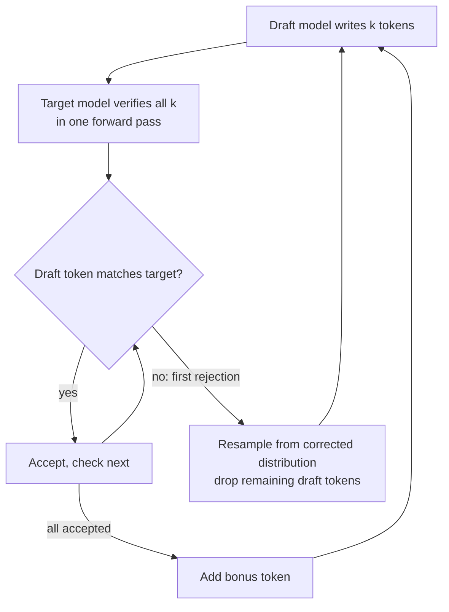

# What is Speculative Decoding?

> **Step 12: LLM Inference Engineering** · ⏱️ 20 min read · [Read original](https://outcomeschool.com/blog/speculative-decoding)

## TL;DR
Speculative Decoding = a small draft model guesses the next few tokens, and the big target model verifies all of them in one parallel forward pass. A rejection-sampling rule guarantees the output distribution is exactly that of the target model alone, so there is no quality loss, and speedup is typically 2x-3x.

## Key Concepts
- **Autoregressive generation** — each token needs a full forward pass of the model; billions of weights are loaded from GPU memory per token.
- **Memory-bound decode** — GPU is slow at moving memory, not at math, so compute sits idle.
- **Draft model** — small, fast (e.g. 1B); **target model** — big, smart (e.g. 70B). They must share the same tokenizer.
- **Draft length** — tokens drafted per round (e.g. 4).
- **Bonus token** — if all drafts are accepted, the target's pass also yields one extra token at the next position, free.
- **q(x), p(x)** — draft and target probabilities of token x.
- **Multi-Token Prediction (MTP)** — DeepSeek-V3's lightweight extra module acting as built-in drafter.

## How It Works

### Why generation is slow
Every token forces a full pass: input "I" gives "love", "I love" gives "teaching", ... Weights are read from memory each time while compute is barely used. Speculative Decoding fills that idle compute.

### One round (prompt "I love teaching AI", draft length 4)
1. Draft model generates "and", "Machine", "Learning", "today" (fast, sequential).
2. Target model takes prompt + 4 draft tokens in ONE forward pass; at every position it predicts the next token (all verified in parallel, not one by one).
3. Accept until the first rejection: "and", "Machine", "Learning" accepted; "today" rejected, target wanted "everyday".
4. Replace the rejected token with the target's choice: add "and Machine Learning everyday" (4 tokens, 1 target pass).
5. Next round continues from there.
If all 4 are accepted: 5 tokens (4 + bonus).
Analogy: junior drafts 5 lines, senior reviews them together, fixes the first wrong one.

### Verification: rejection sampling
LLMs sample from distributions, so "matches top choice" isn't enough.
- If $p(x) \ge q(x)$: always accept.
- Else accept with probability $p(x)/q(x)$.
Example 1: q=0.6, p=0.8 gives always accept. Example 2: q("today")=0.5, p=0.1 gives accept prob 0.1/0.5 = 0.2 (reject 80 percent).
On rejection, sample from the corrected distribution $\max(0, p(x)-q(x))$ normalised:
| token | q | p | max(0,p-q) | corrected |
|---|---|---|---|---|
| everyday | 0.2 | 0.5 | 0.3 | 0.75 |
| today | 0.5 | 0.1 | 0 | 0 |
| tomorrow | 0.3 | 0.4 | 0.1 | 0.25 |
(sum 0.4). Probability of ending with any token x works out to exactly $p(x)$ (full proof omitted; see original papers). Not an approximation. (Some methods shift the distribution on purpose, e.g. LLM watermarking.)

### Speedup numbers
Target 50 ms/token, draft 5 ms/token, draft length 4. A round costs 4x5 + 50 = 70 ms (fixed).
| Case | Tokens in round | Baseline | Spec | Speedup |
|---|---|---|---|---|
| Best (all 4 accepted + bonus) | 5 | 250 ms | 70 ms | 3.57x |
| Average (3 accepted + 1 corrected) | 4 | 200 ms | 70 ms | 2.86x |
| Worst (0 accepted, still 1 token via corrected sample) | 1 | 50 ms | 70 ms | 0.71x (slower) |
200-token answer: baseline 200 x 50 = 10.0 s; speculative at 4 tokens/round = 50 rounds x 70 ms = 3.5 s (6.5 s saved). Real tokens per round range 1-5. Typical speedup 2x-3x; depends on draft-target agreement, draft length, input style.

## Where it is used
- vLLM, SGLang, TensorRT-LLM support it.
- Llama small/large pairings.
- DeepSeek-V3 MTP: built-in drafter, no separate model, about 1.8x speedup.
- Cheap way to 2x-3x without retraining the big model.

## Trade-offs & Pitfalls
- Second model uses extra GPU memory.
- Same tokenizer/vocabulary required.
- Low agreement means many rejections and wasted time.
- Very short outputs: overhead cancels speedup.
- Tune draft length: too short, little gain; too long, wasted tokens.
- Best at low batch sizes (memory-bound, idle compute); at high batch sizes Continuous Batching already uses compute, so gain shrinks or even inverts.
- Alternatives that drop the second model: Medusa (extra decoding heads), EAGLE (drafts internal features), N-gram Speculation (copies from prompt).

## FAQ
- Quality loss? → No, exact distribution.
- Can be slower? → Yes: no acceptances (70 vs 50 ms), high batch sizes, short outputs.
- Same tokenizer? → Yes.
- Always need a draft model? → No: MTP, Medusa, N-gram.

## Key Takeaways
- Decoding is memory-bound, leaving compute idle.
- Draft k tokens cheaply, verify all in one target pass.
- Rejection sampling (accept if p>=q, else with p/q; resample from max(0,p-q)) preserves the target distribution exactly.
- A round yields 1 to k+1 tokens; progress is never zero.
- Typical speedup 2x-3x; worst case slower.
- Needs matching tokenizer, extra memory; gains fall at large batch sizes.
