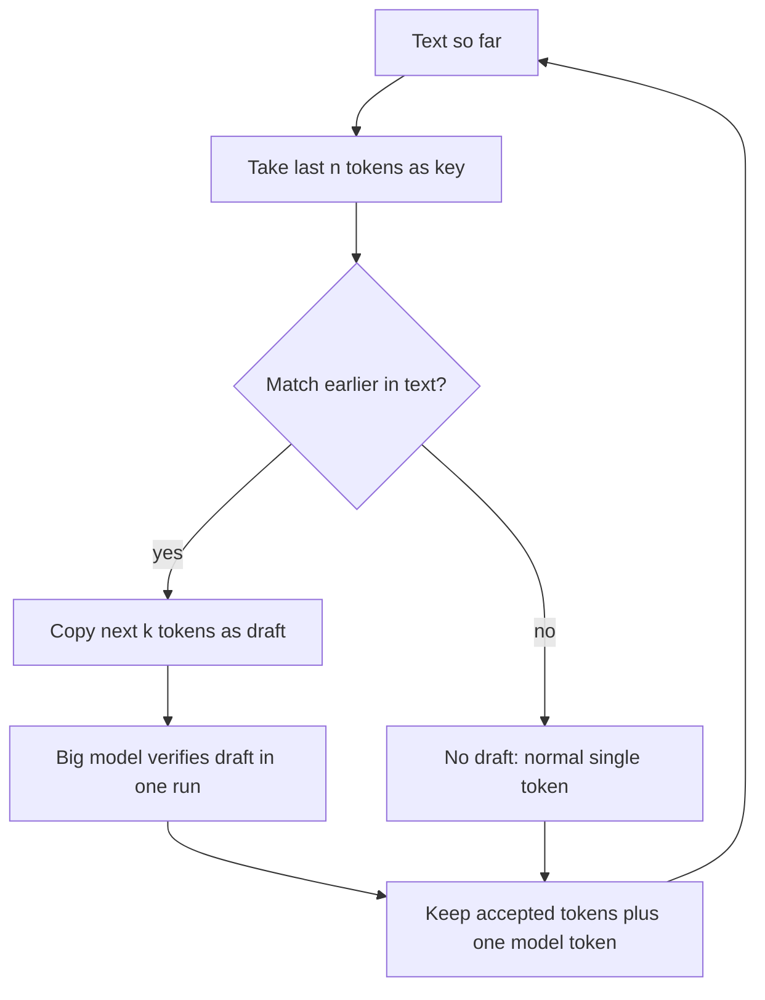

# What is N-gram Speculation in LLMs?

> **Step 12: LLM Inference Engineering** · ⏱️ 20 min read · [Read original](https://outcomeschool.com/blog/n-gram-speculation-in-llms)

## TL;DR
N-gram Speculation (also called Prompt Lookup Decoding) is speculative decoding where the draft comes from matching the last few tokens against earlier text, with no draft model. The big model still verifies everything, so the output is unchanged, and copy-heavy tasks can see about 2x to 4x faster generation.

## Key Concepts
- **Memory-bound decoding** — GPU waits on weight loading, so checking many tokens at once costs about the same as one.
- **Speculative decoding** — draft cheaply, verify in one run; never fewer than 1 token per run.
- **N-gram** — N consecutive tokens (a sliding window over the text).
- **Search key** — the last n tokens written; **k** — max tokens to draft.
- **Prompt Lookup Decoding** — same as N-gram Speculation.

## How It Works
### Why not a draft model?
A draft model needs a second model with the same vocabulary, extra GPU memory, compute per guessed token, and updates when the big model changes.

### Algorithm
1. Take the last n tokens as the key.
2. Search the prompt plus generated text for the same n-gram earlier.
3. Copy the k tokens that followed the match as the draft.
4. Big model verifies all in one run; accept matches, replace the first mismatch with its own token, drop the rest.
5. Repeat. No match means no draft; one normal token, nothing lost.

Example: prompt "The cat sat on the mat. The dog sat on the rug. Now, repeat the first sentence:", written so far "The cat sat", n=2, k=3. Key "cat sat" finds "on the mat". All accepted, plus a free bonus token "." giving 4 tokens in one run. In a second example the draft "mat" fails against the model's "sofa", yielding 3 tokens ("on", "the", "sofa").

```python
def ngram_draft(tokens, n, k):
    key = tokens[-n:]
    for i in range(len(tokens) - n):
        if tokens[i:i + n] == key:
            return tokens[i + n : i + n + k]
    return []
```
Real implementations try several n (3, 2, 1) and search from the end first.

### Output unchanged
Every final token is one the big model chose. Exact for greedy decoding; with sampling a smarter acceptance rule keeps the same probabilities.

### Works vs fails

| Works well | Fails |
|---|---|
| Summarization, code editing, RAG, JSON/tables/lists | Creative writing, open-ended chat, translation |

### Versus draft model

| | N-gram | Draft model |
|---|---|---|
| Guess source | Text lookup | Small model |
| Extra memory | Almost none | Yes |
| New-text guesses | Poor | Good |
| Setup | Works with any model | Needs matching vocab |
| Final output | Same | Same |

Production systems often try n-gram first and fall back to a draft model.

## Diagram


## Key Takeaways
- No draft model: the "draft" is a lookup in the prompt and generated text.
- Verification means the answer is identical to running the big model alone.
- A failed lookup is cheap, so worst case is roughly normal speed.
- Ideal for tasks where output copies input (summaries, code edits, RAG).
- Poor for novel text; combine with a draft model for general workloads.
