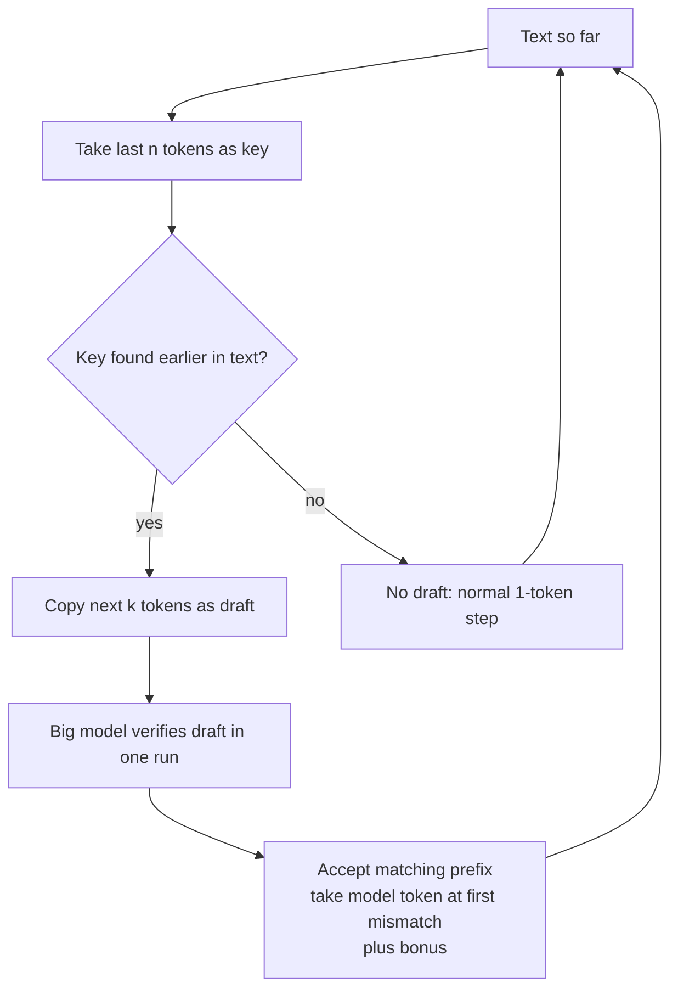

# What is N-gram Speculation in LLMs?

> **Step 12: LLM Inference Engineering** · ⏱️ 20 min read · [Read original](https://outcomeschool.com/blog/n-gram-speculation-in-llms)

## TL;DR
N-gram Speculation (a.k.a. Prompt Lookup Decoding) is Speculative Decoding without a draft model: take the last n tokens, find the same n-gram earlier in the text, copy the next k tokens as the guess, and let the big model verify them in one run. Output is unchanged; it gives 2x-4x speedups when the answer repeats the input.

## Key Concepts
- **Decoding step** — one model run per token; 100 tokens means 100 runs, strictly sequential.
- **Memory-bound** — GPU waits for weights to load from memory far longer than it does the math (chef who can cook ten dishes, helper brings ingredients for one).
- **Checking vs producing** — the model can't produce many tokens at once, but can check many given tokens in one run at almost the cost of one.
- **Speculative Decoding** — guess first, verify later: draft cheaply, big model verifies all in one run; never less than 1 token per run.
- **Draft model** — small LLM guesser in the original method.
- **N-gram** — N consecutive tokens (sliding window). For "the cat sat on the mat": 2-grams "the cat", "cat sat", ...
- **Greedy decoding / sampling** — picking the top token vs sampling probabilistically.

## How It Works

### Draft model costs (motivation)
- Need a second model with the same vocabulary (token list), else guesses can't be compared.
- Extra GPU memory (already scarce).
- Extra time per guessed token.
- Must be updated when the big model changes.

### Algorithm
Text so far = prompt + generated tokens. Use last n tokens as key, draft up to k tokens.
1. Take last n-gram (key).
2. Search earlier text for it (skip the key itself).
3. Copy the k tokens after the match as the draft.
4. Verify: big model processes text + draft in one run, gives prediction at every position; accept matches, at first mismatch take the model's own token and discard the rest of the draft; plus a bonus token if all match.
5. Repeat. No match found means no draft; big model predicts one token as usual, losing nothing.

Analogy: copying a book paragraph; after "the quick brown" look it up, copy "fox jumps over", double check.

Example 1 (n=2, k=3): prompt "The cat sat on the mat. The dog sat on the rug. Now, repeat the first sentence:", written "The cat sat". Key "cat sat" matches; draft "on the mat". Model confirms on, the, mat, and predicts "." as bonus: 4 tokens in one run.
Example 2: prompt has "The cat sat on the mat. The cat sat on the sofa..." asking for the second sentence. First match yields draft "on the mat". Accept "on", "the", mismatch at "sofa" vs "mat": keep model's "sofa" and drop the rest: 3 tokens, still better than 1.

```python
def ngram_draft(tokens, n, k):
    key = tokens[-n:]
    for i in range(len(tokens) - n):
        if tokens[i:i + n] == key:
            return tokens[i + n : i + n + k]
    return []

while not done:
    draft = ngram_draft(tokens, n=2, k=3)
    accepted, next_token = big_model.verify(tokens, draft)
    tokens = tokens + accepted + [next_token]
```
Real implementations try several n (3, then 2, then 1) and search from the end first (recent text more likely repeats); in Example 2 that would have found "sofa" correctly.



### Why output stays identical
Draft is only a suggestion. At each position either it equals the big model's own token (kept) or it is discarded and the model's token used. So every final token is one the big model chose. Exactly true for greedy decoding; with sampling a slightly smarter verification rule keeps the same probabilities.

### Where it works and fails
| Works well (output repeats input) | Fails (new text) |
|---|---|
| Summarization | Creative writing |
| Code editing (small bug fix) | Open-ended chat |
| RAG (copies from retrieved passages) | Translation (different language) |
| Repetitive JSON, tables, lists | |
Works: draft often right, 2x-4x faster for free. Fails: lookup finds nothing or wrong guesses; a failed lookup is very cheap so no big slowdown, but no gain.

## N-gram vs Draft model
| | N-gram | Draft model |
|---|---|---|
| Guesser | Text lookup | Small neural net |
| Extra model | No | Yes |
| GPU memory | Almost none | Yes |
| Guess cost | Very low | A model run per guessed token |
| Best for | Copying tasks (summarization, editing, RAG) | Any, including open-ended |
| Quality on new text | Poor | Good |
| Setup | Works with any model | Needs matching vocabulary |
| Final output | Same | Same |
Production systems often combine: n-gram first, fall back to draft model. Medusa and EAGLE are other ways to drop the separate draft model (extra heads).

## FAQ
- Same as Prompt Lookup Decoding? → Yes.
- Can it slow things? → Not meaningfully.
- Speedup? → 2x-4x on copy-heavy tasks.
- Combine with draft model? → Yes.
- Translation? → No help.

## Key Takeaways
- Decode is memory-bound; verifying many tokens costs about the same as one.
- N-gram Speculation guesses by matching the last n tokens earlier in the text and copying what followed.
- No extra model, no extra memory.
- Verification keeps output identical.
- Great for summarization, code editing, RAG, structured output; useless for creative, chat, translation.
- Failure is cheap; pair with a draft model for general workloads.
