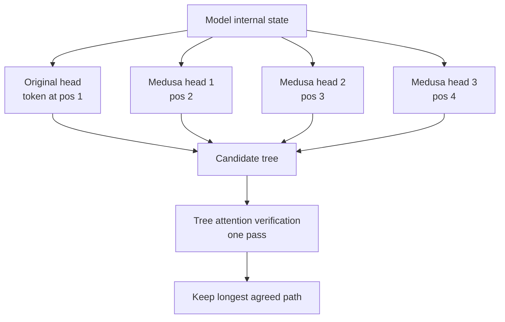

# What is Medusa? Multi-Head Speculative Decoding Explained

> **Step 12: LLM Inference Engineering** · ⏱️ 11 min read · [Read original](https://outcomeschool.com/blog/decoding-medusa)

## TL;DR
Medusa (2024, "Medusa: Simple LLM Inference Acceleration Framework with Multiple Decoding Heads", Cai, Li, Dao et al.) adds a few small extra heads to a frozen LLM; each head guesses a token further ahead, and tree attention verifies all candidates in one pass. It gives about 2-3x faster generation, no draft model, and unchanged outputs.

## Key Concepts
- **Decode bottleneck** — one token per full forward pass; GPU mostly idle.
- **Speculative decoding** — small draft model guesses, big model verifies in one pass; needs a second model to find/train, load and run.
- **Medusa heads** — tiny extra layers on the model's internal state. Original head predicts position 1, Medusa head 1 position 2, head 2 position 3, head 3 position 4.
- **Tree attention** — special attention mask that verifies many candidate paths at once without interference.
- Name: mythical Medusa with many heads.

## How It Works
1. Base model is frozen; only small heads are trained (cheap, little time and data).
2. In one forward pass, original head + 3 Medusa heads give guesses for 4 positions.
3. Each head gives its top few candidates; combining gives several possible continuations, arranged as a tree.
4. One verification pass checks the whole tree with tree attention.
5. Keep the longest path the model agrees with; discard the rest. Output equals normal generation.
Analogy: finishing a friend's sentence; keep only if right.

### Speedup math
Normal: 1 token per pass, 6 tokens = 6 passes. Medusa: each round guesses 4 tokens; if on average 3 are accepted, 2 rounds give 6 tokens = 2 passes, 3x faster.
$$\text{speedup} = \text{average accepted tokens per pass}$$
2.5 accepted per pass means about 2.5x. Numbers (3 heads, 3 accepted) are illustrative; real setups tune number of heads and tree shape.

### Results
About 2-3x on popular models, no quality change (every accepted token verified). Easy to add, no separate draft model.

## Legacy
- Inspired EAGLE (feature-level drafting, higher speedups).
- Multi-Token Prediction (e.g. DeepSeek-V3) trains extra heads from the start, improving the model and giving built-in speedup.
- Tree-based verification is now common in fast systems like TensorRT-LLM.

## Trade-offs & Pitfalls
- Medusa avoids the draft-model burden (finding a matching small model, two models in memory) but still needs head training.
- Speed depends on acceptance rate; heads further ahead are less accurate.

## FAQ
- Changes answers? → No.
- Retrain whole model? → No, only the heads.
- Better than draft-model speculative decoding? → Simpler, less memory and complexity.
- Vs EAGLE? → Medusa guesses tokens directly; EAGLE guesses internal features, more accurate and faster.
- Speedup? → About 2-3x.

## Key Takeaways
- Normal decoding is one token per pass and leaves the GPU idle.
- Medusa adds extra heads to one model so one pass guesses several future tokens.
- Base model frozen; only cheap heads trained.
- Tree attention verifies many candidate continuations in one pass.
- Speedup equals average accepted tokens per pass (about 2-3x), lossless.
- Paved the way for EAGLE and Multi-Token Prediction.
