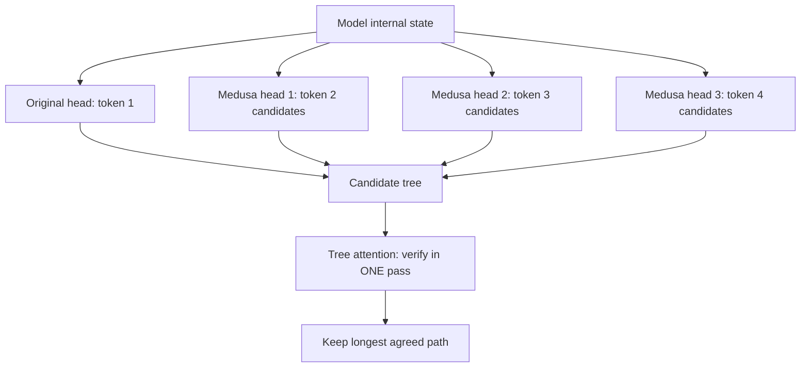

# What is Medusa? Multi-Head Speculative Decoding Explained

> **Step 12: LLM Inference Engineering** · ⏱️ 11 min read · [Read original](https://outcomeschool.com/blog/decoding-medusa)

## TL;DR
Medusa speeds up generation about 2x to 3x by adding a few small extra prediction heads to one model, each guessing a token further ahead. It removes the need for a separate draft model, and tree attention verifies many candidate continuations in a single pass, leaving the output unchanged.

## Key Concepts
- **Medusa heads** — small extra layers on the model's internal state; head k predicts the token at position k+1.
- **Frozen base model** — only the heads are trained, which is cheap.
- **Candidate tree** — each head gives its top few candidates, combined into a tree of continuations.
- **Tree attention** — special mask allowing all candidate paths to be verified in one pass without interfering.
- **Speedup** — average number of tokens accepted per pass.

## How It Works
### Motivation
Normal decoding does one full forward pass per token, leaving the GPU mostly idle. Speculative decoding fixes that but needs a second draft model: find or train a matching small model, and load and run two models. Medusa lets the big model guess for itself.

### Mechanism
1. The original head predicts position 1; Medusa heads 1, 2, 3 predict positions 2, 3, 4, all in one pass.
2. Each head proposes several candidates; combine them into a tree.
3. Verify the whole tree in one forward pass with tree attention.
4. Keep the longest path the model agrees with; discard the rest.

Every kept token is one the model itself would produce, so the text equals normal generation.

### Math with small numbers
Normal: 6 tokens need 6 passes. Medusa with original plus 3 heads (4 guesses) and about 3 accepted per round: 2 passes give 6 tokens, a 3x speedup.
$$\text{speedup} \approx \text{average accepted tokens per pass}$$
(Head count and accepted count are illustrative; real setups tune heads and tree shape.)

### Legacy
- Inspired EAGLE (feature-level drafting).
- Multi-Token Prediction (e.g. DeepSeek-V3) trains with extra heads from the start.
- Tree-based verification is common in systems like TensorRT-LLM.

## Diagram

## Key Takeaways
- Medusa = many heads on one model; no draft model needed.
- Base model frozen, only small heads trained, so it is simple to adopt.
- Tree attention verifies many guesses at once; output stays identical.
- Speedup is about 2x to 3x, equal to average accepted tokens per pass.
- It paved the way for EAGLE and Multi-Token Prediction.
