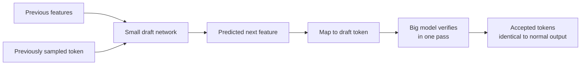

# What is EAGLE? Feature-Level Speculative Decoding Explained

> **Step 12: LLM Inference Engineering** · ⏱️ 9 min read · [Read original](https://outcomeschool.com/blog/decoding-eagle)

## TL;DR
EAGLE ("EAGLE: Speculative Sampling Requires Rethinking Feature Uncertainty" and EAGLE-2, Yuhui Li et al., 2024) is lossless speculative decoding that drafts at the feature level (the model's smooth hidden state) instead of the noisy token level. More accurate drafts mean more accepted tokens per pass and typically 3-4x faster generation.

## Key Concepts
- **Speculative decoding** — cheap draft, big model verifies in one pass; better guesses mean bigger speedup.
- **Token-level drafting** (e.g. Medusa) — predicts the exact sampled token; noisy because the model outputs a distribution and the token is sampled randomly, so many guesses are rejected.
- **Feature** — the model's internal hidden vector from the second-to-last layer, just before mapping to a token. The feature sequence is much more regular than the token sequence (randomness enters only at token selection).
- **Feature uncertainty** — the next feature depends on which token was sampled previously.
- **Dynamic draft tree** (EAGLE-2) — context-aware tree of candidate continuations.

## How It Works
1. Train a small lightweight draft network that autoregresses at the feature level: predicts the next feature from previous features, then maps features to tokens.
2. Resolve feature uncertainty by feeding the previously sampled token back into the draft network along with the features, so it sees both the smooth feature stream and the actual chosen token.
3. Big model verifies drafted tokens in one pass; output identical to normal generation.

```
Medusa: guess next TOKEN directly (noisy, often rejected)
EAGLE:  guess next FEATURE, then the token (smooth, often accepted)
```



### Speedup math
Speedup = average accepted tokens per verification pass. Token-level: 2.5 accepted per pass gives about 2.5x. Feature-level: 3.5 accepted gives about 3.5x. Entire gain comes from higher acceptance rate. Numbers illustrative; real values depend on model and task.

### EAGLE-2
Builds a dynamic, context-aware draft tree: spends more guesses where the draft network is confident, fewer where unsure, shaped per input. More accepted tokens per pass, still lossless.

## Today
- Often about 3-4x faster; among the highest lossless speedups.
- Supported in vLLM, SGLang, TensorRT-LLM.
- Core lesson (draft smooth features, not noisy tokens) influenced later research; extended in EAGLE-3.

## Trade-offs & Pitfalls
- Requires training a draft network (small, lightweight).
- Real speedup depends on model and task via acceptance rate.

## FAQ
- Changes output? → No, every token verified.
- Better than Medusa? → Usually bigger speedup, since features are more predictable.
- Speedup? → About 3-4x.
- In production? → Yes, via vLLM, SGLang, TensorRT-LLM.

## Key Takeaways
- Speculative decoding speed depends on guess accuracy.
- Token guesses are noisy due to sampling randomness.
- EAGLE drafts the smooth feature (second-to-last layer hidden state) then maps to tokens.
- Feeding back the sampled token removes feature uncertainty.
- Speedup equals average accepted tokens per pass; higher acceptance means more speed.
- EAGLE-2 adds dynamic context-aware draft trees; EAGLE-3 extends further.
- Output stays identical (lossless).
