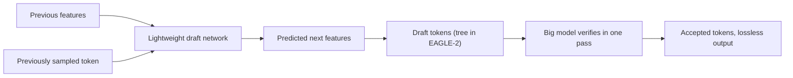

# What is EAGLE? Feature-Level Speculative Decoding Explained

> **Step 12: LLM Inference Engineering** · ⏱️ 9 min read · [Read original](https://outcomeschool.com/blog/decoding-eagle)

## TL;DR
EAGLE is a lossless speculative decoding method that drafts at the level of the model's internal features instead of tokens. Features are smoother and more predictable than sampled tokens, so more drafts are accepted per pass and the speedup is larger, often around 3x to 4x.

## Key Concepts
- **Token-level drafting** — guessing the exact next token (Medusa style); noisy because tokens are sampled from a distribution.
- **Feature** — the hidden-state vector from the second-to-last layer, just before it becomes a token.
- **Feature uncertainty** — the next feature depends on which token was sampled; unknown without that token.
- **EAGLE-2 dynamic draft tree** — context-aware tree with more guesses where the draft is confident.
- **Speedup** — average accepted tokens per verification pass.

## How It Works
### Problem
Speculative decoding speed depends on accurate cheap guesses. Token guesses are inherently noisy due to sampling randomness, so many are rejected, capping speedup.

### Key idea
Randomness enters at the final token selection step; features beneath are regular. A small lightweight draft network autoregresses on features (predicts next feature from previous ones), then maps features to tokens. Verification by the big model keeps the output identical.

### Resolving uncertainty
Feed the previously sampled token back into the draft network along with the features, which removes feature uncertainty (this gives the first paper its name).

### Math (illustrative)
- Token-level: about 2.5 accepted per pass gives about 2.5x.
- Feature-level: about 3.5 accepted per pass gives about 3.5x.
The gain comes entirely from higher acceptance. Real numbers depend on model and task.

### EAGLE-2
Builds a dynamic, context-aware draft tree, shaped per input, for more accepted tokens per pass while still lossless.

### Today
Supported in vLLM, SGLang and TensorRT-LLM; extended in EAGLE-3.

| | Medusa | EAGLE |
|---|---|---|
| Guesses | Next tokens directly | Next features, then tokens |
| Noise | High (sampling) | Lower (smooth features) |
| Accepted tokens | Fewer | More |

## Diagram

## Key Takeaways
- Draft at the feature level, not the token level: features are smoother than sampled tokens.
- Feeding back the sampled token resolves feature uncertainty.
- More accurate drafts mean more accepted tokens per pass, so higher speedup.
- Output is exactly the big model's; the speedup is free in quality.
- EAGLE-2 adds dynamic draft trees; typical speedup around 3x to 4x.
