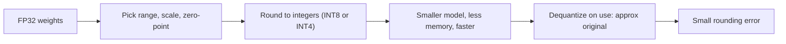

# How does Model Quantization work?

> **Step 12: LLM Inference Engineering** · ⏱️ 22 min read · [Read original](https://outcomeschool.com/blog/how-does-model-quantization-work)

## TL;DR
Model Quantization stores and computes a model's numbers at lower precision (for example FP32 to INT8 or INT4), so it uses less memory and runs faster. The cost is a small, controllable loss of accuracy; 4-bit is the usual sweet spot for LLMs.

## Key Concepts
- **Weights** — the learned numbers of the model; **activations** — layer outputs produced at runtime.
- **FP32 / FP16 / BF16 / INT8 / INT4** — 32, 16, 16, 8 (256 values), 4 (16 values) bits.
- **Scale** — real value represented by one integer step; **zero-point** — the integer that represents real 0.
- **Symmetric vs asymmetric** — range centered on zero (zero-point 0, simpler) vs shifted range (better for one-sided data).
- **Per-tensor vs per-channel** — one scale for the whole tensor vs one per row/channel.
- **PTQ vs QAT** — quantize after training vs simulate rounding during training.
- **Outliers** — rare huge activation values that stretch the scale and crush everything else.
- **GPTQ, AWQ, bitsandbytes, GGUF/llama.cpp** — popular methods and tools.

## How It Works
### Memory and speed
FP32 = 4 bytes, INT8 = 1 byte, INT4 = half a byte. A 7B model: about 28 GB (FP32), 7 GB (INT8), 3.5 GB (INT4). Smaller numbers also move faster from memory and integer math is often faster.

### Core mapping
$$q = \text{round}(x / \text{scale}) + \text{zero\_point}$$
$$x \approx (q - \text{zero\_point}) \times \text{scale}$$
Example: range -1.0 to 1.0 into 0 to 255: scale = 2/255 ≈ 0.00784, zero-point ≈ 128. Weight 0.5 becomes 192, and reads back as about 0.502; the gap is the rounding error.

### PTQ vs QAT

| | PTQ | QAT |
|---|---|---|
| When | After training | During training |
| Cost | Low | High |
| Data | Small sample | Full training data |
| Accuracy at low bits | Good | Best |

Frontier models use QAT (DeepSeek-V4 trains with FP4 QAT).

### Weights vs activations
Weight-only (activations stay FP16) is the common LLM choice and safer. Weight-and-activation gives more speed, common on small devices. The KV cache can be quantized too.

### Outlier problem
A few activations (say 60 among values in -1 to 1) force a wide scale, squashing normal values. Methods handle this:
- **GPTQ** — post-training 4-bit, layer by layer, adjusting remaining weights to compensate for rounding error.
- **AWQ** — protects important weights tied to large activations.
- **bitsandbytes** — easiest, loads in 8/4-bit (`load_in_4bit=True`), keeps outliers in higher precision.
- **GGUF / llama.cpp** — CPU-friendly local running; TensorRT-LLM on NVIDIA GPUs.

### Trade-off
Fewer bits mean smaller and faster but less accurate. INT8 loss is barely noticeable, INT4 small with GPTQ/AWQ, 2-bit often makes clear mistakes. Distillation is a different shrinking route (student copies teacher).

## Diagram

## Key Takeaways
- Quantization maps a range of real values onto few integers via scale and zero-point.
- 4-bit shrinks a 7B model from about 28 GB to about 3.5 GB versus FP32.
- Per-channel scales protect rows with different magnitudes.
- PTQ is easy and popular; QAT gives best low-bit accuracy.
- Outliers in activations are why weight-only quantization is the LLM default.
- 4-bit is the usual sweet spot between size and quality.
