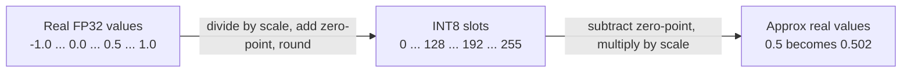
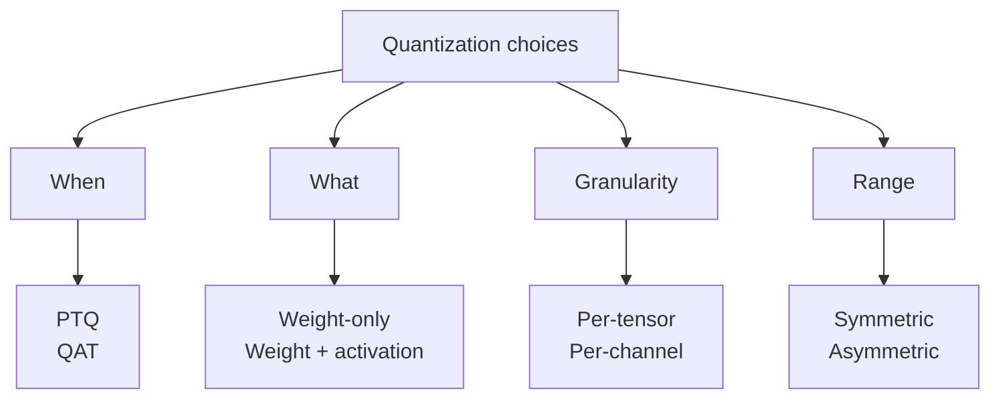

# How does Model Quantization work?

> **Step 12: LLM Inference Engineering** · ⏱️ 22 min read · [Read original](https://outcomeschool.com/blog/how-does-model-quantization-work)

## TL;DR
Quantization stores and computes a model's numbers (weights, sometimes activations) at lower precision, e.g. FP32 to INT8 or INT4, using a scale and zero-point to map decimals onto a small set of integers. The model gets smaller, faster, cheaper, at the cost of a small rounding error. 4-bit is the usual sweet spot for LLMs.

## Key Concepts
- **Weights** — a model's learned numbers (billions in an LLM). Quantization rounds detailed decimals (0.7319284) into small integers (94), like compressing a photo.
- **Bit formats**
| Format | Bits | Stores | Detail |
|---|---|---|---|
| FP32 | 32 | precise decimals (training default) | very high |
| FP16 | 16 | decimals, half size | high |
| BF16 | 16 | decimals, wide range | high |
| INT8 | 8 | whole numbers, 256 values (-128..127) | low |
| INT4 | 4 | whole numbers, 16 values | very low |
- **Scale** — real-value size of one integer step. **Zero-point** — integer representing real 0.
- **Tensor** — grid of numbers; a layer's weights are one tensor.
- **Activations** — outputs flowing between layers at run time (vs fixed weights).
- **Outliers** — rare, huge activation values.

## How It Works

### Why fewer bits help
- Memory: FP32 = 4 bytes, INT8 = 1 byte (4x smaller), INT4 = 8x smaller. 7B model: FP32 about 28 GB, INT8 about 7 GB, INT4 about 3.5 GB; fits a single GPU or good laptop.
- Speed: moving 1 byte beats 4; integer math is often faster; less power.
- Price: small accuracy loss.

### Core mechanic
$$q = \text{round}(x / s) + z \qquad x \approx (q - z)\cdot s$$
(s = scale, z = zero-point.) De-quantizing gives close, not exact, values; the gap is rounding error, the source of accuracy loss.
Example: weights in [-1.0, 1.0] to INT8 slots 0-255. Scale = 2.0/255 about 0.00784; zero-point about 128; weight 0.5 gives round(63.7)+128 = 192; back: (192-128) x 0.00784 about 0.502.



### Choices in quantization
- **Symmetric** — range centred on zero (-1..1 to -127..127), zero-point = 0, simpler/faster math; suits weights. **Asymmetric** — lopsided range (e.g. 0..6) with shifted zero-point; no wasted integers for one-sided data like never-negative outputs.
- **Per-tensor** — one scale/zero-point for the whole tensor; simple, but tiny rows (0.001) get crushed when large rows (0.9) set the scale. **Per-channel** — one scale per row/channel; costs a few more scales, much better accuracy; common for weights.
- **PTQ vs QAT**
| | PTQ | QAT |
|---|---|---|
| When | After training ("train first, shrink later") | During training with rounding simulated |
| Cost | Low, fast | High, needs full training |
| Data | Small sample to measure ranges | Full training data |
| Accuracy at low bits | Good (can hurt at INT4) | Best |
| Ease | Very easy, most popular | Harder |
Frontier models use QAT: DeepSeek-V4 trains with FP4 QAT.
- **Weight-only** (activations stay FP16) — most common for LLMs, big memory saving, safer. **Weight-and-activation** (e.g. INT8 both) — faster integer math, common for small devices/phones. KV cache can also be quantized (KV Cache Compression).

### Outlier problem
Most activations lie in -1..1 but a few hit 60; the scale must stretch, crushing all normal values into a few integers. This is why quantizing activations in LLMs is hard.

### Popular methods
- **GPTQ** — post-training, weights to 4 bits layer by layer; after rounding each weight, adjusts remaining weights to compensate the error.
- **AWQ (Activation-aware Weight Quantization)** — important weights (linked to large activations) get special treatment to keep detail at 4 bits.
- **bitsandbytes** — easiest, Hugging Face friendly, load in 8-bit/4-bit; keeps outliers in higher precision.
- **GGUF / llama.cpp** — CPU-friendly local running, many bit sizes in one file. TensorRT-LLM does the same on NVIDIA GPU servers.

```python
from transformers import AutoModelForCausalLM, BitsAndBytesConfig
config = BitsAndBytesConfig(load_in_4bit=True)
model = AutoModelForCausalLM.from_pretrained("some-large-model", quantization_config=config)
```



## Trade-offs & Pitfalls
- Fewer bits means smaller/faster but less accurate. INT8: barely noticeable loss. INT4: larger loss, kept small by GPTQ/AWQ. 2-bit: clear mistakes. 4-bit is the sweet spot for LLMs.
- Local laptop use (llama.cpp + GGUF): privacy, no cost, control.
- Alternative shrinking: Knowledge Distillation (small student copies big teacher) instead of rounding numbers.

## FAQ
- Exact number back? → No (0.5 returns 0.502).
- How many bits? → 4-bit usually.
- Easiest for beginners? → bitsandbytes.
- Quantization vs distillation? → Lower precision of same model vs training a smaller model.

## Key Takeaways
- Quantization = lower-precision numbers: less memory, faster, cheaper.
- INT8 is 4x and INT4 8x smaller than FP32 (7B: 28 to 7 to 3.5 GB).
- Mapping uses scale and zero-point; rounding error is the cost.
- Symmetric for balanced data, asymmetric for one-sided; per-channel beats per-tensor for accuracy.
- PTQ is easy and popular; QAT gives best low-bit accuracy.
- LLM activations have outliers; GPTQ, AWQ, bitsandbytes address accuracy.
- Fewer bits = smaller and faster but less accurate; 4-bit is the sweet spot.
