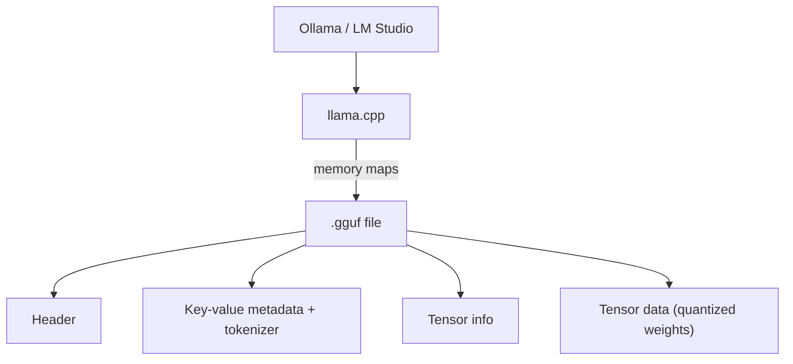

# How does GGUF work?

> **Step 12: LLM Inference Engineering** · ⏱️ 21 min read · [Read original](https://outcomeschool.com/blog/how-does-gguf-work)

## TL;DR
GGUF is a single-file format that packs a model's weights, tokenizer and metadata so it can run locally on a normal computer. It supports many quantization levels to shrink models and uses memory mapping for fast startup; it is the standard format of llama.cpp, Ollama and LM Studio.

## Key Concepts
- **Weights / tensors** — learned numbers stored as grids of numbers.
- **Local inference** — running the model on your own machine: private, works offline, no per-use cost.
- **GGML** — older predecessor format; inflexible, hard to extend.
- **GGUF** — "GPT-Generated Unified Format"; everything in one self-contained file.
- **Key-value metadata** — labeled pairs (architecture, context length, etc.).
- **Quantization** — store weights with fewer bits.
- **mmap** — memory mapping; read file parts on demand.

## How It Works
### Problem before GGUF
Weights, tokenizer and settings were scattered across files: fragile, not portable, slow to load. GGML helped but could not evolve with new model designs.

### File layout
1. **Header** — marker "GGUF", version, counts.
2. **Key-value metadata** — architecture, context length (e.g. 4096), tokenizer vocabulary, quantization info.
3. **Tensor info** — table of contents: names, shapes, positions.
4. **Tensor data** — the huge block of weights.

### Quantization
16 bits per weight makes a 7B model about 14 GB; about 4 bits makes about 4 GB. Trade-off: fewer bits mean smaller and faster but slightly lower quality.

Reading names like Q4_K_M: Q = quantized, 4 = about 4 bits per weight, K = smarter modern method, M = size variant (S/M/L).

| Name | Bits | Size | Quality | Good for |
|---|---|---|---|---|
| Q4_K_M | about 4 | smallest | good | limited-memory laptops; safe default |
| Q5_K_M | about 5 | medium | better | a bit more memory |
| Q8_0 | about 8 | largest | best | plenty of memory |

### Fast loading
mmap treats the on-disk file as if in memory and reads only needed parts when needed, instead of copying the full 4 GB first. GGUF's ordered tensor layout fits this.

### Cross-platform and extensible
Same file runs on Windows, macOS, Linux and different processors. New settings are just new key-value pairs, so old files and programs keep working (GGML's weakness fixed).

### In the real world
llama.cpp reads GGUF and runs on CPU or GPU; Ollama and LM Studio sit on top.

## Diagram

## Key Takeaways
- GGUF = one self-contained file: weights + tokenizer + metadata.
- Succeeds GGML with extensible key-value metadata.
- Quantized weights stored inside make big models fit on laptops.
- In Qx_K_M names, the number is bits per weight; Q4_K_M is a good default.
- Memory mapping gives fast startup and efficient memory use.
- No separate tokenizer files are needed.
