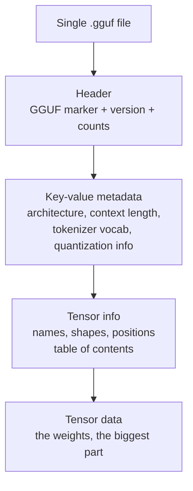
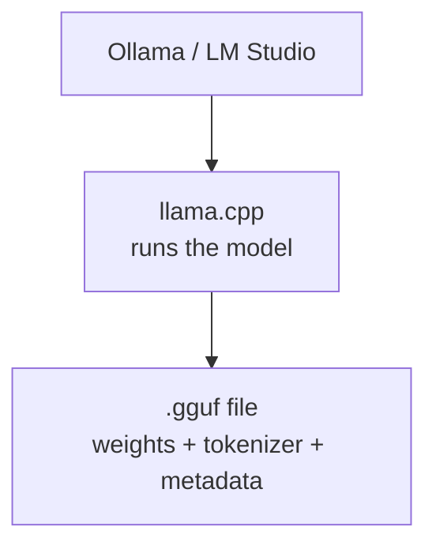

# How does GGUF work?

> **Step 12: LLM Inference Engineering** · ⏱️ 21 min read · [Read original](https://outcomeschool.com/blog/how-does-gguf-work)

## TL;DR
GGUF (GPT-Generated Unified Format) is a single self-contained file holding an LLM's weights, tokenizer and metadata, with built-in quantization and memory-mapped loading. It makes models portable, quick to start, and small enough to run locally on laptops via llama.cpp, Ollama and LM Studio.

## Key Concepts
- **Weights / tensors** — learned numbers (e.g. 7B), stored as tensors (grids of numbers).
- **Inference** — using the trained model; **local inference** runs on your own machine (private, offline, no per-use cost) vs cloud inference over the internet.
- **Tokenizer** — splits text into tokens and joins them back; vocabulary and rules are stored in the GGUF file.
- **Metadata** — key-value pairs describing the model (architecture, context length such as 4096, quantization info).
- **GGML** — older predecessor; made local inference possible but inflexible, adding info was painful.
- **Quantization** — store weights in fewer bits.
- **mmap (memory mapping)** — treat the disk file as if already in memory.

## How It Works

### Problem before GGUF
Weights, tokenizer, config lived in scattered files/formats: fragile (missing file breaks load), not portable (folder of files, tools read differently), slow to load. Need: single organised, fast, extensible file. Analogy: one neatly labelled box vs loose parts in three boxes.

### File layout

### Quantization in GGUF
16-bit, 7B model needs about 14 GB. At about 4 bits it is about 4 GB, so it fits a laptop CPU/GPU. Analogy: rounding 19.997 rupees to 20.
- Fewer bits: smaller, faster, slightly lower quality. More bits: larger, slower, higher quality.
GGUF stores quantized weights directly in the file.

### Reading names like Q4_K_M
- Q = quantized; number = approximate bits per weight (Q4 about 4, Q8 about 8).
- K = smarter modern method spending bits wisely.
- Last letter = size variant (S small, M medium, L large).
| Name | Bits | Size | Quality | Good for |
|---|---|---|---|---|
| Q4_K_M | about 4 | smallest | good | limited-memory laptops, great balance, safe start |
| Q5_K_M | about 5 | medium | better | a bit more memory |
| Q8_0 | about 8 | largest | best | plenty of memory, quality first |
Bigger number = more bits = bigger file, better quality. If answers feel off and memory is spare, move up to Q5_K_M or Q8_0.

### Fast loading with mmap
Slow way: copy all of a 4 GB file into memory before starting. mmap: start immediately and read only needed parts on demand (like opening the exact page instead of photocopying the book). Clean ordered tensor layout lets the program jump to any tensor directly.

### Cross-platform and extensible
- Cross-platform: same file on Windows, macOS, Linux and different processors.
- Extensible: new settings are just new key-value pairs; old programs still read the file (GGML's weakness fixed).

### In the real world
llama.cpp (open-source, runs LLMs on CPU or GPU on ordinary computers) reads GGUF. Ollama (download and run with a simple command) and LM Studio (desktop app to search, download GGUF, chat) sit on top.
Flow: download a .gguf for the model and quantization, tool opens it via mmap, reads weights, tokenizer, metadata from one file, you chat. Locally run models are often Small Language Models.

## Trade-offs & Pitfalls
- Lower quant = lower quality; pick by memory and quality need.
- Knowledge distillation is a different way to shrink (small model copies a larger one).

## FAQ
- GGUF vs GGML? → GGUF is successor with key-value metadata so new info doesn't break old files.
- Which quantization? → Q4_K_M start; up to Q5_K_M/Q8_0.
- Worse answers? → Slightly.
- Separate tokenizer files? → No.
- Ollama/LM Studio use GGUF? → Yes, via llama.cpp.

## Key Takeaways
- GGUF packs weights, tokenizer, and metadata into one file.
- Replaces scattered files and the limited GGML format.
- Built-in quantization (16-bit 14 GB to about 4-bit 4 GB for 7B).
- Name decoding: Q4_K_M = about 4 bits, K-method, medium size.
- mmap gives fast startup and efficient memory use.
- Cross-platform and extensible through key-value metadata.
- Standard format behind llama.cpp, Ollama, LM Studio.
