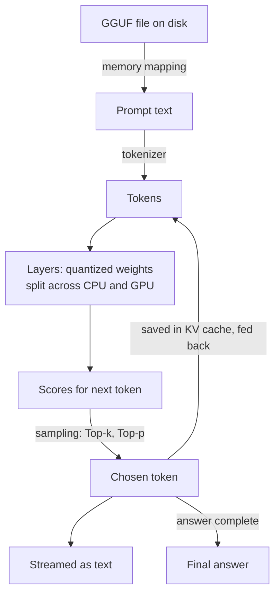
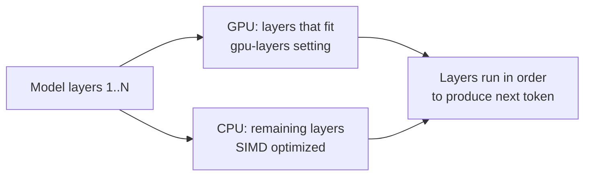

# How does llama.cpp run LLMs on everyday hardware?

> **Step 12: LLM Inference Engineering** · ⏱️ 19 min read · [Read original](https://outcomeschool.com/blog/how-does-llama-cpp-run-llms-on-everyday-hardware)

## TL;DR
llama.cpp is a C/C++ engine that runs LLMs on laptops, desktops and phones. It shrinks the model with block-wise quantization, packs it in one GGUF file, loads it instantly with memory mapping, speeds up CPU math with SIMD, and splits layers between CPU and GPU.

## Key Concepts
- **llama.cpp** — "llama" (Meta's LLaMA family) + ".cpp" (C++). Created by Georgi Gerganov in March 2023 to run LLaMA on a Mac using only the regular CPU. Over 120,000 GitHub stars; powers Ollama and LM Studio.
- **Everyday hardware** — laptops, desktops, phones, not data-centre machines.
- **Why needed** — big models needed pricey GPUs and memory; cloud use meant cost, privacy loss, and internet dependence.
- **Weights / parameters** — learned numbers (7B = 7 billion). Model predicts next word repeatedly; each word needs huge multiply-add work.
- **The wall** — 7B at 2 bytes per weight is about 14 GB; many laptops have 8 or 16 GB total.
- **Block and scale factor** — group of weights (e.g. 32) sharing one number recording their magnitude.
- **GGML** — the author's small math library llama.cpp uses; GGUF is the file format for it.
- **SIMD** — Single Instruction, Multiple Data.
- **Layer** — one processing stage; the model is a stack of layers.
- **Tensor** — big table of numbers.
- **KV cache** — remembers work for earlier tokens.

## How It Works

### Quantization (block-wise)
Store 16-bit weights in 4 bits (4x smaller). For each block: find the largest weight, derive a shared scale, squeeze each weight to a 4-bit value (range -8..7), multiply by scale to restore.
Example: block `[0.92, -0.31, 0.78, -0.55, 0.12 ...]`, scale = 0.92/7 = 0.13, stored `[7, -2, 6, -4, 1 ...]`. Restored: 7 x 0.13 = 0.91, 6 x 0.13 = 0.78, -4 x 0.13 = -0.52 (0.92 comes back 0.91, -0.55 comes back -0.52: the precision cost).
7B: about 14 GB down to about 4 GB (about 70 percent smaller), fits a normal laptop.

### Names like Q4_K_M
- **Q4** — about 4 bits per weight (Q8 is about 8 bits: more precise, larger).
- **K** — K-quant: groups small blocks into a super-block of 256 weights with one main scale, each small block keeps only a tiny adjustment (like a base salary with small plus/minus), so helper numbers cost little space.
- **M** — medium: sensitive tensors (hurt more by quantization) stored at 6 bits, rest at 4 bits; better quality for slightly larger file. **S** (small) keeps everything at 4 bits: smaller, usually less accurate.
Q4_K_M is the most popular: small with quality close to original; drop barely noticed for everyday tasks.

### GGUF file
One file with quantized weights, architecture details, tokenizer, quantization settings. Replaced older harder-to-extend formats; llama.cpp opens it and starts almost instantly.

### Memory mapping (mmap)
Normal: copy whole file from disk to memory first (slow, heavy). mmap: OS treats the disk file as if in memory and loads only needed pieces on demand. Wins: near-instant readiness; multiple programs can share the same data in memory.

### CPU speed with SIMD
Do the same operation on many numbers in one step (8 multiplications in one step instead of 8). Instruction sets: AVX, AVX2, AVX512 (Intel/AMD), NEON (Apple/ARM). Tuned C/C++ gives usable CPU-only speed. (LPUs are chips designed around this job; separate blog.)

### Sharing work with the GPU
GPU = many small workers in parallel, but may lack memory for the whole model. Split by layers; the `gpu-layers` setting chooses how many go to GPU; the more (while they fit), the faster; the rest stay on CPU. Backends: Apple Metal, NVIDIA CUDA, Vulkan, AMD ROCm; falls back to CPU with no GPU.

### Journey of a prompt
1. Start llama.cpp on a GGUF file (mmap, ready quickly).
2. Type a prompt.
3. Tokenizer turns text into tokens.
4. Tokens pass through layers using quantized weights, split over CPU and GPU.
5. Scores for every possible next token; sampling (Top-k, Top-p) picks one.
6. Token turned into text and streamed.
7. KV cache saves earlier work.
8. New token fed back; repeat until complete.

## Where used
Ollama and LM Studio build on it. Supports Llama, Mistral, Qwen, Gemma; runs on Windows, Mac, Linux, phones, small single-board computers.

## Trade-offs & Pitfalls
- Heavy quantization means smaller/faster but slightly less accurate; choose balance (e.g. Q4_K_M) per use case.
- GPU speedup limited by GPU memory.

## FAQ
- Need a GPU? → No; SIMD CPU works, GPU layers optional.
- Ollama relation? → Built on llama.cpp.
- Less accurate? → Slightly; Q4_K_M barely noticeable.
- Layers on GPU? → As many as memory holds.
- Only LLaMA? → No, many models.

## Key Takeaways
- llama.cpp lets everyday hardware run LLMs, avoiding cloud cost, privacy, and dependence issues.
- Weights are the size problem: 7B at 2 bytes about 14 GB.
- Block quantization with shared scale: 4-bit shrinks 7B to about 4 GB.
- Q4_K_M = 4-bit base, super-block K-quant, medium (sensitive tensors at 6 bits).
- GGUF packs everything; mmap loads instantly and shares memory.
- SIMD (AVX/NEON) boosts CPU; gpu-layers splits work with GPU.
- Generation loops one token at a time with sampling and KV cache.
