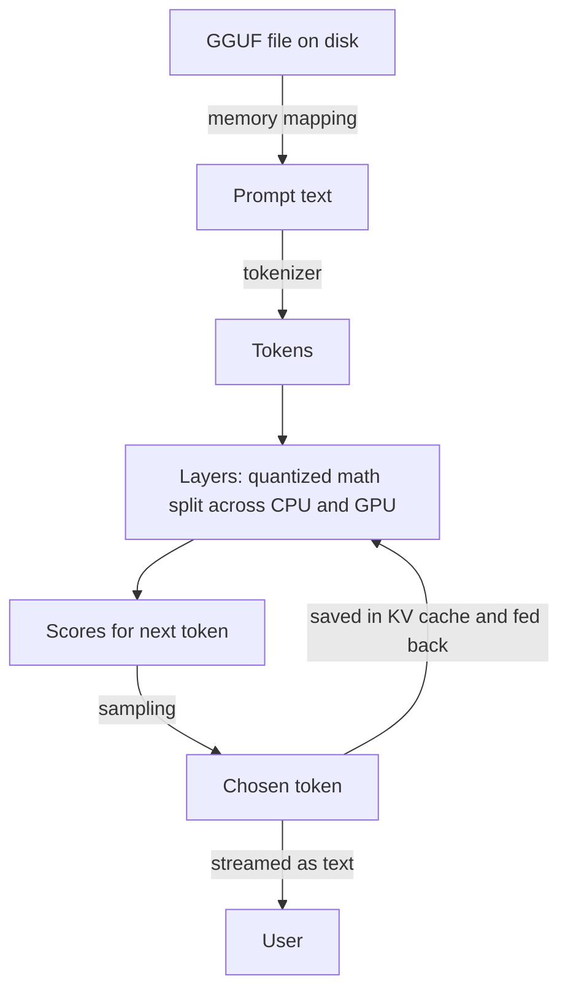

# How does llama.cpp run LLMs on everyday hardware?

> **Step 12: LLM Inference Engineering** · ⏱️ 19 min read · [Read original](https://outcomeschool.com/blog/how-does-llama-cpp-run-llms-on-everyday-hardware)

## TL;DR
llama.cpp is a C/C++ engine (created by Georgi Gerganov in March 2023) that runs LLMs on laptops and other normal hardware. It shrinks models with block-wise quantization, packs them in GGUF files, loads them via memory mapping, uses CPU SIMD, and splits layers between CPU and GPU.

## Key Concepts
- **Everyday hardware** — laptops, desktops, phones; not data-center machines.
- **Quantization** — fewer bits per weight, using per-block scale factors.
- **Q4_K_M** — about 4-bit K-quant with a medium mix of extra-precision tensors.
- **GGUF** — single file with quantized weights, architecture, tokenizer, quantization settings (used with the GGML library).
- **mmap** — memory mapping for instant start.
- **SIMD** — one instruction on many numbers (AVX, AVX2, AVX512 on Intel/AMD; NEON on Apple/ARM).
- **gpu-layers** — how many model layers go to the GPU.

## How It Works
### The wall
7B parameters at 2 bytes is about 14 GB, but many laptops have 8 or 16 GB total. Cloud use costs money, sacrifices privacy and needs internet.

### Block quantization
Weights are grouped in blocks (e.g. 32). Find the largest value, derive a shared scale (0.92 / 7 = 0.13), store each weight as a 4-bit integer in -8..7. Restore with value x scale: 7 x 0.13 = 0.91 (original 0.92). Result: about 14 GB falls to about 4 GB (roughly 70 percent smaller) at slight precision cost.

### Reading Q4_K_M
- **Q4** — about 4 bits (Q8 is more precise, larger).
- **K** — K-quant: super-blocks of 256 weights share one main scale; small blocks store only small adjustments, so helper numbers cost little space.
- **M** — medium: sensitive tensors stored at 6 bits, rest at 4. S keeps everything at 4 bits (smaller, usually less accurate).

### Loading and speed
- **mmap**: start immediately, pull pieces on demand; multiple programs can share the same memory.
- **CPU**: SIMD tuned code gives usable speed even without a GPU.
- **GPU**: split layers; more on GPU is faster if memory allows, remainder stays on CPU. Backends: Metal, CUDA, Vulkan, ROCm, or CPU fallback.

### Journey of a prompt
1. Open GGUF via mmap.
2. Tokenize the prompt.
3. Tokens flow through layers (CPU + GPU, quantized weights).
4. Scores for next token, sampling (Top-k, Top-p) picks one.
5. Token streamed as text; K/V saved in KV cache.
6. Feed back and repeat until done.

Used by Ollama and LM Studio; supports Llama, Mistral, Qwen, Gemma; runs on Windows, Mac, Linux, phones.

## Diagram

## Key Takeaways
- Quantization is the key trick: 14 GB to about 4 GB for a 7B model.
- Block scale factors keep restored weights close to the originals.
- Q4_K_M = about 4-bit, super-block K-quant, medium mix; the popular default.
- mmap gives near-instant loading; SIMD makes CPUs usable.
- gpu-layers splits work across GPU and CPU; no GPU is required.
