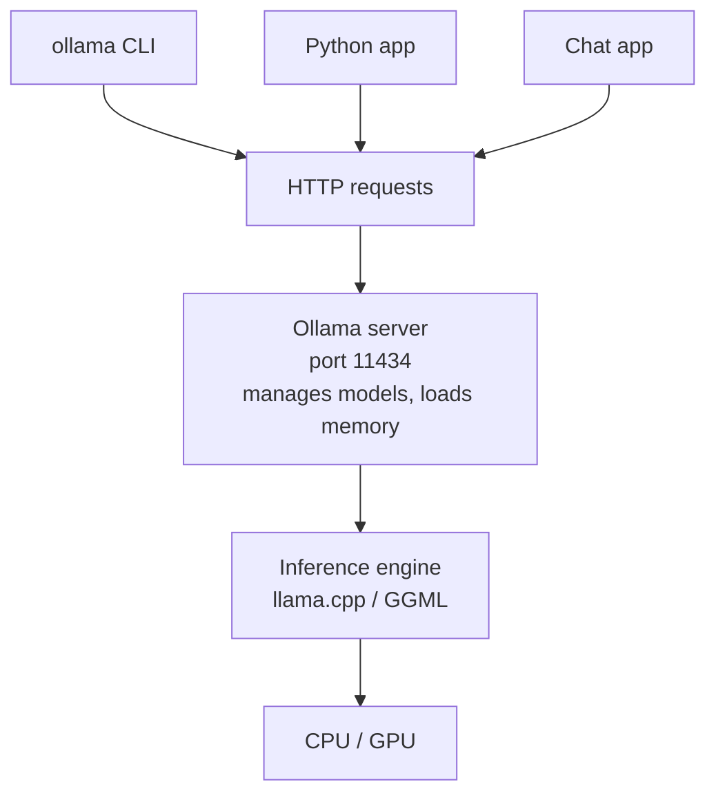
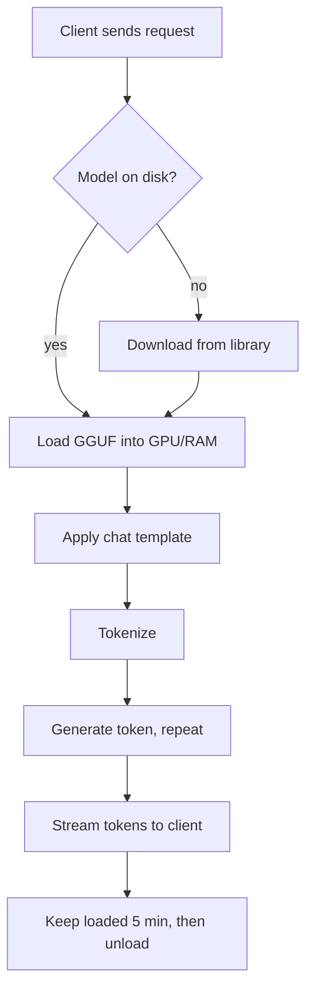

# How does Ollama work?

> **Step 12: LLM Inference Engineering** · ⏱️ 18 min read · [Read original](https://outcomeschool.com/blog/how-does-ollama-work)

## TL;DR
Ollama is a free, open-source tool to download and run LLMs locally with one command. A background server downloads quantized (GGUF) model files, loads them into CPU/GPU memory, and uses a llama.cpp/GGML-based engine to generate text. Clients (CLI, apps) talk to it over HTTP at `localhost:11434`.

## Key Concepts
- **Running locally** — model runs on our machine; gives privacy, offline use, no per-message cost, full control (like cooking at home vs ordering from a restaurant).
- **Weights** — billions of learned numbers; normally 16 bits (2 bytes) each.
- **Quantization** — store each weight in fewer bits (e.g. 4 instead of 16); smaller, faster, slight quality loss.
- **GGUF** — single file format for GGML models: quantized weights + architecture details (e.g. layer count) + tokenizer.
- **llama.cpp / GGML** — C/C++ engine that runs LLMs efficiently even without a strong GPU; Ollama is built on top (newer versions also have own engine for some models, same GGML base).
- **Inference engine** — program that runs a trained model to produce answers; Ollama is the layer on top handling everything else.
- **Server / client** — server (`ollama serve`, auto-started by desktop app) manages and runs models; client (the `ollama` CLI or any app) sends requests.
- **Chat template** — model-specific layout with markers for system/user/assistant text; Ollama applies it automatically.
- **Layers, manifest, hash** — a model is stored as pieces (GGUF weights, template, settings, license); manifest lists which layers make the model; layers are named by content hash.
- **Partial offloading** — some model layers on GPU, rest on CPU.
- **KV cache / context length** — saved work on earlier tokens; longer context uses more memory.
- **Modelfile** — text recipe to build a custom model from an existing one.
- **keep_alive** — how long a model stays loaded after use (default 5 min).

## How It Works

### Why shrink models?
- 8B weights x 2 bytes = 16 GB; many laptops have only 8-16 GB total, shared with OS and apps.
- Every token requires reading all weights, so bigger file = slower replies.
- 4-bit: 8B x 0.5 byte = ~4 GB (a bit more in practice), ~4x smaller, fits a laptop, faster, small quality drop. Ollama's default downloads are ~4-bit.

### What happens on `ollama run llama3.2`
1. Client sends request to server at `localhost:11434`.
2. Server checks disk; if missing, downloads from the Ollama library.
3. Loads the GGUF weights into GPU memory, RAM, or a mix (a few seconds).
4. Wraps the prompt in the model's chat template.
5. Tokenizer turns text into token numbers.
6. Engine predicts next token, appends, repeats until done.
7. Each token is streamed back as soon as ready (words appear one by one).
8. Model stays loaded 5 min (`keep_alive`); a follow-up skips step 3 and starts instantly; then it is unloaded to free memory.

### Download and storage
- Library at ollama.com; names have tags (`llama3.2:3b`, `qwen2.5:7b`); default tag is `latest`.
- `ollama pull <model>` downloads without running.
- Same hash = stored once: two custom variants with different system prompts share one weights layer, saving disk. Files live in `~/.ollama/models` (on Mac).
- Commands: `ollama list` (on disk), `ollama ps` (loaded in memory, shows GPU/CPU split), `ollama rm <model>`.

### CPU and GPU
- GPUs do thousands of calculations in parallel, ideal for LLMs. Supports NVIDIA, many AMD GPUs, Apple Silicon (CPU and GPU share memory).
- Whole model fits in GPU: all layers on GPU (fastest). Only part fits: partial offloading. No usable GPU: all on CPU.
- Example: 32 layers, GPU holds 20 -> layers 1-20 GPU, 21-32 CPU.
- Memory is also needed for the KV cache; bigger context length = more memory.

### Modelfile
```
FROM llama3.2
PARAMETER temperature 0.3
PARAMETER num_ctx 4096
SYSTEM """You are a friendly teacher. Explain everything in simple words."""
```
- `FROM` base model; `PARAMETER temperature` controls randomness (lower = more focused); `num_ctx` context length; `SYSTEM` system message.
- `ollama create teacher -f Modelfile` then `ollama run teacher`. No weights copy; only small settings layers are new.

### API
- `POST http://localhost:11434/api/chat` with `model`, `messages` (role + content), `stream` (default streams piece by piece; `False` = full reply at once). Response text at `response.json()["message"]["content"]`.
- OpenAI-compatible endpoint at `http://localhost:11434/v1`: OpenAI-built apps work by changing the address.

### Diagram: client-server architecture


### Diagram: lifecycle of one request


## Trade-offs & Pitfalls
| Point | Cloud LLM | Ollama (local) |
|---|---|---|
| Where it runs | Company servers | Our computer |
| Privacy | Data sent over internet | Stays on machine |
| Internet | Yes | Only to download models |
| Cost | Pay per use/subscription | Free, needs own hardware |
| Model size | Very large | Limited by memory |
| Speed | Fast servers | Depends on CPU/GPU |
| Setup | Account + API key | Install + pull model |

- Works well: privacy, building/testing without per-request cost, offline, trying many open models quickly.
- Struggles: largest/smartest models too big; low memory or no GPU = slow; many concurrent users (Ollama targets one person or small team; use vLLM for high traffic).
- Smaller models (SLMs) are the sweet spot on personal computers.

## FAQ
- Free? Yes, open source; only hardware cost.
- Needs internet? Only for downloading models.
- Run without GPU? Yes, on CPU, slower.
- OpenAI-API apps work? Yes via `/v1`.
- First reply slower? Model must load from disk; later replies skip it within `keep_alive`.

## Key Takeaways
- Ollama = app store for LLMs: one command pulls, sets up, and runs a model.
- Quantization (~4-bit) shrinks an 8B model from 16 GB to ~4 GB so it fits laptops.
- GGUF packs weights, architecture, and tokenizer in one file; engine is llama.cpp/GGML.
- Architecture is a local HTTP server (port 11434) plus any number of clients.
- Content-hash layers let custom models share weights and save disk.
- Layers are split between GPU and CPU automatically (partial offloading).
- Model stays loaded 5 min by default (`keep_alive`) so follow-ups are fast.
- Not built for high concurrency; use vLLM there.
