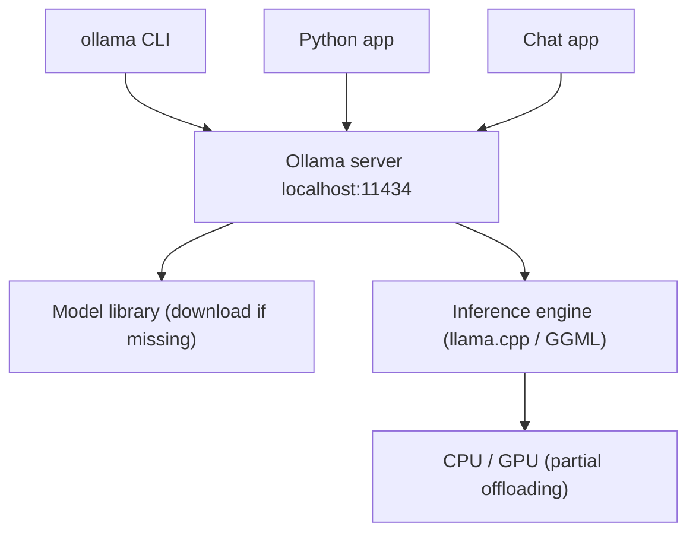

# How does Ollama work?

> **Step 12: LLM Inference Engineering** · ⏱️ 18 min read · [Read original](https://outcomeschool.com/blog/how-does-ollama-work)

## TL;DR
Ollama is a free, open-source tool that downloads and runs LLMs locally with one command. A background server manages models and runs them on a llama.cpp/GGML-based engine, while clients (CLI, apps) talk to it over HTTP.

## Key Concepts
- **Local LLM** — runs on your machine: private, offline, no per-request cost, full control.
- **Quantization** — about 4-bit weights so models fit laptops (8B: 16 GB at 16-bit, about 4 GB at 4-bit).
- **GGUF** — single file with quantized weights, architecture and tokenizer.
- **Server / client** — server (`ollama serve`) at `localhost:11434`; the CLI is just a client.
- **Chat template** — model-specific layout for system, user, assistant messages.
- **Layers and manifest** — a model is stored as hashed layers plus a manifest.
- **Modelfile** — recipe for a custom model.
- **keep_alive** — how long a model stays loaded (default 5 minutes).

## How It Works
### What `ollama run llama3.2` does
1. Client contacts server on port 11434.
2. Server checks disk; downloads from the Ollama library if missing.
3. Loads GGUF into GPU memory, RAM, or both.
4. Wraps the message in the model's chat template.
5. Tokenizes the prompt.
6. Engine predicts tokens one by one.
7. Tokens stream back to the client.
8. Model stays loaded for 5 minutes (second question starts instantly), then unloads.

### Storage
Models have a name and tag (`llama3.2:3b`, default `latest`). Pieces (GGUF weights, template, settings, license) are saved by content hash with a manifest listing them, so identical weights are stored once even across custom variants. Commands: `ollama pull`, `list`, `ps`, `rm`.

### CPU and GPU
Supports NVIDIA, many AMD GPUs and Apple Silicon (shared memory). All layers on GPU if they fit; else partial offloading (some layers GPU, rest CPU); with no GPU everything runs on CPU. Conversation memory (KV cache) and context length also consume memory.

### Modelfile
```
FROM llama3.2
PARAMETER temperature 0.3
PARAMETER num_ctx 4096
SYSTEM """You are a friendly teacher."""
```
`ollama create teacher -f Modelfile` builds it without copying the weights.

### API
POST to `http://localhost:11434/api/chat` with model and messages (stream by default). An OpenAI-compatible endpoint exists at `/v1`.

| | Cloud LLM | Ollama |
|---|---|---|
| Privacy | Data sent out | Stays local |
| Cost | Pay per use | Free, own hardware |
| Model size | Very large | Limited by memory |
| Many users | Good | Weak (use vLLM) |

## Diagram


## Key Takeaways
- Ollama is the app-store-like layer on top of llama.cpp/GGML.
- Client-server over HTTP lets many apps share one local server.
- Default models are about 4-bit GGUF so they fit laptops.
- Content-hashed layers avoid duplicate weights; Modelfiles customize cheaply.
- First reply is slower (load time); keep_alive controls unload.
- Great for privacy and offline use; not for serving many users.
