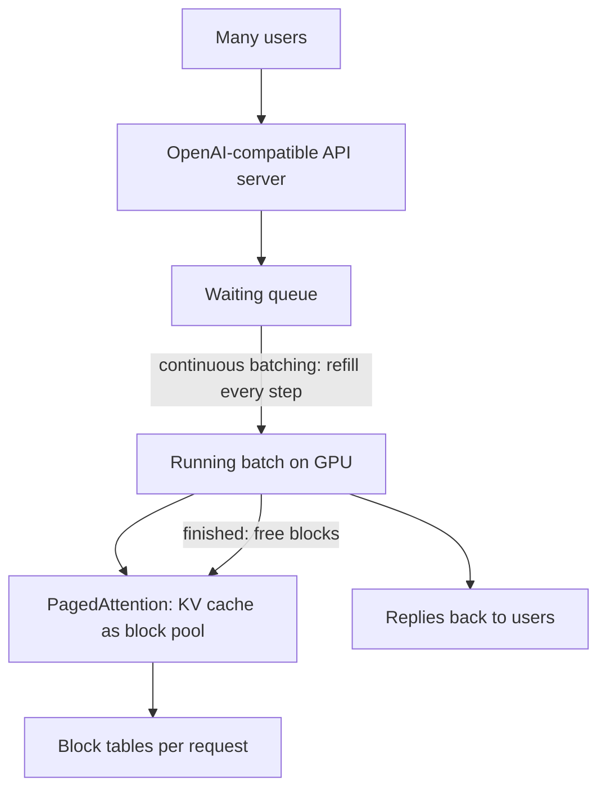

# How does vLLM work?

> **Step 12: LLM Inference Engineering** · ⏱️ 22 min read · [Read original](https://outcomeschool.com/blog/how-does-vllm-work)

## TL;DR
vLLM is a high-throughput LLM serving engine. It combines PagedAttention (block-based KV cache memory) with continuous batching so one GPU can serve many more users, behind an OpenAI-compatible API, without changing answer quality.

## Key Concepts
- **Serving engine** — takes many user requests, runs the model, returns replies.
- **KV cache** — per-token "notes" from prefill and decode; grows with the answer and lives in GPU memory.
- **Over-reservation** — reserving space for the longest possible answer.
- **Fragmentation** — free memory split into scattered unusable gaps.
- **PagedAttention** — KV cache in small fixed-size blocks (e.g. 16 tokens) with a block table.
- **Continuous batching** — refill finished slots at every decode step.
- **Throughput** — tokens and requests served per second.

## How It Works
### The real bottleneck
After the model weights take their share, remaining GPU memory holds all requests' KV caches. So KV cache memory, not math speed, limits how many users are served.

### Naive waste
A request reserves one contiguous block for the max length (e.g. 2,000 tokens) even if the answer is 50, causing over-reservation and fragmentation.

### PagedAttention
Borrowed from OS paging: memory is one pool of equal blocks; a request gets a block only when needed, wherever free; a block table maps its blocks in order. Finished requests release all blocks at once. Result: almost no over-reservation or fragmentation.

### Sharing
Two requests can point to the same block.
- **Identical prefixes** — long shared system prompt stored once (see prompt caching).
- **Beam search** — beams share the common beginning and use separate blocks only where they diverge.

### Continuous batching
Static batching waits for the slowest request, leaving idle slots. vLLM removes finished requests and inserts waiting ones every step. PagedAttention frees blocks instantly and continuous batching reuses them, keeping both GPU memory and compute busy.

### API and benefits
OpenAI-compatible server: point existing tools at your own vLLM by changing the address. Benefits: higher throughput, better GPU utilization, lower cost per request, easy adoption.

### Real world
High-traffic chat apps and agent systems (same large instruction prefix each step, many short steps). Alternatives: SGLang (radix tree prefix matching), TensorRT-LLM (NVIDIA kernels).

## Diagram

## Key Takeaways
- Serving is a memory-management problem: KV cache memory limits concurrency.
- Naive contiguous reservation wastes memory via over-reservation and fragmentation.
- PagedAttention = OS-style fixed-size blocks plus block table; enables prefix and beam sharing.
- Continuous batching keeps GPU slots full by swapping requests every step.
- OpenAI-compatible API makes adoption easy; answer quality is unchanged.
